<!-- Schritte und Screenshots am 16. November 2026 mit einem Testkonto auf macOS durchgespielt. zu prüfen: dieselben Schritte auf Windows. -->

Diese Seite ist die Anleitung für die Übung im Workshop 1. Du bringst dein Rezept in das gemeinsame gitklar-Kochbuch, über einen eigenen  und einen .

- **Im Workshop 1:** Ihr arbeitet zu zweit in einem Breakout-Raum die Schritte 1 bis 6 durch. Eine Person teilt den Bildschirm, die andere liest mit. Steht der Pull request, tauscht ihr. Schritt 7 kommt nach der Übung.
- **Nicht fertig geworden oder nicht dabei gewesen?** Dann machst du dieselben Schritte allein, bis Dienstag, 1. Dezember. Die Aufzeichnung des Workshops zeigt sie ebenfalls. Im Workshop 2 lesen wir die Pull requests zu zweit.

## Bevor du anfängst

Du brauchst die fertige Vorbereitung: dein Repository `rezept-dein-benutzername` mit dem Ordner `rezept`, geklont mit GitHub Desktop nach `Dokumente/gitrepos/gh-org-gitklar`. Fehlt dir etwas davon, beginne bei der [Vorbereitung](vorbereitung/index.qmd).

Das Kochbuch ist das Repository [gitklar/kochbuch](https://github.com/gitklar/kochbuch). Alle Teilnehmer:innen können es lesen und Branches hineinschieben. Jedes Rezept liegt dort in einem eigenen Ordner unter `rezepte/`.

## Schritt 1: das Kochbuch klonen

1. Öffne GitHub Desktop. Klicke oben links auf **Current Repository**.

   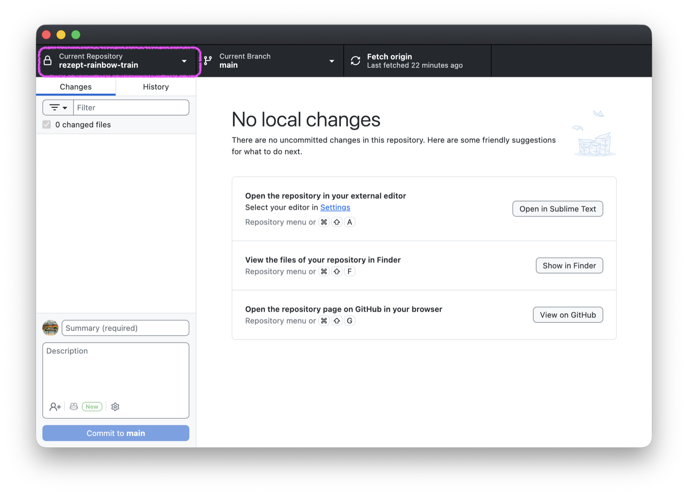{.bild-screenshot fig-alt="GitHub Desktop: oben links ist das Feld Current Repository mit rezept-rainbow-train markiert"}

2. Klicke auf **Add**, dann auf **Clone Repository…**.

   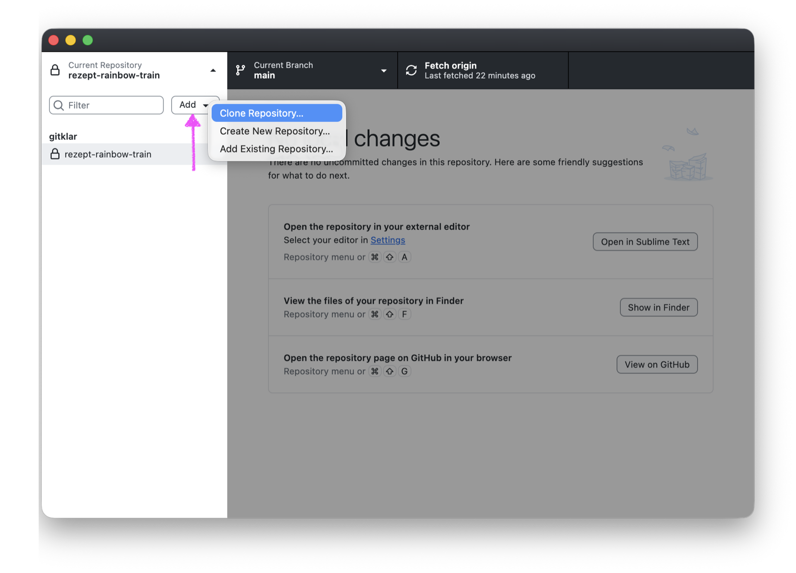{.bild-screenshot fig-alt="GitHub Desktop: die aufgeklappte Liste der Repositorys, ein Pfeil zeigt auf den Knopf Add, im Menü ist Clone Repository markiert"}

3. Klicke im Fenster **Clone a Repository** auf den Reiter **URL**. Tippe in das Feld darunter `gitklar/kochbuch`. Im Reiter **GitHub.com** fehlt das Kochbuch oft in der Liste, darum der Weg über **URL**.
4. Prüfe das Feld **Local Path**. Der Pfad soll auf `gitrepos/gh-org-gitklar/kochbuch` enden, also in dem Ordner liegen, in dem schon dein Repository `rezept-dein-benutzername` liegt. Steht dort etwas anderes, klicke auf **Choose…** und wähle den Ordner **Dokumente/gitrepos/gh-org-gitklar**. Lege dabei keinen neuen Ordner an.
5. Klicke auf **Clone**.

   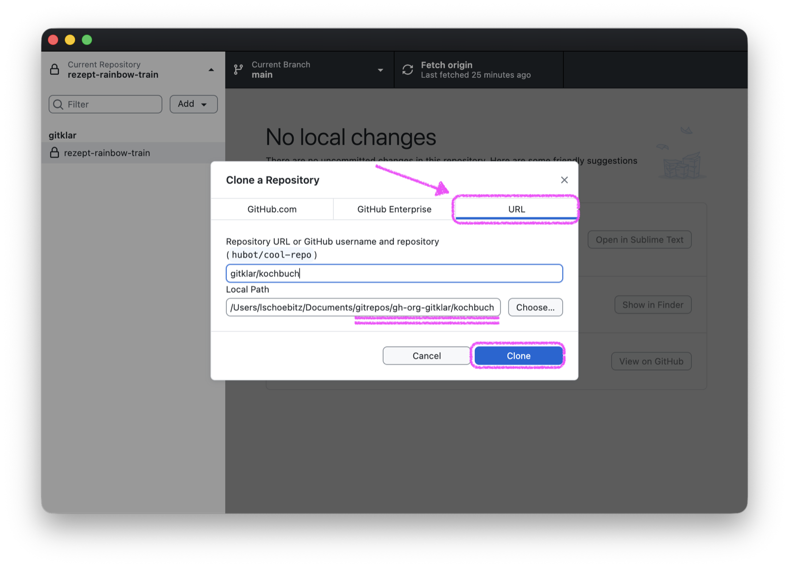{.bild-screenshot fig-alt="GitHub Desktop: das Fenster Clone a Repository, der Reiter URL ist markiert, im Feld steht gitklar/kochbuch, der Local Path endet auf gitrepos/gh-org-gitklar/kochbuch, der Knopf Clone ist markiert"}

6. Oben links steht jetzt **Current Repository: kochbuch**.

   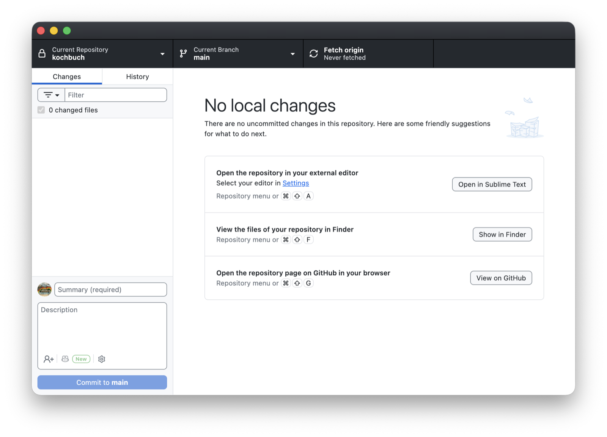{.bild-screenshot fig-alt="GitHub Desktop: Current Repository kochbuch, Current Branch main, in der Mitte No local changes"}

## Schritt 2: einen Branch anlegen

Ein Branch ist deine eigene Arbeitslinie im Kochbuch. Auf ihm kannst du Dateien hinzufügen, ohne die Hauptfassung `main` anzufassen.

1. Dein Ordner im Kochbuch heisst wie dein GitHub-Benutzername, in Kleinbuchstaben, zum Beispiel `rezepte/dein-benutzername`. Weil jeder Benutzername nur einmal vorkommt, kann kein Ordner doppelt angelegt werden.
2. Klicke in GitHub Desktop oben in der Mitte auf **Current Branch**, dann auf **New Branch**.

   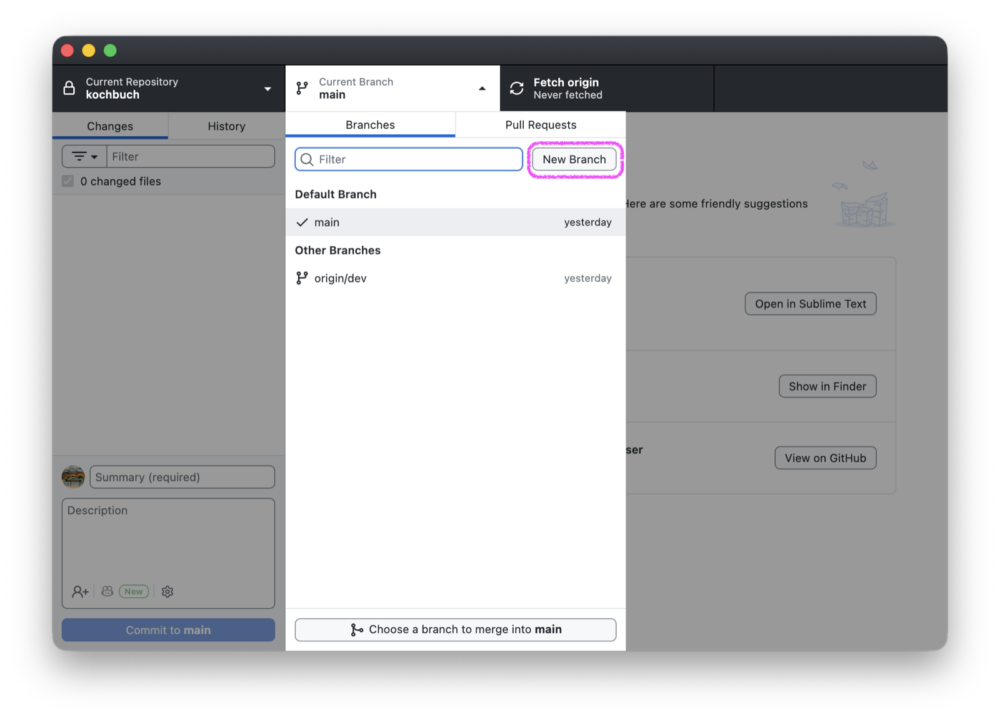{.bild-screenshot fig-alt="GitHub Desktop: das aufgeklappte Feld Current Branch mit main und origin/dev, der Knopf New Branch ist markiert"}

3. Schreib als Namen `rezept-` und deinen Benutzernamen, zum Beispiel `rezept-dein-benutzername`. Klicke auf **Create Branch**.



4. Oben steht jetzt **Current Branch: rezept-dein-benutzername**.

   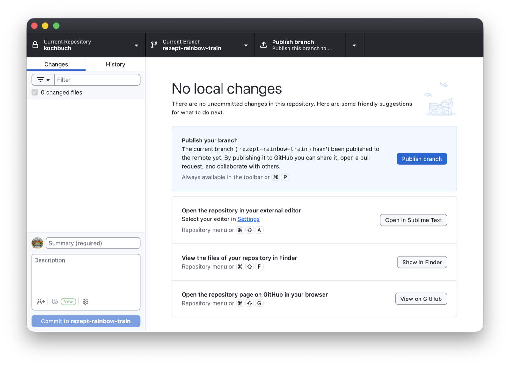{.bild-screenshot fig-alt="GitHub Desktop: Current Branch rezept-rainbow-train, rechts daneben Publish branch, unten links der Knopf Commit to rezept-rainbow-train"}

## Schritt 3: deinen Rezeptordner kopieren

Du kopierst den Ordner `rezept` aus deinem eigenen Repository in das Kochbuch. Dein eigenes Repository bleibt, wie es ist.

::: {.panel-tabset}

## macOS

1. Öffne im Finder `Dokumente/gitrepos/gh-org-gitklar/rezept-dein-benutzername`.
2. Klicke einmal auf den Ordner `rezept` und drücke **Befehl** und **C**.
3. Öffne `Dokumente/gitrepos/gh-org-gitklar/kochbuch/rezepte` und drücke **Befehl** und **V**. Jetzt liegt dort ein Ordner `rezept`.
4. Benenne den Ordner `rezept` um, sodass er wie dein Benutzername heisst. Klicke dazu einmal auf den neuen Ordner, drücke die Eingabetaste, schreib deinen Benutzernamen in Kleinbuchstaben und drücke noch einmal die Eingabetaste.

## Windows

1. Öffne im Explorer `Dokumente\gitrepos\gh-org-gitklar\rezept-dein-benutzername`.
2. Klicke einmal auf den Ordner `rezept` und drücke **Strg** und **C**.
3. Öffne `Dokumente\gitrepos\gh-org-gitklar\kochbuch\rezepte` und drücke **Strg** und **V**. Jetzt liegt dort ein Ordner `rezept`.
4. Benenne den Ordner `rezept` um, sodass er wie dein Benutzername heisst. Klicke dazu einmal auf den neuen Ordner, drücke **F2**, schreib deinen Benutzernamen in Kleinbuchstaben und drücke die Eingabetaste.

:::

Im Ordner `rezepte` liegen jetzt `_vorlage` und dein neuer Ordner mit `zutaten.csv` und `rezept.md`.

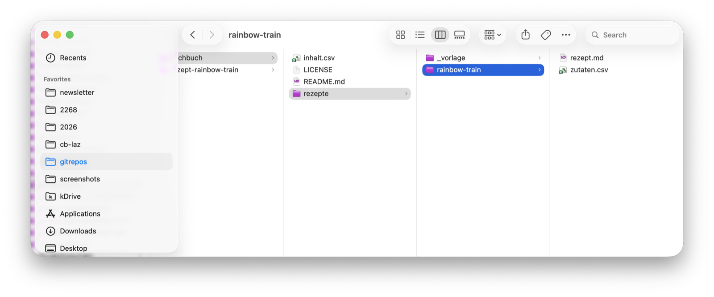{.bild-screenshot fig-alt="Finder auf macOS: im Ordner kochbuch/rezepte liegen _vorlage und der Ordner rainbow-train, darin rezept.md und zutaten.csv"}

## Schritt 4: committen

1. Wechsle zu GitHub Desktop. Im Reiter **Changes** stehen links deine neuen Dateien, zum Beispiel `rezepte/dein-benutzername/rezept.md`, jede mit einem Häkchen. Fehlt ein Häkchen, klicke auf das Kästchen vor der Datei.
2. Schreib unten links bei **Summary** eine Nachricht, zum Beispiel `Rezept Linsensuppe hinzugefügt`.
3. Der Knopf darunter heisst jetzt **Commit 2 files to rezept-dein-benutzername**, mit der Zahl deiner Dateien und dem Namen deines Branches. Endet er auf **to main**, bist du auf dem falschen Branch. Geh dann zurück zu Schritt 2.
4. Klicke auf den Knopf **Commit 2 files to rezept-dein-benutzername**.

   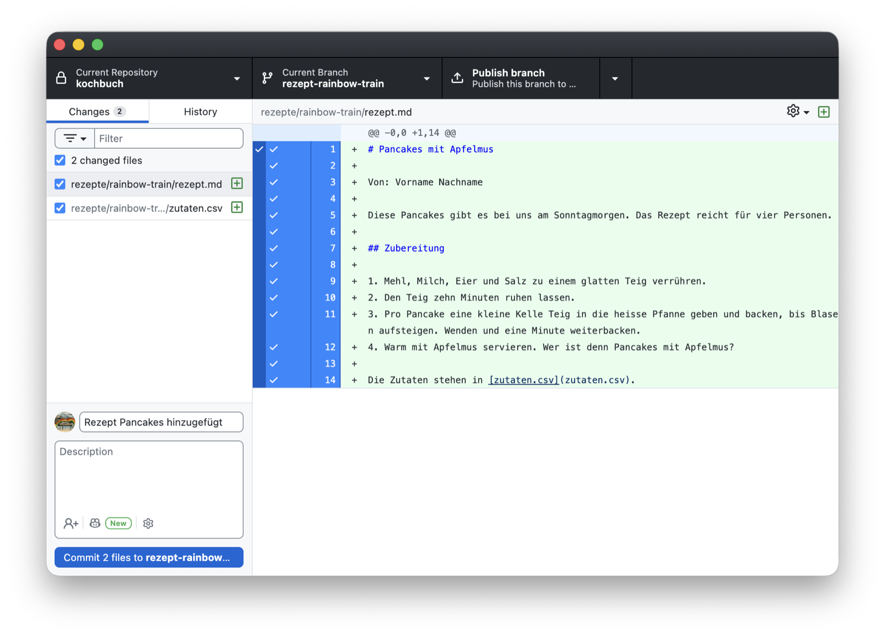{.bild-screenshot fig-alt="GitHub Desktop: im Reiter Changes stehen zwei Dateien mit Häkchen, bei Summary steht Rezept Pancakes hinzugefügt, der Knopf darunter heisst Commit 2 files to rezept-rainbow-train"}

## Schritt 5: den Branch veröffentlichen

Dein Branch existiert bis jetzt nur auf deinem Laptop. Klicke auf **Publish branch**, oben in der Leiste oder auf den blauen Knopf in der Mitte. GitHub Desktop schiebt den Branch mit deinem Commit nach GitHub.



## Schritt 6: den Pull request öffnen

Ein Pull request ist deine Bitte, deinen Branch zu prüfen und in `main` zu übernehmen.

1. GitHub Desktop zeigt nach dem Veröffentlichen den blauen Knopf **Preview Pull Request**. Klicke darauf.

   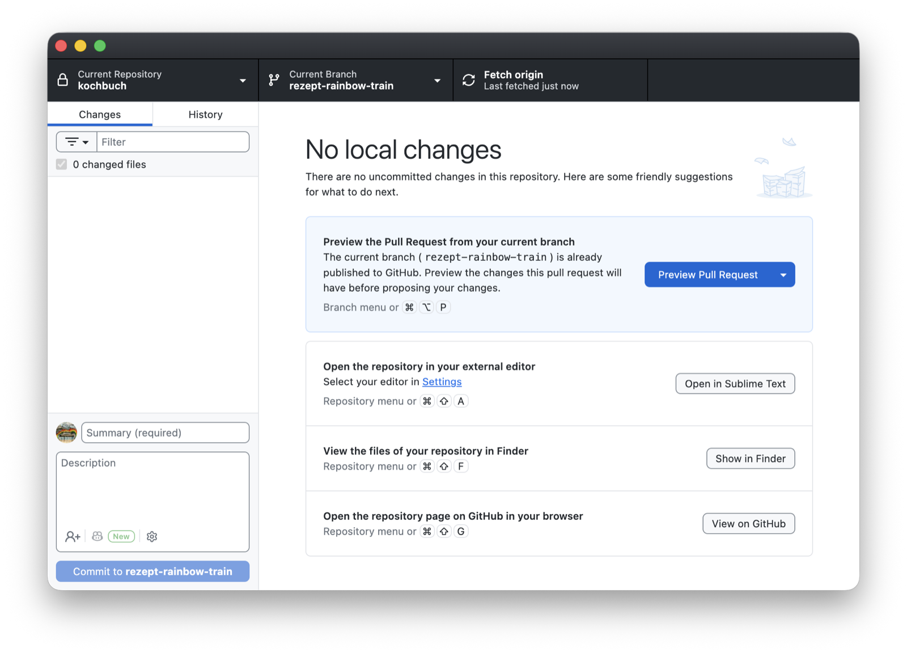{.bild-screenshot fig-alt="GitHub Desktop: nach dem Veröffentlichen steht in der Mitte der Kasten Preview the Pull Request from your current branch mit dem Knopf Preview Pull Request"}

2. Das Fenster **Open a Pull Request** zeigt deine Dateien. Klicke unten rechts auf **Create Pull Request**. Dein Browser öffnet sich auf github.com.

   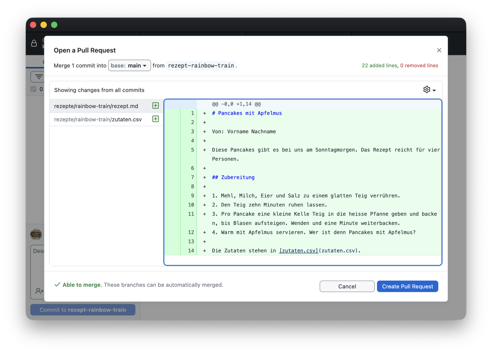{.bild-screenshot fig-alt="GitHub Desktop: das Fenster Open a Pull Request mit base main, den zwei Dateien und unten rechts dem Knopf Create Pull Request"}

3. Oben steht **base: main** und **compare: rezept-dein-benutzername**. So soll es sein.
4. Bei **Add a title** steht deine Commit-Nachricht. Ersetze sie durch den Namen deines Gerichts, zum Beispiel `Linsensuppe`.
5. Im Textfeld darunter steht schon eine Vorlage mit drei Zeilen. Ergänze bei **Gericht** den Namen. Schreib bei **Name im Buch**, was im öffentlichen Kochbuch bei deinem Rezept stehen soll: dein Benutzername, ein anderer Name oder «kein Name». Bei **Link** kannst du eine Website oder ein Profil angeben, wenn du magst.



6. Klicke auf **Create pull request**. Damit bist du einverstanden, dass dein Rezept unter der Lizenz CC BY 4.0 im gitklar-Kochbuch steht.

   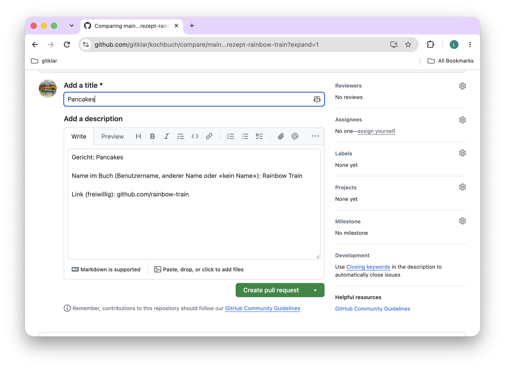{.bild-screenshot fig-alt="github.com: der Titel Pancakes, die drei ausgefüllten Zeilen der Vorlage und darunter der grüne Knopf Create pull request"}

7. Dein Pull request ist offen. Klicke auf dieser Seite nicht auf **Try the Overview page**. Der Knopf schaltet auf eine neue Ansicht um, die anders aussieht als in dieser Anleitung.

   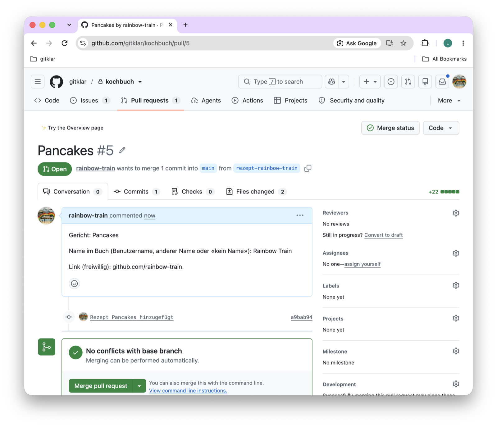{.bild-screenshot fig-alt="github.com: der offene Pull request Pancakes mit der Marke Open, den drei Zeilen und dem Commit Rezept Pancakes hinzugefügt"}

## Schritt 7: auf das Review warten

Ich oder eine andere Person aus dem Kurs liest deinen Pull request. Das heisst . Kommentare kommen bei dir als E-Mail von GitHub an.

- **Alles passt.** Dann wird dein Pull request gemergt, und dein Rezept steht im Kochbuch.
- **Jemand bittet um eine Änderung.** Ändere die Datei auf deinem Laptop im Ordner `kochbuch`, auf demselben Branch. Committe und klicke auf **Push origin**. Der offene Pull request zeigt den neuen Commit von selbst. Einen neuen Pull request brauchst du nicht.

Merge deinen Pull request nicht selbst, auch wenn GitHub dir den Knopf anzeigt. Das Lesen durch eine zweite Person ist der Sinn der Übung.

## Geschafft, wenn

Auf [github.com/gitklar/kochbuch/pulls](https://github.com/gitklar/kochbuch/pulls) dein Pull request mit dem Namen deines Gerichts steht, mit deinen Dateien im Reiter **Files changed** und den drei ausgefüllten Zeilen.

## Hängt es?

- **Commit auf main statt auf deinem Branch.** Solange du noch nicht gepusht hast, zeigt GitHub Desktop unten links unter dem Commit den Knopf **Undo**. Klicke darauf. Deine Dateien sind wieder ungespeicherte Änderungen. Leg dann den Branch an (Schritt 2). GitHub Desktop fragt, ob die Änderungen mitkommen sollen. Wähle, dass sie auf den neuen Branch mitkommen. Hast du schon gepusht, schreib mir.
- **Im Reiter Changes erscheint nichts.** Der Ordner liegt an einem anderen Ort. Er gehört nach `kochbuch/rezepte`. Prüfe den Pfad.
- **Der Ordner heisst noch rezept.** Benenne ihn um, wie in Schritt 3. GitHub Desktop zeigt die Änderung als neue Dateien an.
- **Publish branch fehlt, oben steht Push origin.** Der Branch ist schon veröffentlicht. Klicke auf **Push origin**, falls Commits fehlen, und mach mit Schritt 6 weiter.
- Alles andere: Kommentar in dein Issue im Repository [gitklar/vorbereitung](https://github.com/gitklar/vorbereitung), mit Screenshot.
