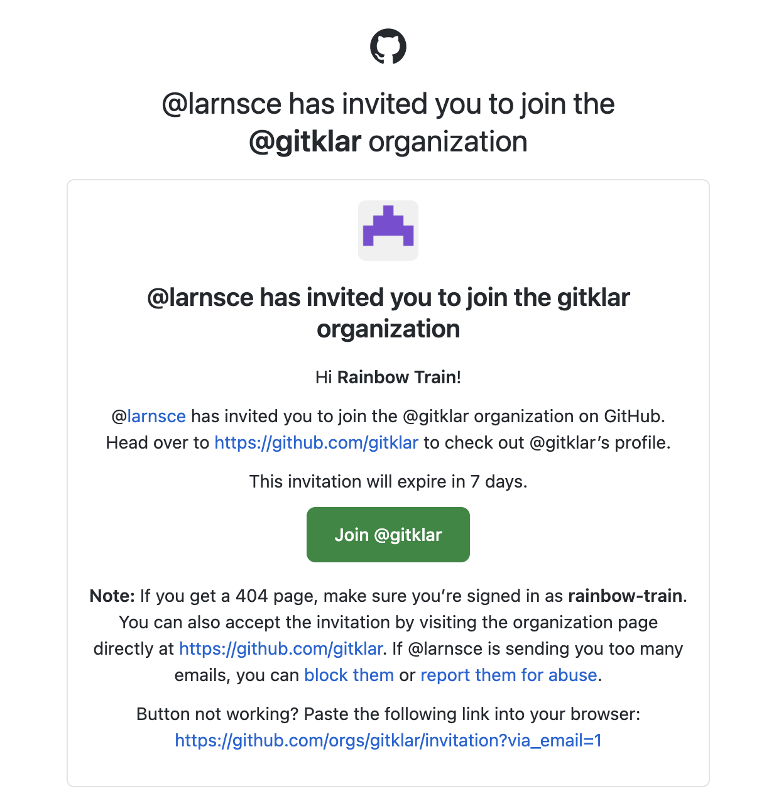
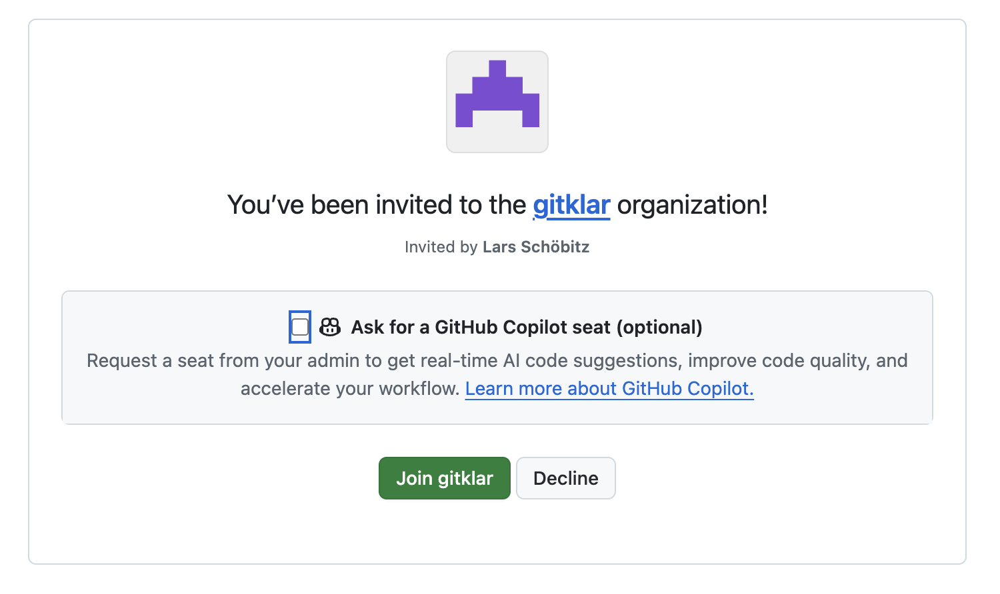

Der Kurs läuft in der GitHub-Organisation **gitklar**. Dort legst du dein eigenes Repository an, dort liegt dein Issue mit den Schritten der Vorbereitung, und dort arbeiten wir im Workshop am gemeinsamen Kochbuch. Die Einladung kommt per E-Mail von GitHub. Dein Issue siehst du erst, wenn du sie angenommen hast. Deshalb ist das der erste Schritt.

## Schritte

1. Öffne die E-Mail von GitHub mit «@larnsce has invited you to join the @gitklar organization» und klicke auf **Join @gitklar**. Findest du die E-Mail nicht, öffne, angemeldet, [github.com/orgs/gitklar/invitation](https://github.com/orgs/gitklar/invitation).

   {.bild-screenshot fig-alt="Die E-Mail von GitHub: larnsce has invited you to join the gitklar organization, mit dem grünen Knopf Join gitklar"}

2. Im Browser öffnet sich die Seite mit der Einladung. Klicke auf **Join gitklar**. Das Kästchen **Ask for a GitHub Copilot seat** lässt du leer.

   {.bild-screenshot fig-alt="github.com: You've been invited to the gitklar organization, mit den Knöpfen Join gitklar und Decline"}

3. GitHub zeigt die Seite der Organisation, oben mit **You are being added as a member of gitklar**. Klicke auf **Repositories**, dann auf **vorbereitung**, dann auf den Reiter **Issues**. Dort liegt dein Issue mit dem Titel «Deine Vorbereitung auf gitklar» und deinem Benutzernamen in Klammern. Es ist dir zugewiesen.

Einladungen gelten sieben Tage. Ist deine abgelaufen, schreib mir, und ich schicke sie neu.

## Geschafft, wenn

Du dein Issue im Repository [gitklar/vorbereitung](https://github.com/gitklar/vorbereitung/issues?q=is%3Aissue+assignee%3A%40me) siehst.

## Wer was sieht

In der Organisation sehen die anderen Teilnehmer:innen deinen Benutzernamen. Im Repository `vorbereitung` können alle Teilnehmer:innen jedes Issue lesen, auch deines und deine Kommentare. Dein Issue zeigt, welche Schritte für dich gelten, zum Beispiel ob du macOS oder Windows benutzt. Schreib dort nichts hinein, was nicht für die Gruppe bestimmt ist. Was nur ich wissen soll, schick mir per E-Mail.

Dein eigenes Repository `rezept-dein-benutzername` legst du privat an. Privat heisst: Es ist nicht öffentlich im Internet. Alle Teilnehmer:innen in der Organisation gitklar können es lesen, ändern kannst nur du.

Das gemeinsame Kochbuch sehen während des Kurses ebenfalls nur die Teilnehmer:innen. Am Ende des Kurses wird es öffentlich. Dann kann jede Person im Internet die Rezepte darin lesen, mit den Benutzernamen und den Commits derer, die sie geschrieben haben. Dein eigenes Repository bleibt privat.

## Wie es weitergeht

Geh zurück zu deinem Issue und hake diesen Schritt ab. Der nächste Schritt, die Lesezeichen, sorgt dafür, dass du das Issue jederzeit wiederfindest.
