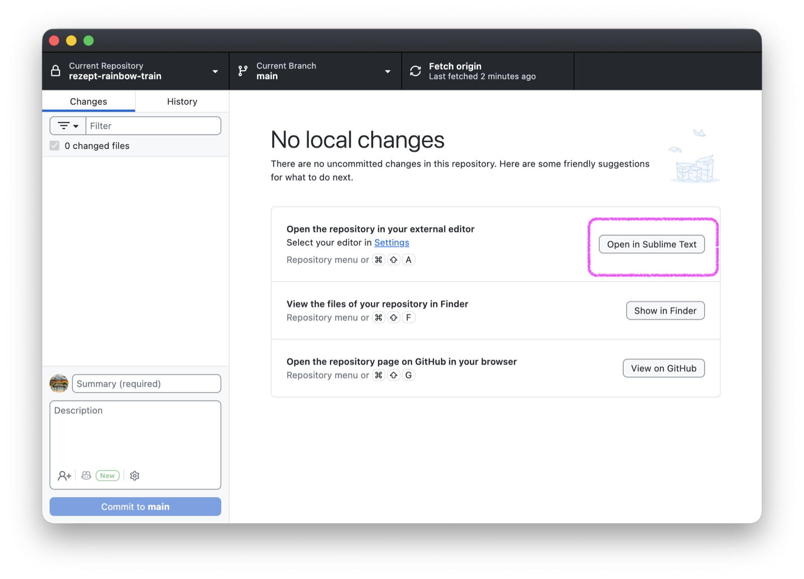
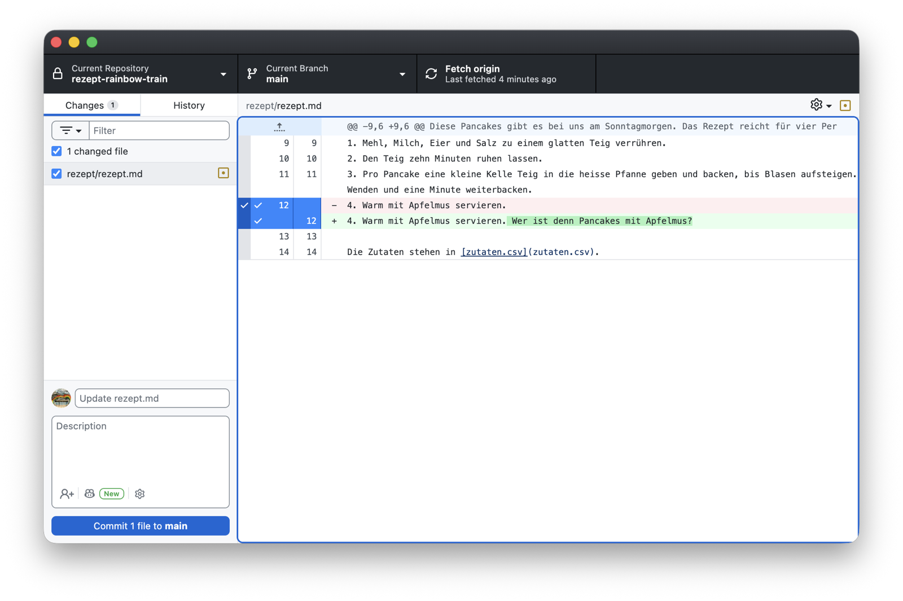
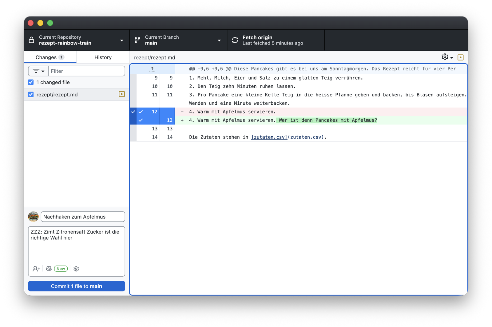
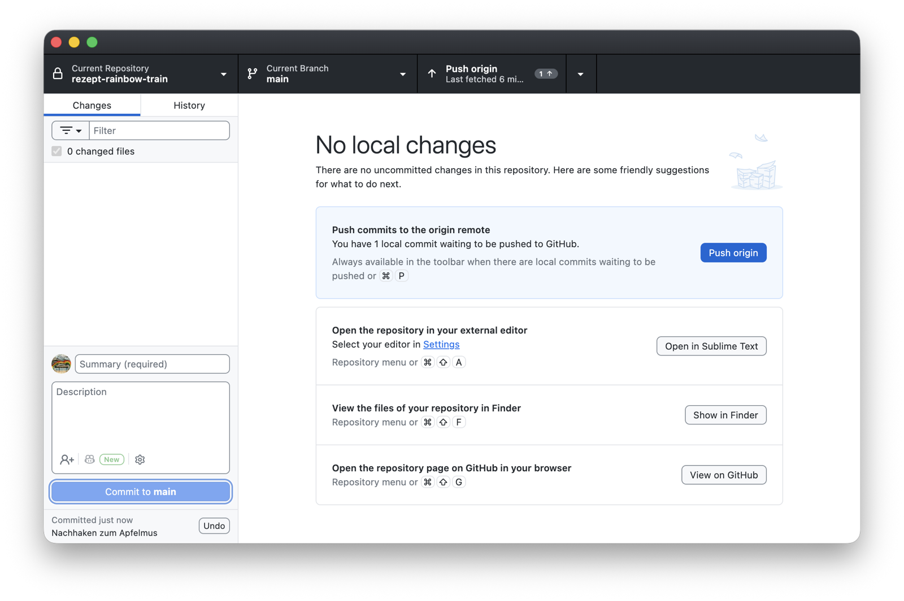
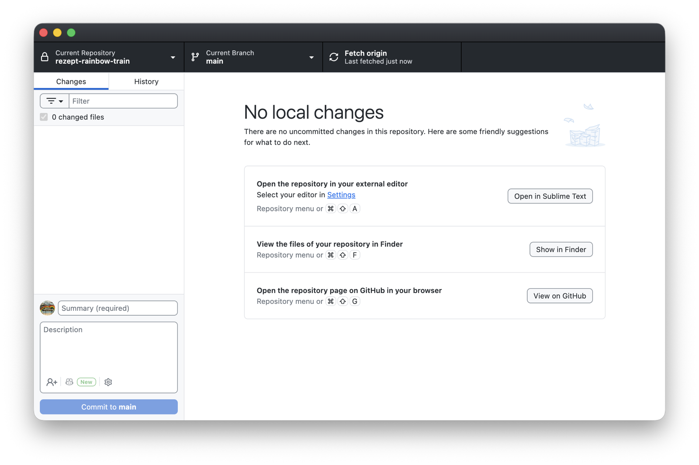
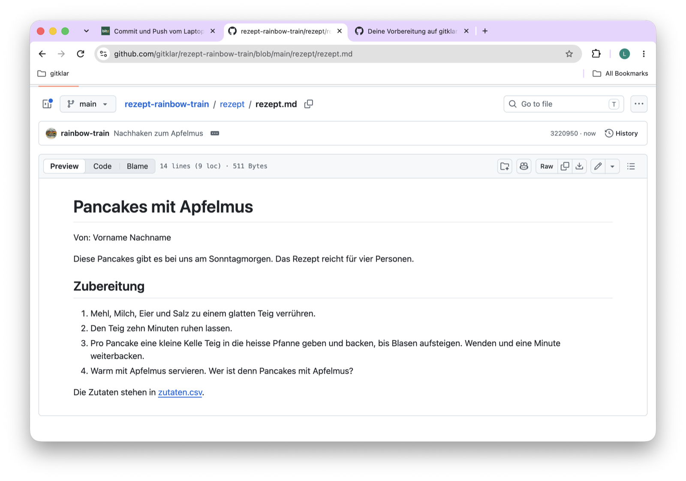
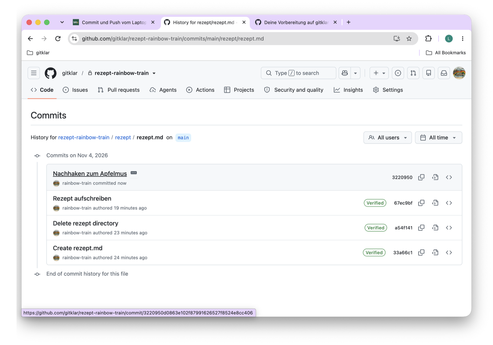
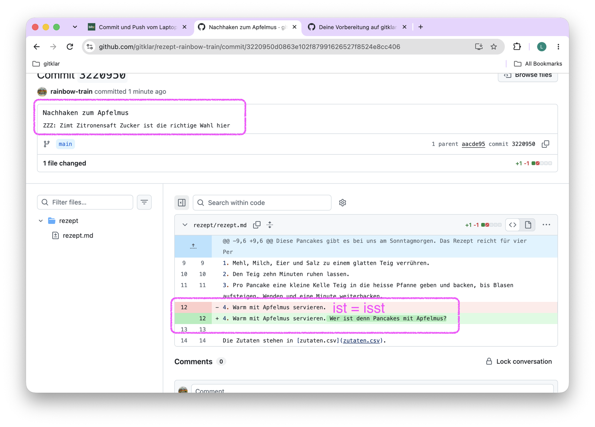
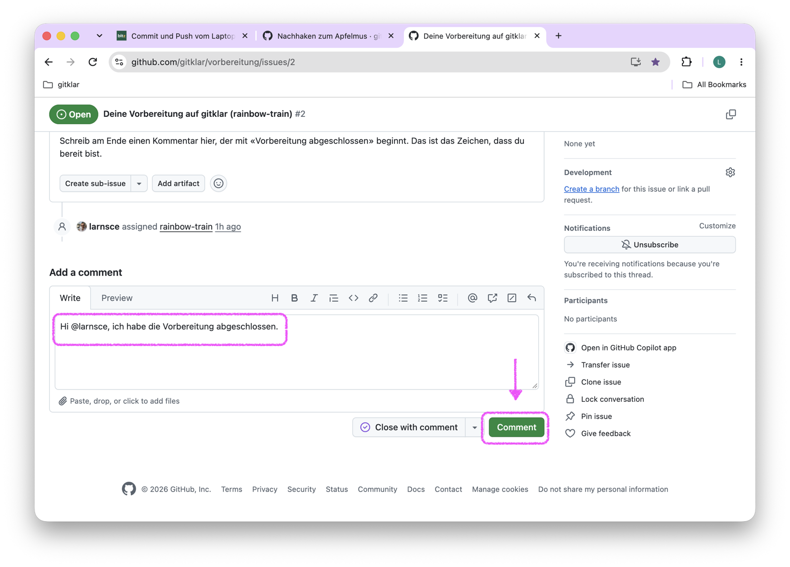

Deine ersten Commits hast du im Browser gemacht. Jetzt machst du einen auf deinem Laptop und bringst ihn mit einem Push nach GitHub. Genau das tut eine KI, wenn sie für dich committet. Deshalb machst du es einmal selbst, von Hand.

## Vorher: ein Texteditor

Für Markdown- und CSV-Dateien brauchst du ein Programm, das reinen Text schreibt. Auf jedem Laptop ist eines dabei: TextEdit auf macOS, Editor auf Windows. Beide können wenig und zeigen zum Beispiel keine Zeilennummern.

Ich empfehle allen, mindestens [Sublime Text](https://www.sublimetext.com) zu installieren. Sublime Text ist ein Texteditor für macOS und Windows. Du kannst ihn kostenlos herunterladen und ohne zeitliche Begrenzung nutzen. Ab und zu fragt er nach einer Lizenz, die brauchst du für den Kurs nicht. Ein grosses Programm wie VS Code oder Positron brauchst du für Markdown-Dateien nicht. Hast du schon einen Code-Editor, kannst du ihn statt Sublime Text nehmen.

GitHub Desktop bearbeitet selbst keine Dateien. Es zeigt dir, was sich geändert hat, und öffnet die Dateien in deinem Editor. Damit das mit Sublime Text klappt:

1. Installiere Sublime Text von [sublimetext.com](https://www.sublimetext.com) und öffne es einmal.
2. Öffne in GitHub Desktop **Settings** (macOS: Menü **GitHub Desktop**, **Settings**; Windows: Menü **File**, **Options**), den Reiter **Integrations**.
3. Wähle bei **External editor** den Eintrag **Sublime Text** und klicke auf **Save**.

Ab dann steht in GitHub Desktop unter **No local changes** der Knopf **Open in Sublime Text**. Er öffnet deinen ganzen Ordner in Sublime Text.

## Schritte

1. Klicke in GitHub Desktop auf **Open in Sublime Text**. Der Knopf steht in der Mitte, unter **No local changes**. Sublime Text öffnet sich mit deinem Ordner in der Seitenleiste links. Klicke dort auf `rezept` und dann auf `rezept.md`.

   {.bild-screenshot fig-alt="GitHub Desktop: No local changes, der Knopf Open in Sublime Text ist markiert"}

   Ohne Sublime Text: Klicke auf **Show in Finder** oder **Show in Explorer**, öffne den Ordner `rezept`, Rechtsklick auf `rezept.md`, **Öffnen mit**, und dann **TextEdit** auf macOS oder **Editor** auf Windows. Zeigt TextEdit Formatierungsknöpfe, wähle im Menü **Format** den Punkt **In reinen Text umwandeln**.

2. Ändere etwas an deinem Rezept. Zum Beispiel hängst du an den letzten Schritt der Zubereitung eine Frage an: `Wer isst denn Pancakes mit Apfelmus?` Speichere die Datei mit ⌘S auf macOS oder Ctrl+S auf Windows.
3. Wechsle zu GitHub Desktop. Links im Reiter **Changes** steht jetzt `rezept/rezept.md` mit einem Häkchen. Rechts siehst du deine Änderung: die alte Zeile rot mit einem Minus, die neue grün mit einem Plus.

   {.bild-screenshot fig-alt="GitHub Desktop: Reiter Changes mit rezept/rezept.md, rechts die alte Zeile in Rot und die neue Zeile mit der Frage in Grün"}

   Im Screenshot steht «Wer ist denn» statt «Wer isst denn». Git zeigt jede Änderung so, wie du sie gespeichert hast, auch mit Tippfehler. Den korrigierst du mit dem nächsten Commit, und beide Fassungen bleiben erhalten.

4. Unten links steht im Feld **Summary** der Vorschlag `Update rezept.md`. Ersetze ihn durch eine eigene Nachricht, zum Beispiel `Nachhaken zum Apfelmus`. Im Feld **Description** darunter kannst du mehr schreiben, zum Beispiel deine Antwort auf die Frage. Das Feld darf leer bleiben. Klicke auf **Commit 1 file to main**.

   {.bild-screenshot fig-alt="GitHub Desktop: Summary mit Nachhaken zum Apfelmus, Description mit einem Satz, darunter der Knopf Commit 1 file to main"}

5. Oben rechts steht jetzt **Push origin**, mit einer 1 und einem Pfeil nach oben: Ein Commit wartet darauf, nach GitHub zu kommen. Klicke darauf.

   {.bild-screenshot fig-alt="GitHub Desktop: oben der Knopf Push origin mit 1 Commit, in der Mitte der Kasten Push commits to the origin remote"}

   Nach ein paar Sekunden steht dort wieder **Fetch origin**. Dein Commit ist auf GitHub.

   {.bild-screenshot fig-alt="GitHub Desktop: oben wieder Fetch origin, in der Mitte No local changes"}

6. Öffne im Browser dein Repository (Lesezeichen **gitklar - GitHub**, dann **Repositories**, dann `rezept-dein-benutzername`), den Ordner `rezept` und darin `rezept.md`. Deine Frage steht im Text, und über der Datei steht deine Nachricht.

   {.bild-screenshot fig-alt="github.com: die Datei rezept.md mit der Frage am Ende von Schritt 4 und der Nachricht Nachhaken zum Apfelmus über dem Text"}

7. Klicke rechts auf **History**. Dein Commit vom Laptop steht zuoberst, über denen aus dem Browser.

   {.bild-screenshot fig-alt="github.com: die Commits von rezept.md, zuoberst Nachhaken zum Apfelmus"}

   Klicke ihn an. Oben stehen Nachricht und Beschreibung, darunter die Änderung, Zeile für Zeile.

   {.bild-screenshot fig-alt="github.com: der Commit Nachhaken zum Apfelmus mit der Beschreibung und der geänderten Zeile in Rot und Grün"}

Öffne `zutaten.csv` auf dem Laptop nur mit einem Texteditor wie Sublime Text, TextEdit oder dem Windows-Editor, nicht mit Excel oder Numbers. Diese Programme können beim Speichern die Kommas durch Strichpunkte ersetzen, und dann stimmt die Tabelle nicht mehr.

## Geschafft, wenn

Deine Frage in `rezept.md` auf GitHub steht und in GitHub Desktop im Reiter **History** dein Commit vom Laptop zuoberst steht, über den Commits aus dem Browser.

## Was gerade passiert ist

Git hat deine Änderung als Commit mit deiner Nachricht festgehalten, auf deinem Laptop. Der Push hat den Commit nach GitHub kopiert. Im Reiter **History** liegen jetzt beide Arten von Commits in einer Reihe: die aus dem Browser und der vom Laptop. Für Git sind sie gleich. Jeder trägt einen Namen, eine Zeit, eine Nachricht und eine Änderung. Jede Fassung bleibt erhalten, und du kannst zu jeder zurück.

## Hängt es?

- **Links in GitHub Desktop erscheint keine Änderung.** Die Datei ist nicht gespeichert, oder du hast eine Kopie ausserhalb des Ordners bearbeitet. Prüfe den Pfad: `Dokumente/gitrepos/gh-org-gitklar/rezept-dein-benutzername/rezept/rezept.md`.
- **Push origin schlägt fehl.** Meist ist die Anmeldung in GitHub Desktop abgelaufen. **Settings** oder **Options**, **Accounts**, neu anmelden.
- **GitHub Desktop zeigt Pull origin statt Push origin.** Du hast nach dem Klonen noch etwas im Browser geändert. Klicke zuerst auf **Pull origin**, dann auf **Push origin**.
- Alles andere: Kommentar in dein Issue, mit Screenshot.

## Geschafft

Das war die Vorbereitung. Du hast ein Repository auf GitHub und auf deinem Laptop, Commits aus dem Browser und vom Laptop, und du weisst, wo du sie findest. Mehr brauchst du für den Workshop nicht. Die Schritte **Claude Code** und **Editor** in deinem Issue sind freiwillig, nur für die, die so ein Werkzeug schon haben.

## Im Issue melden

Dein Zeichen, dass du bereit bist, ist ein Kommentar in deinem Issue. Ich bekomme eine Nachricht, sobald du ihn schreibst, und weiss, dass ich für dich nichts mehr prüfen muss.

1. Öffne dein Issue über das Lesezeichen **gitklar - Vorbereitung** oder über [github.com/gitklar/vorbereitung/issues](https://github.com/gitklar/vorbereitung/issues?q=is%3Aissue+assignee%3A%40me). Hake die Kästchen ab, die noch offen sind.
2. Scroll ganz nach unten zum Feld **Add a comment**.
3. Schreib einen Kommentar mit den Worten **Vorbereitung abgeschlossen**. Dazu, wenn du magst, zwei Sätze: Was hat gehakt, wie lange hast du gebraucht, was war unklar. Das hilft der nächsten Gruppe.
4. Klicke auf **Comment**, nicht auf **Close with comment**. Das Issue bleibt offen, bis der Kurs vorbei ist.

   {.bild-screenshot fig-alt="github.com: das Feld Add a comment mit dem Text Hi larnsce, ich habe die Vorbereitung abgeschlossen, ein Pfeil zeigt auf den Knopf Comment"}

Ein Beispiel:

> Vorbereitung abgeschlossen. Ich habe etwa 80 Minuten gebraucht, am längsten für die Zutaten. Beim Klonen fand ich mein Repository erst nach dem Aktualisieren.

Ich antworte im Issue, meist am selben Tag. Den Zoom-Link bekommst du per E-Mail. Lass GitHub Desktop installiert und den Ordner, wo er ist. Im Workshop 1 bringen wir dein Rezept in das gemeinsame gitklar-Kochbuch.
