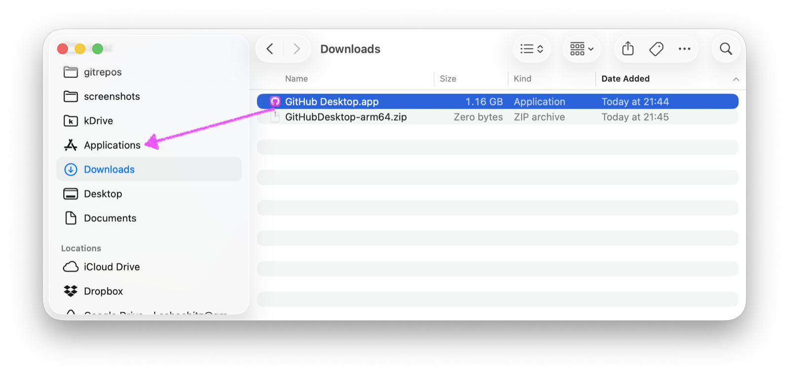
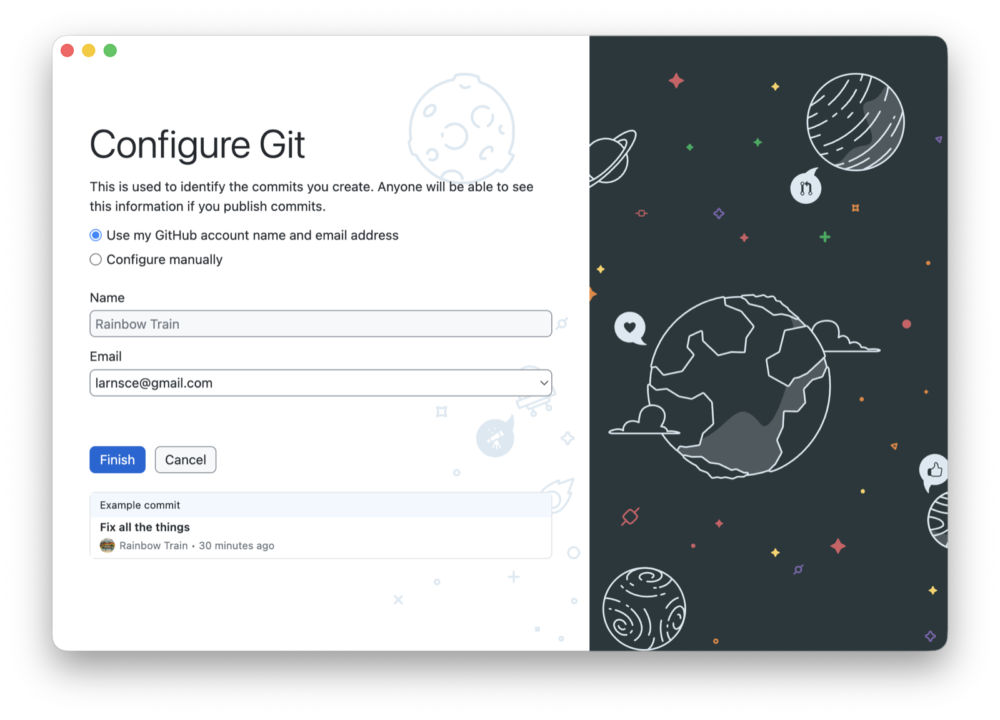
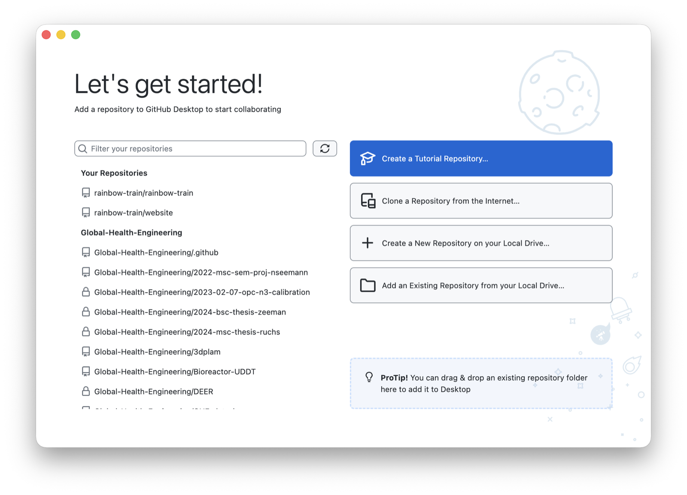
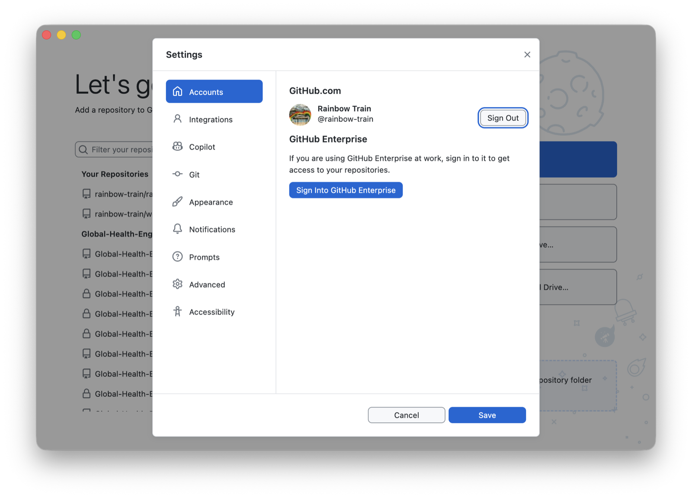

GitHub Desktop ist ein Programm mit Knöpfen für die Dinge, die Git sonst im Terminal erledigt. Git selbst ist darin enthalten, du installierst also nur dieses eine Programm.

## Schritte

1. Öffne [desktop.github.com](https://desktop.github.com/) und klicke auf **Download for macOS**. Die Seite erkennt, ob dein Mac einen Apple- oder einen Intel-Chip hat.
2. Öffne im Finder den Ordner **Downloads** und darin die heruntergeladene ZIP-Datei. Daneben erscheint das Programm **GitHub Desktop**. Zieh es links in der Seitenleiste auf den Ordner **Programme**. Steht dein Mac auf Englisch, heisst der Ordner **Applications**.

   {.bild-screenshot fig-alt="Finder: der Ordner Downloads mit GitHub Desktop, ein Pfeil zeigt auf den Ordner Applications in der Seitenleiste"}

3. Starte GitHub Desktop. Fragt macOS, ob du ein aus dem Internet geladenes Programm öffnen willst, klicke auf **Öffnen**.
4. Klicke auf **Sign in to GitHub.com**. Dein Browser öffnet sich. Melde dich mit deinem GitHub-Konto an und klicke auf **Authorize desktop**. Der Browser fragt, ob er GitHub Desktop öffnen darf. Erlaube es.
5. Zurück in GitHub Desktop siehst du **Configure Git**. Dein Name und deine E-Mail-Adresse stehen später in jedem Commit, den du auf dem Laptop machst. Das gemeinsame Kochbuch wird am Ende des Kurses öffentlich, und mit ihm diese Angaben. Wähle bei **Email** die Adresse, die du dort zeigen magst. Willst du keine zeigen, wähle in der Liste die Adresse, die auf `@users.noreply.github.com` endet. GitHub ordnet deine Commits damit trotzdem deinem Konto zu. Klicke dann auf **Finish**.

   {.bild-screenshot fig-alt="GitHub Desktop: das Fenster Configure Git mit den Feldern Name und Email und dem Knopf Finish"}

6. Es erscheint die Startansicht mit **Let's get started!**. Du kannst das Programm offen lassen oder schliessen. Dein Repository klonst du im nächsten Schritt.

   {.bild-screenshot fig-alt="GitHub Desktop: die Startansicht Let's get started mit der Liste der Repositories links und den vier Knöpfen rechts"}

## Geschafft, wenn

Im Menü **GitHub Desktop**, **Settings**, Reiter **Accounts** steht dein GitHub-Benutzername.

{.bild-screenshot fig-alt="GitHub Desktop: Settings, Reiter Accounts, mit dem angemeldeten Konto"}

## Hängt es?

- **Das Programm lässt sich nicht öffnen, weil es «von einem nicht verifizierten Entwickler» stammt.** Rechtsklick auf GitHub Desktop im Ordner Programme, dann **Öffnen**, dann noch einmal **Öffnen**.
- **Der Browser kommt nicht zurück zur App.** Schliesse GitHub Desktop, starte es neu und versuche die Anmeldung noch einmal.
- **Du hast bei Configure Git die falsche Adresse gewählt.** Menü **GitHub Desktop**, **Settings**, Reiter **Git**. Dort änderst du Name und E-Mail-Adresse.
- Alles andere: Kommentar in dein Issue, mit Screenshot.


