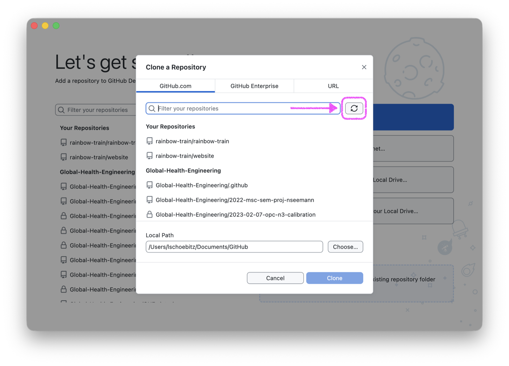
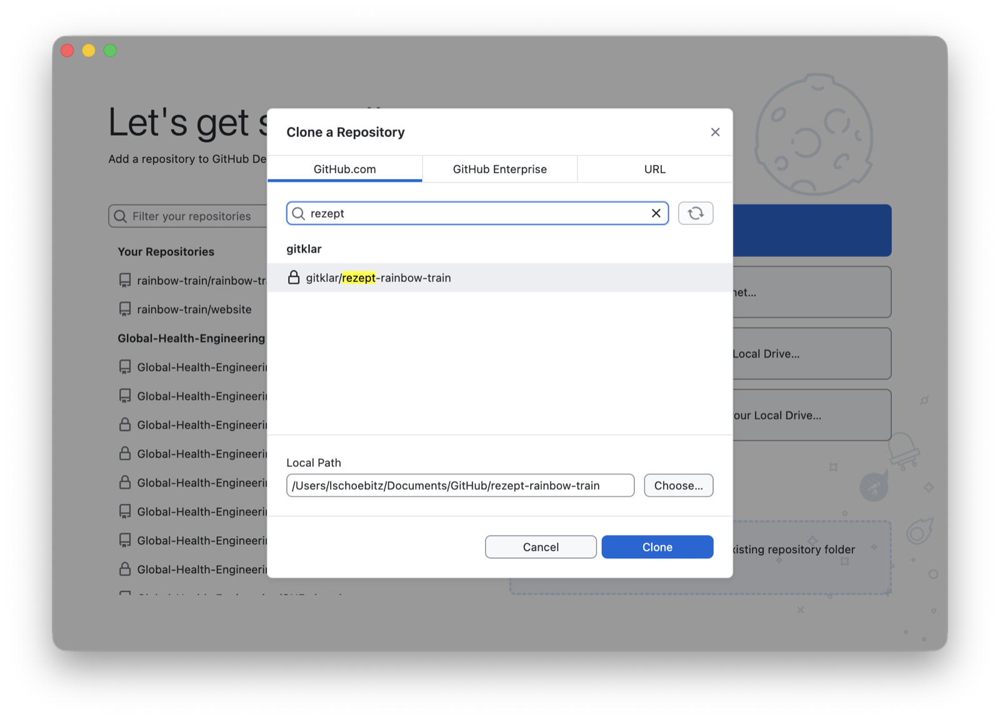
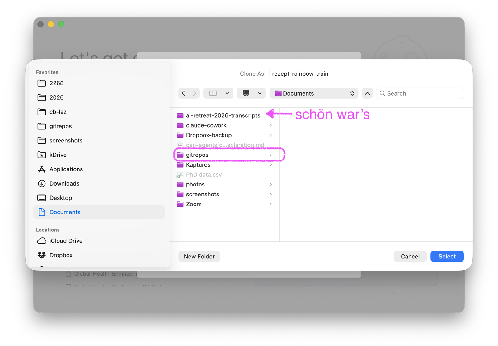
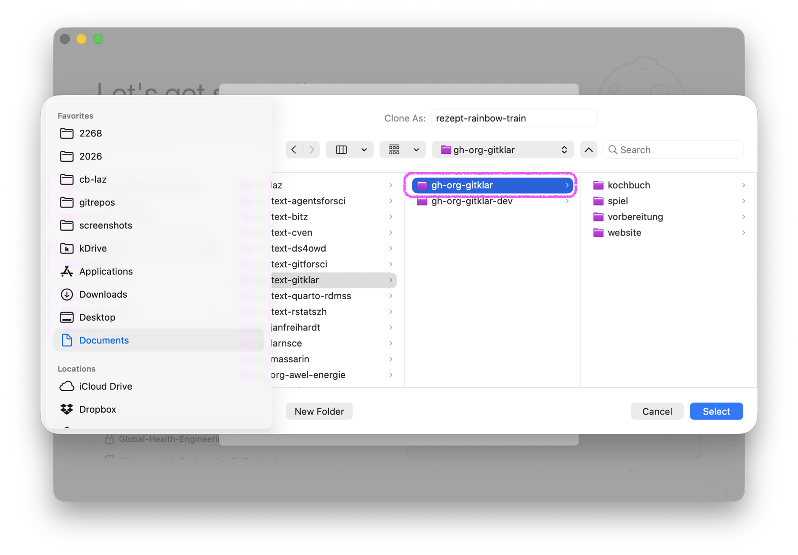
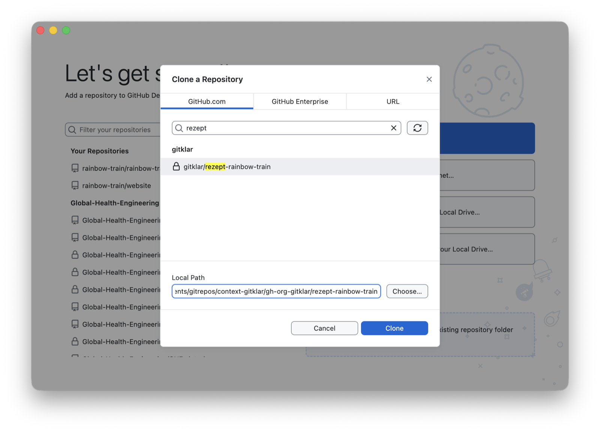
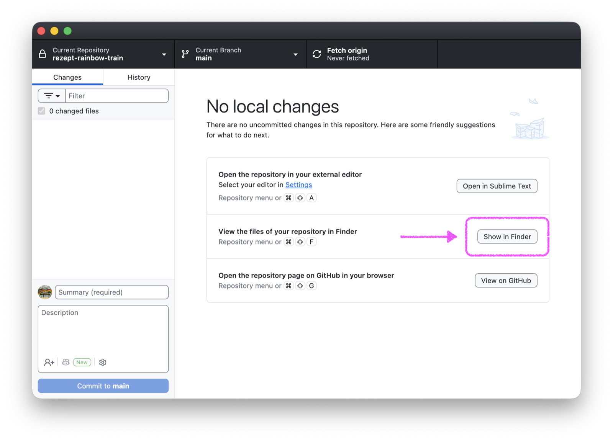
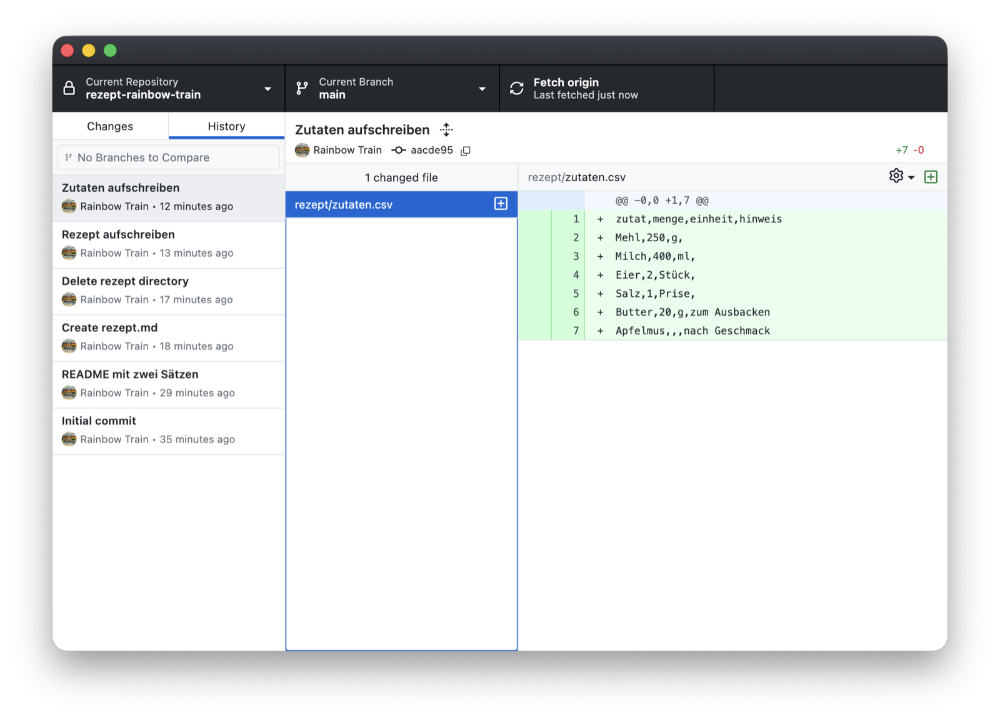

Bis jetzt liegt dein Repository `rezept-dein-benutzername` nur auf GitHub. Klonen heisst: eine vollständige Kopie davon auf deinem Laptop anlegen, samt aller Commits, die du im Browser gemacht hast, und samt Verbindung zurück zu GitHub. Ab dann kannst du auch auf dem Laptop daran arbeiten, und GitHub Desktop bringt deine Änderungen hoch.

## Vorher: ein Ordner für alle Repositories

Leg im Ordner **Dokumente** (macOS: Documents) einen Ordner namens **gitrepos** an. Jedes Repository, das du je klonst, kommt dort hinein. Darin legst du einen Ordner pro Ort auf GitHub an, an dem Repositories liegen:

- **gh-org-gitklar** für die Repositories der Organisation gitklar, also dein `rezept-dein-benutzername` und später das Kochbuch.
- **gh-dein-benutzername** für Repositories, die du später in deinem eigenen Konto anlegst. Diesen Ordner brauchst du im Kurs noch nicht.

```
Dokumente/
└── gitrepos/
    ├── gh-org-gitklar/
    │   └── rezept-dein-benutzername/
    └── gh-dein-benutzername/
```

So siehst du am Ordner, wohin ein Repository auf GitHub gehört. Kommt später eine weitere Organisation dazu, bekommt sie ihren eigenen Ordner `gh-org-` und den Namen der Organisation.

::: {.callout-warning}
## Nicht in iCloud, OneDrive oder Dropbox

Leg den Ordner `gitrepos` nicht in einen Ordner, der mit iCloud, OneDrive oder Dropbox synchronisiert wird. Git und die Synchronisation kommen sich in die Quere, und Änderungen gehen verloren. Auf manchen Macs liegt **Dokumente** in iCloud Drive: Prüfe in den Systemeinstellungen unter **iCloud**, **iCloud Drive**, ob **Schreibtisch- und Dokumentenordner** eingeschaltet ist. Wenn ja, lege `gitrepos` stattdessen direkt in deinem Benutzerordner an (Finder: Menü **Gehe zu**, **Benutzerordner**) und merke dir den Pfad.
:::

Für jetzt brauchst du `Dokumente/gitrepos/gh-org-gitklar`. Leg die beiden Ordner im Finder (macOS) oder im Explorer (Windows) an.

## Schritte

1. Öffne GitHub Desktop. Auf der Startseite **Let's get started!** klicke auf **Clone a Repository from the Internet...**. Ist schon ein Repository offen, geht es über das Menü **File**, **Clone Repository...**.
2. Wähle im Fenster **Clone a Repository** den Reiter **GitHub.com**. Darunter stehen die Repositories, die du sehen darfst, gruppiert nach Konto und Organisation. Fehlt **gitklar** in der Liste, klicke rechts neben dem Suchfeld auf das Aktualisieren-Symbol und warte. Das kann eine Minute dauern.

   {.bild-screenshot fig-alt="GitHub Desktop: das Fenster Clone a Repository, ein Pfeil zeigt auf das Aktualisieren-Symbol rechts neben dem Suchfeld"}

3. Tippe deinen Benutzernamen in das Suchfeld. Unter **gitklar** bleibt dein Repository **gitklar/rezept-dein-benutzername** übrig, mit einem Schloss davor, weil es privat ist. Klicke es an.

   {.bild-screenshot fig-alt="GitHub Desktop: im Suchfeld steht rezept, darunter unter gitklar das Repository gitklar/rezept-rainbow-train mit einem Schloss"}

4. Bei **Local Path** schlägt GitHub Desktop einen Ordner **GitHub** vor. Klicke auf **Choose...**, gehe in **Dokumente** (Documents), dann in **gitrepos**, markiere **gh-org-gitklar** und klicke auf **Select** (Auswählen).

   {.bild-screenshot fig-alt="macOS: das Fenster zum Auswählen eines Ordners, im Ordner Documents ist gitrepos markiert"}

   {.bild-screenshot fig-alt="macOS: im Ordner gitrepos ist gh-org-gitklar markiert, rechts davon die Ordner kochbuch, spiel, vorbereitung und website"}

   Bei mir liegen in Dokumente und in gh-org-gitklar mehr Ordner als bei dir. Dein gh-org-gitklar ist noch leer.

5. **Local Path** endet jetzt auf `gh-org-gitklar/rezept-dein-benutzername`. Den Namen des Repositorys hängt GitHub Desktop von selbst an. Klicke auf **Clone**.

   {.bild-screenshot fig-alt="GitHub Desktop: Local Path endet auf gh-org-gitklar/rezept-rainbow-train, darunter der blaue Knopf Clone"}

   Bei mir steht ein Ordner mehr im Pfad. Bei dir endet er auf `Documents/gitrepos/gh-org-gitklar/rezept-dein-benutzername`.

6. GitHub Desktop zeigt jetzt dein Repository: oben links **Current Repository: rezept-dein-benutzername**, in der Mitte **No local changes**. Klicke dort auf **Show in Finder** (Windows: **Show in Explorer**). Der Ordner öffnet sich. Du siehst die Datei `README.md` und den Ordner `rezept` mit deinen Dateien.

   {.bild-screenshot fig-alt="GitHub Desktop: No local changes, ein Pfeil zeigt auf den Knopf Show in Finder"}

7. Klicke in GitHub Desktop links auf den Reiter **History**. Dort stehen alle Commits, die du im Browser gemacht hast, mit deinem Namen und deinen Nachrichten. Klickst du einen an, siehst du rechts, was er geändert hat.

   {.bild-screenshot fig-alt="GitHub Desktop: der Reiter History mit der Liste der Commits links und dem Diff von zutaten.csv rechts"}

Ein anderer Weg zum selben Ziel: Öffne dein Repository auf github.com, klicke auf den grünen Knopf **Code** und dann auf **Open with GitHub Desktop**. Auch dann wählst du bei **Local Path** den Ordner `Dokumente/gitrepos/gh-org-gitklar`.

## Geschafft, wenn

Der Ordner `Dokumente/gitrepos/gh-org-gitklar/rezept-dein-benutzername` existiert, darin `README.md` und der Ordner `rezept` liegen, und der Reiter **History** deine Commits aus dem Browser zeigt.

## Hängt es?

- **Dein Repository fehlt in der Liste.** Klicke auf das Aktualisieren-Symbol und warte eine Minute. Fehlt es dann noch, prüfe unter **Settings** oder **Options**, **Accounts**, ob du mit deinem Konto angemeldet bist, und auf [github.com/gitklar](https://github.com/gitklar), ob das Repository in der Organisation liegt und nicht in deinem eigenen Konto.
- **GitHub Desktop fragt nach einer Anmeldung oder meldet «Authentication failed».** **Settings** oder **Options**, **Accounts**, abmelden und neu anmelden.
- **Fehlermeldung beim Klonen.** Schreib sie in dein Issue, mit Screenshot.


