Drei Seiten brauchst du im Kurs immer wieder: die Kurswebsite, die Organisation gitklar auf GitHub und dein Issue mit den Schritten der Vorbereitung. Leg dafür einen Ordner in der Lesezeichenleiste deines Browsers an. Dann findest du dein Issue auch wieder, wenn du den Reiter geschlossen hast.

Die Schritte zeigen Chrome auf Englisch, mit den deutschen Bezeichnungen in Klammern. Für Safari, Firefox und Edge steht es weiter unten.

## Schritte

1. Blende die Lesezeichenleiste ein: Klicke rechts oben auf die drei Punkte, dann auf **Bookmarks and lists** (Lesezeichen und Listen), **Show Bookmark Bar** (Lesezeichenleiste anzeigen), **Always Show** (Immer anzeigen). Unter der Adresszeile erscheint eine leere Leiste. Schneller geht es mit ⌘⇧B auf macOS oder Ctrl+Shift+B auf Windows.

   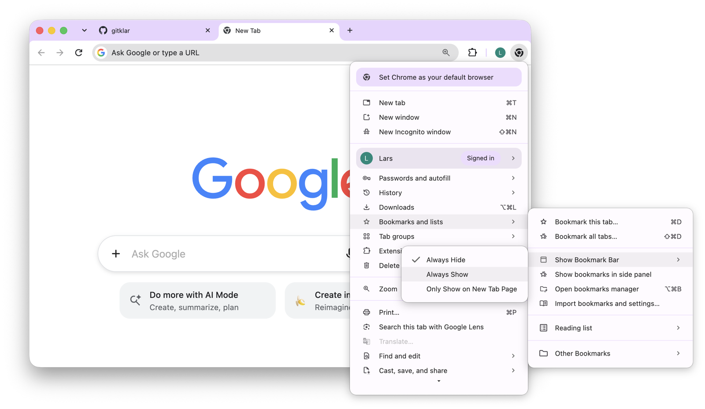{.bild-screenshot fig-alt="Chrome: das Menü mit Bookmarks and lists, Show Bookmark Bar und Always Show"}

2. Klicke mit der rechten Maustaste auf die leere Leiste und wähle **Add Folder...** (Ordner hinzufügen).

   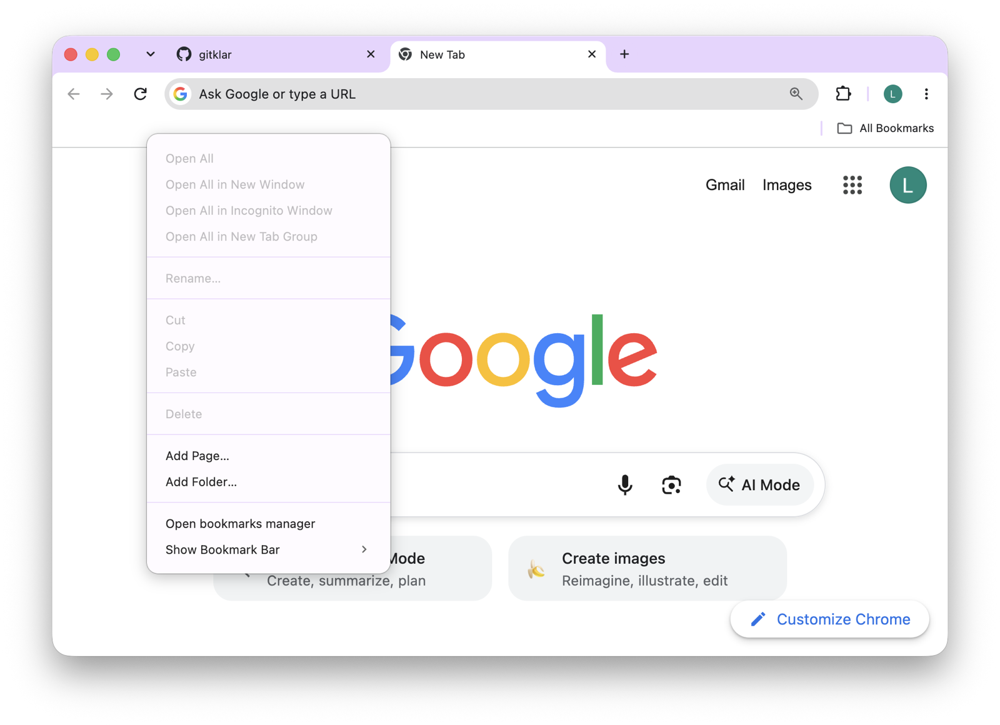{.bild-screenshot fig-alt="Chrome: das Menü nach dem Rechtsklick auf die Lesezeichenleiste, mit Add Page und Add Folder"}

3. Schreib als Namen `gitklar`. Darunter bleibt **Bookmarks Bar** (Lesezeichenleiste) markiert. Klicke auf **Save** (Speichern).

   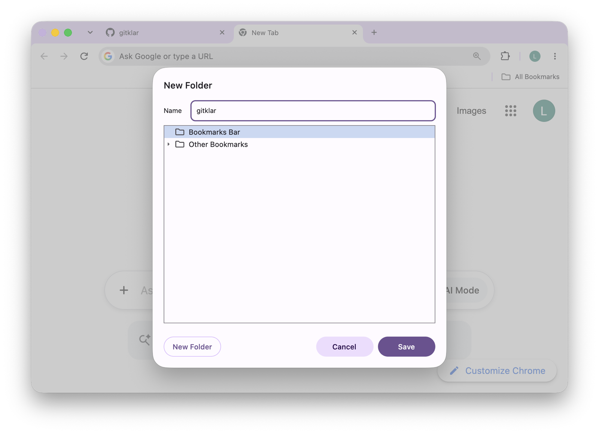{.bild-screenshot fig-alt="Chrome: das Fenster New Folder mit dem Namen gitklar und Bookmarks Bar markiert"}

   Der Ordner steht jetzt links in der Leiste, noch leer.

   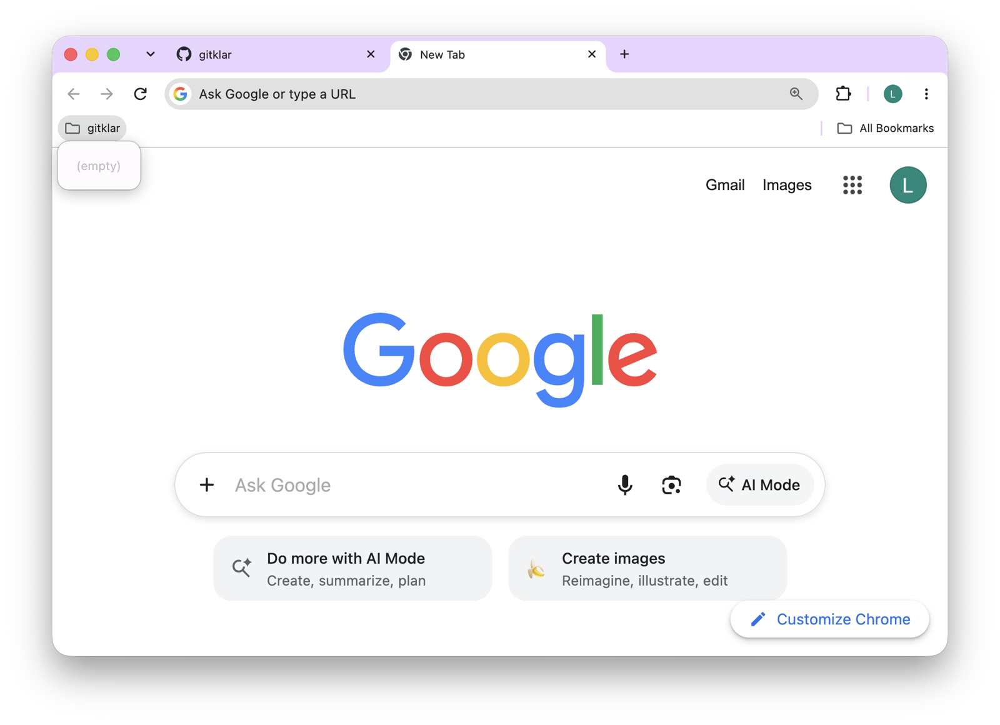{.bild-screenshot fig-alt="Chrome: der leere Ordner gitklar in der Lesezeichenleiste"}

4. Öffne die [Startseite dieser Website](../index.qmd) und klicke rechts in der Adresszeile auf den Stern. Chrome schlägt als Namen den Seitentitel vor. Ersetze ihn durch `gitklar - Kurswebsite` und wähle bei **Folder** (Ordner) den Ordner **gitklar**. Klicke auf **Done** (Fertig).

   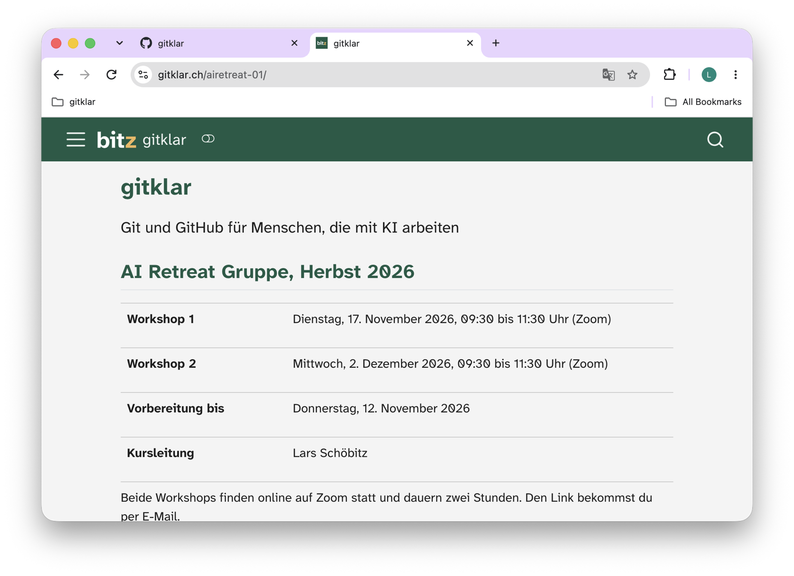{.bild-screenshot fig-alt="Chrome: die Startseite der Kurswebsite, der Stern in der Adresszeile ist noch leer"}

   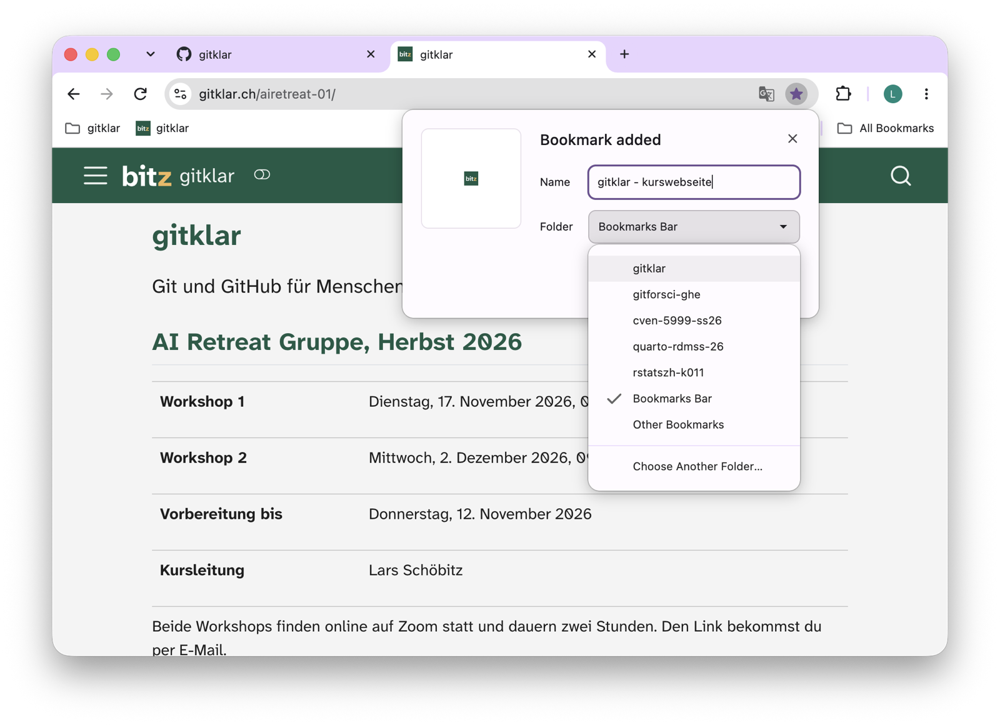{.bild-screenshot fig-alt="Chrome: das Fenster Bookmark added mit dem Namen gitklar - Kurswebsite und der aufgeklappten Ordnerliste mit gitklar"}

5. Öffne [github.com/gitklar](https://github.com/gitklar) und klicke wieder auf den Stern. Name `gitklar - GitHub`, Ordner **gitklar**, **Done**.

   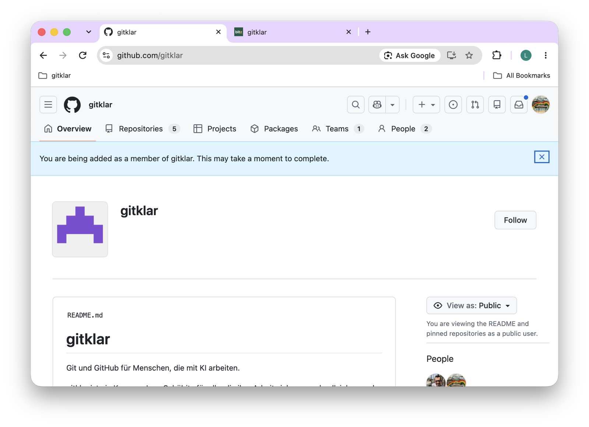{.bild-screenshot fig-alt="github.com/gitklar: die Seite der Organisation mit den Reitern Overview, Repositories, Teams und People"}

   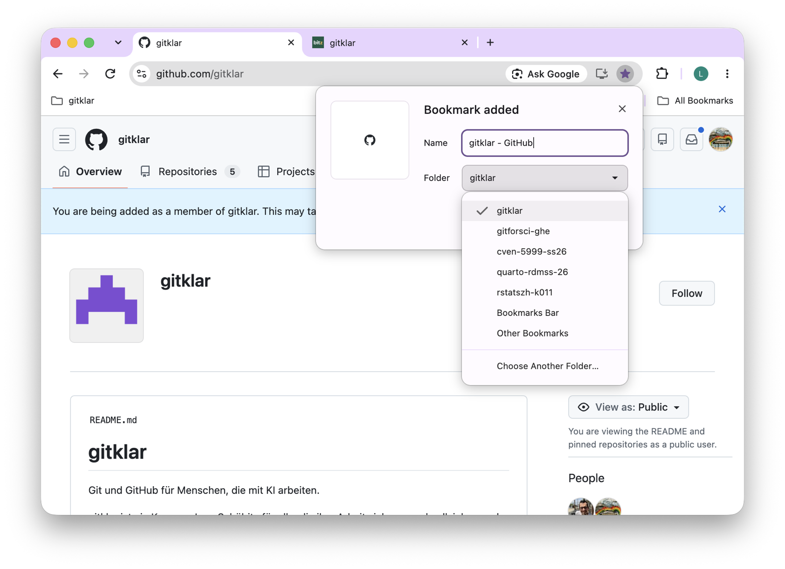{.bild-screenshot fig-alt="Chrome: das Fenster Bookmark added mit dem Namen gitklar - GitHub und dem Ordner gitklar"}

6. Klicke auf der Seite der Organisation oben auf **Repositories**, dann auf **vorbereitung**, dann auf den Reiter **Issues**. Dort steht dein Issue «Deine Vorbereitung auf gitklar» mit deinem Benutzernamen in Klammern. Klicke es an.

   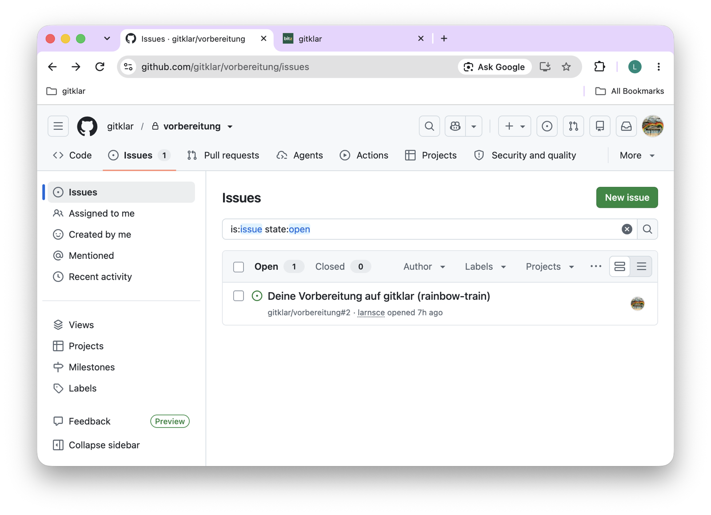{.bild-screenshot fig-alt="github.com: das Repository gitklar/vorbereitung, Reiter Issues, mit dem Issue Deine Vorbereitung auf gitklar (rainbow-train)"}

7. Klicke auf den Stern. Name `gitklar - Vorbereitung`, Ordner **gitklar**, **Done**.

   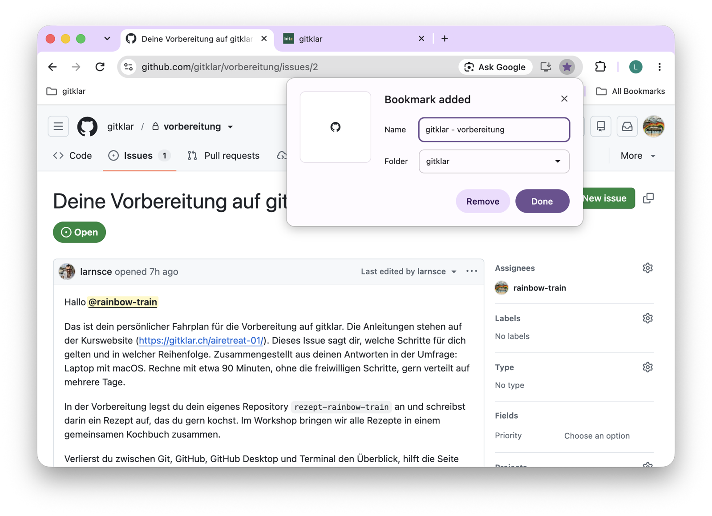{.bild-screenshot fig-alt="Chrome: das Fenster Bookmark added über dem Issue, mit dem Namen gitklar - Vorbereitung und dem Ordner gitklar"}

## Geschafft, wenn

Ein Klick auf den Ordner **gitklar** in der Leiste die drei Einträge zeigt: Kurswebsite, GitHub, Vorbereitung.

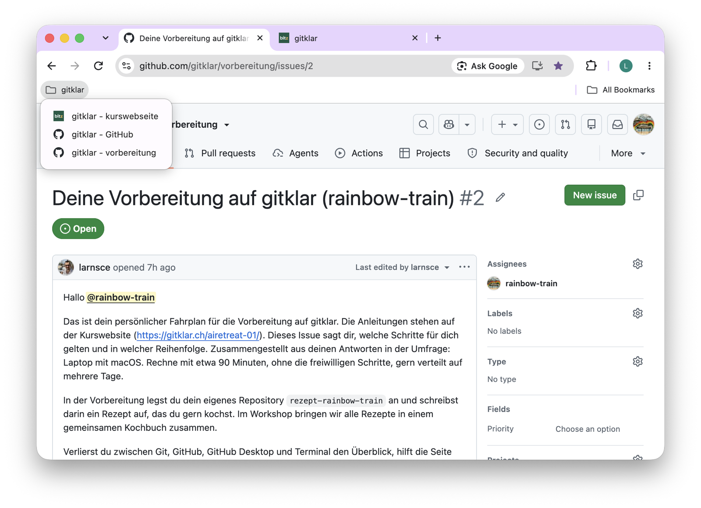{.bild-screenshot fig-alt="Chrome: der aufgeklappte Ordner gitklar in der Lesezeichenleiste mit den drei Einträgen gitklar - Kurswebsite, gitklar - GitHub und gitklar - Vorbereitung"}

## Andere Browser

- **Safari:** Blende die Leiste ein mit dem Menü **Darstellung**, **Favoritenleiste einblenden**. Einen Ordner legst du im Menü **Lesezeichen**, **Lesezeichen bearbeiten**, mit dem Knopf **Neuer Ordner** an. Eine Seite speicherst du mit dem Menü **Lesezeichen**, **Lesezeichen hinzufügen**, und wählst dort den Ordner.
- **Firefox:** Die Leiste erscheint mit ⌘⇧B auf macOS oder Ctrl+Shift+B auf Windows. Rechtsklick auf die Leiste, **Neuer Ordner**. Eine Seite speicherst du mit dem Stern in der Adresszeile und wählst dort den Ordner.
- **Edge:** Wie Chrome, nur heissen die Lesezeichen dort Favoriten. Ctrl+Shift+B für die Leiste, Rechtsklick auf die Leiste, **Ordner hinzufügen**, dann der Stern in der Adresszeile.

Teile ich im Kurs weitere Seiten, legst du sie im selben Ordner ab.


