Ein  ist ein Projektordner, dessen Geschichte Git festhält. In diesem Schritt legst du dein eigenes an, im Browser, in der Organisation gitklar. Es heisst `rezept-` und dann dein Benutzername, zum Beispiel `rezept-anna-koch`, wenn dein Benutzername `anna-koch` ist. Im nächsten Schritt schreibst du darin ein Rezept auf.

Alles in diesem Schritt passiert auf github.com. GitHub Desktop brauchst du erst beim [Klonen](klonen.qmd).

## Schritte

1. Öffne [github.com/organizations/gitklar/repositories/new](https://github.com/organizations/gitklar/repositories/new). Das ist die Seite **Create a new repository**, mit gitklar schon als Besitzerin eingetragen.

   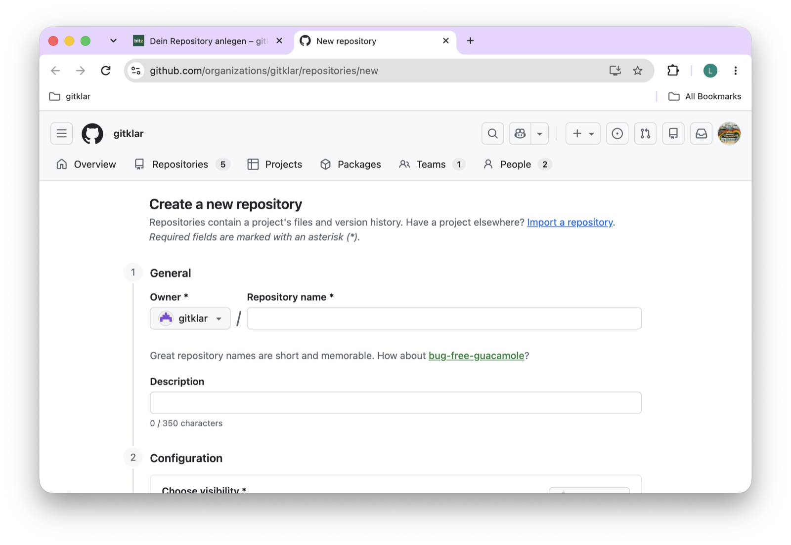{.bild-screenshot fig-alt="github.com: die Seite Create a new repository mit Owner gitklar und dem leeren Feld Repository name"}

2. Prüfe das Feld **Owner**. Dort muss **gitklar** stehen. Steht dort dein eigener Benutzername, klicke darauf und wähle **gitklar**.
3. Schreib bei **Repository name** `rezept-` und deinen Benutzernamen, genau so, wie er auf GitHub heisst. Nur Kleinbuchstaben, Zahlen und Bindestriche, keine Leerzeichen. Tippst du ein Leerzeichen, macht GitHub daraus einen Bindestrich. Unter dem Feld erscheint grün **is available**.

   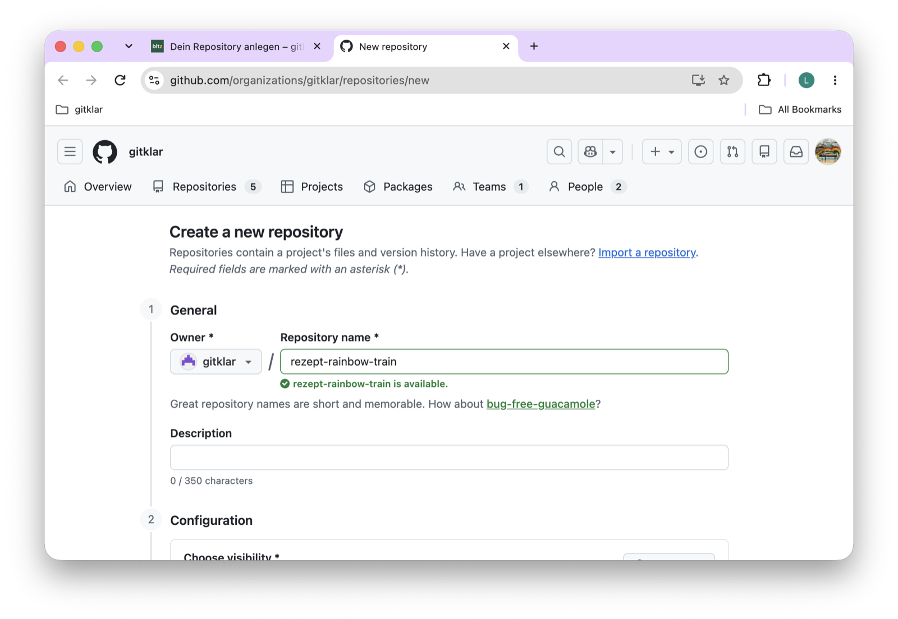{.bild-screenshot fig-alt="github.com: das Feld Repository name mit rezept-rainbow-train und darunter der grüne Hinweis rezept-rainbow-train is available"}

4. Bei **Description** kannst du einen Satz schreiben, zum Beispiel `Mein Rezept für gitklar`. Das Feld darf leer bleiben.
5. Wähle bei **Choose visibility** den Eintrag **Private**, nicht **Public**. Warum, steht weiter unten.
6. Schalte **Add README** ein. Die Felder **Start with a template**, **Add .gitignore** und **Add license** lässt du, wie sie sind.

   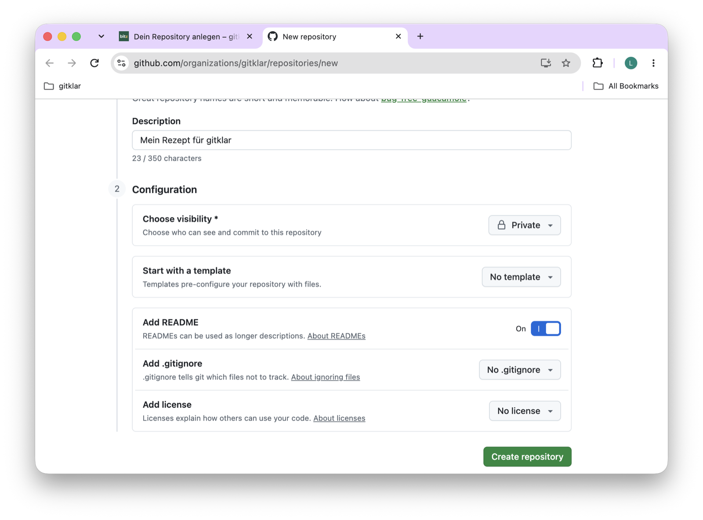{.bild-screenshot fig-alt="github.com: der untere Teil der Seite mit Description, Choose visibility auf Private, Add README eingeschaltet und dem Knopf Create repository"}

7. Klicke auf **Create repository**. GitHub zeigt jetzt dein Repository, mit einer einzigen Datei: `README.md`.

## Die README schreiben

Die  ist die Startseite deines Repositorys. GitHub zeigt sie unter der Dateiliste an. Im Moment steht darin nur eine Überschrift mit dem Namen des Repositorys, und darunter deine Description, falls du eine geschrieben hast.

1. Klicke rechts oben im Kasten **README** auf den Stift.

   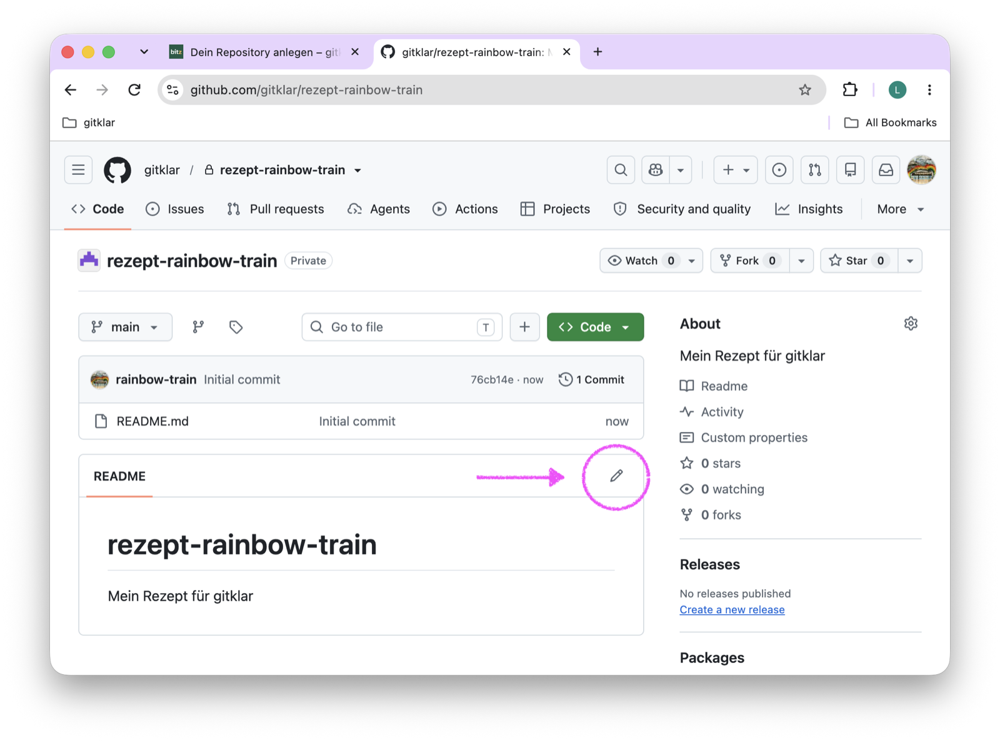{.bild-screenshot fig-alt="github.com: das neue Repository rezept-rainbow-train mit der README, ein Pfeil zeigt auf den Stift rechts oben im Kasten README"}

2. Es öffnet sich ein Textfeld. In Zeile 1 steht `# rezept-dein-benutzername`. Hast du eine Description geschrieben, steht sie in Zeile 2, direkt unter der Überschrift. Dazwischen fehlt eine leere Zeile. In Markdown gehört sie dazu: Eine Überschrift steht allein in ihrer Zeile, dann kommt eine leere Zeile, dann der Text.

   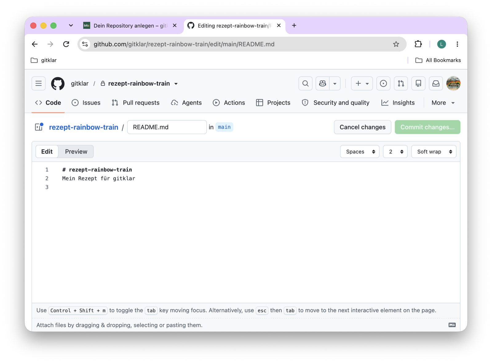{.bild-screenshot fig-alt="github.com: das Textfeld mit der Überschrift in Zeile 1 und der Description in Zeile 2, ohne leere Zeile dazwischen"}

3. Lösch die zweite Zeile. Schreib unter die Überschrift, nach einer leeren Zeile, zwei Sätze: wer du bist, so viel du teilen willst, und welches Rezept hier hineinkommt. Zum Beispiel: `Hier schreibe ich mein Rezept für den gitklar-Kurs auf. Es sind die Pancakes, die es bei uns sonntags gibt.`

   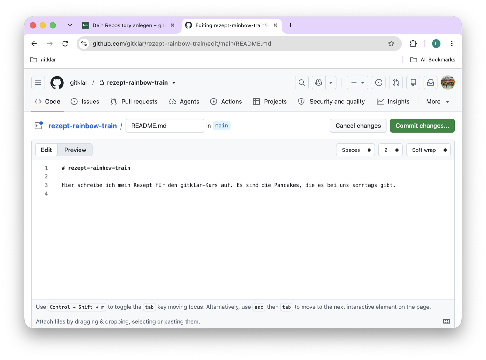{.bild-screenshot fig-alt="github.com: das Textfeld mit der Überschrift in Zeile 1, einer leeren Zeile 2 und den zwei Sätzen in Zeile 3"}

4. Klicke oben auf **Preview**. So wird GitHub die Datei anzeigen. Mit **Edit** kommst du zurück zum Text.

   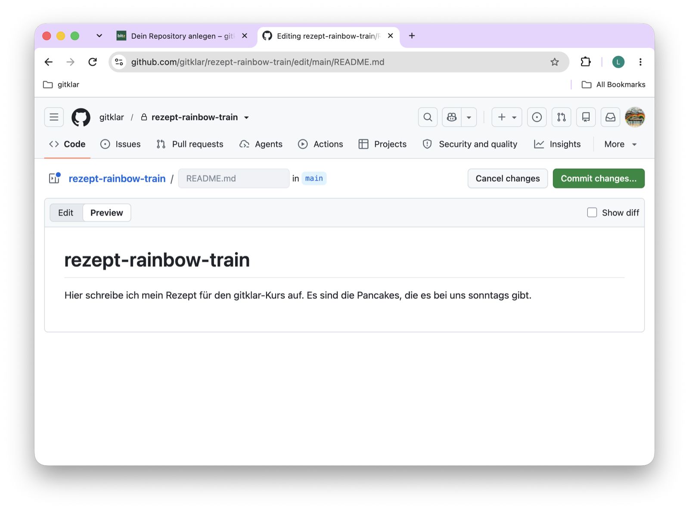{.bild-screenshot fig-alt="github.com: der Reiter Preview mit der Überschrift rezept-rainbow-train und den zwei Sätzen darunter"}

5. Klicke rechts oben auf **Commit changes...**. Es öffnet sich ein Fenster. Im Feld **Commit message** steht `Update README.md`.

   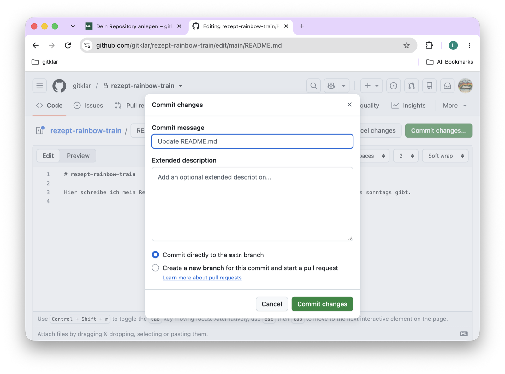{.bild-screenshot fig-alt="github.com: das Fenster Commit changes mit der vorgeschlagenen Nachricht Update README.md und der Auswahl Commit directly to the main branch"}

6. Ersetze die Nachricht durch `README mit zwei Sätzen`. Lass **Commit directly to the main branch** ausgewählt und klicke auf **Commit changes**.

   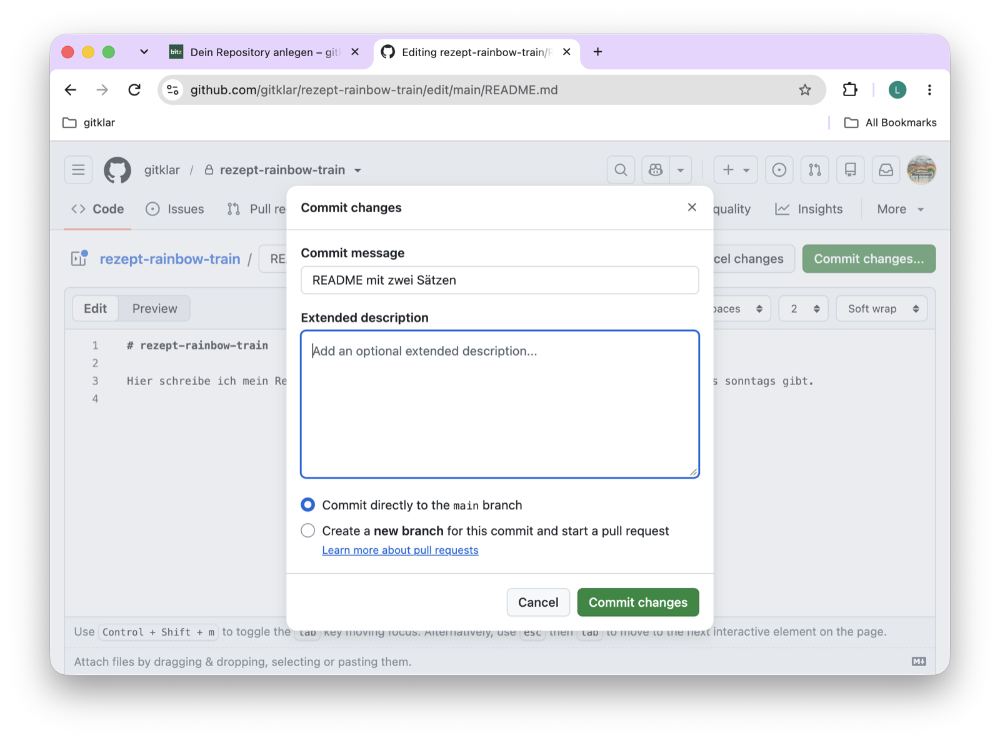{.bild-screenshot fig-alt="github.com: das Fenster Commit changes mit der Nachricht README mit zwei Sätzen"}

## Was gerade passiert ist

Du hast zwei  gemacht, ohne etwas zu installieren. Den ersten hat GitHub beim Anlegen für dich gemacht, mit der README. Den zweiten hast du mit **Commit changes** gemacht. Jedes Mal, wenn du im Browser eine Datei speicherst, entsteht ein Commit. Schau sie dir an:

1. Nach dem Commit zeigt GitHub die Datei `README.md`. Rechts über dem Text steht **History**. Klicke darauf.

   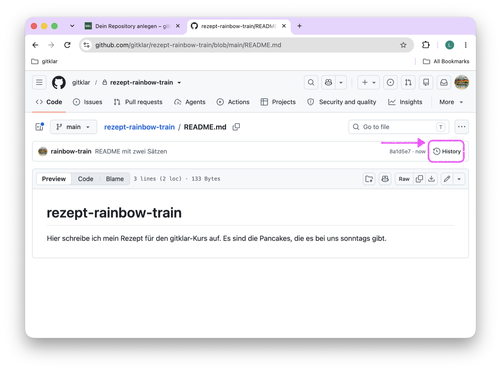{.bild-screenshot fig-alt="github.com: die Datei README.md, ein Pfeil zeigt auf den Knopf History rechts über dem Text"}

2. Du siehst die Liste **Commits** mit beiden: **README mit zwei Sätzen** und **Initial commit**, je mit deinem Benutzernamen und der Zeit.

   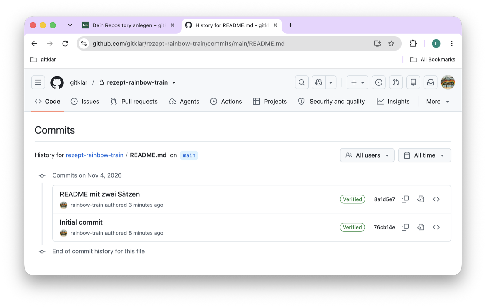{.bild-screenshot fig-alt="github.com: die Liste Commits mit README mit zwei Sätzen und Initial commit"}

3. Klicke auf **README mit zwei Sätzen**. GitHub zeigt, was sich geändert hat: die gelöschte Zeile rot mit einem Minus, die neuen Zeilen grün mit einem Plus.

   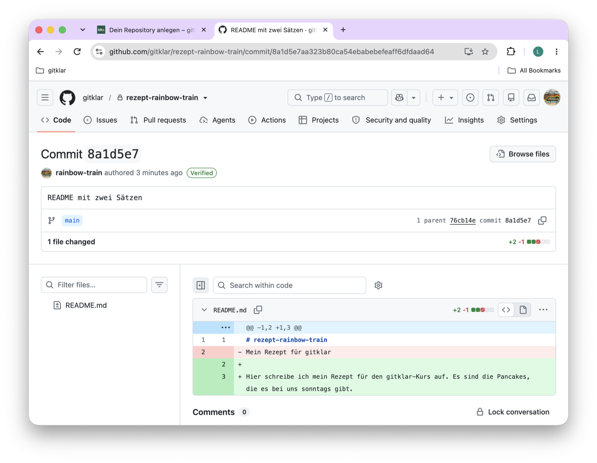{.bild-screenshot fig-alt="github.com: der Commit README mit zwei Sätzen mit der gelöschten Zeile in Rot und den zwei neuen Zeilen in Grün"}

## Markdown in drei Zeichen

Die Endung `.md` steht für Markdown. Eine Markdown-Datei ist reiner Text mit ein paar Zeichen, die GitHub als Formatierung anzeigt:

| Du schreibst | GitHub zeigt |
|---|---|
| `# Pancakes` | eine Überschrift |
| `**heiss**` | **heiss**, fett |
| `- Mehl` | einen Punkt in einer Liste |
| `1. Teig rühren` | einen nummerierten Schritt |

Mehr brauchst du für das Rezept nicht.

## Geschafft, wenn

Dein Repository unter `github.com/gitklar/rezept-dein-benutzername` existiert, die README deine zwei Sätze zeigt, und neben dem Namen **Private** steht oder vor dem Namen das Schloss.

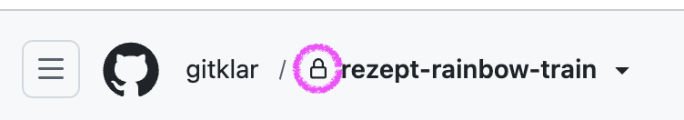{.bild-screenshot fig-alt="github.com: oben links gitklar, ein Schloss und rezept-rainbow-train"}

## Wer dein Repository sieht

Privat heisst: Es ist nicht öffentlich im Internet. Alle Teilnehmer:innen in der Organisation gitklar und die Kursleitung können es lesen, ändern kannst nur du. So könnt ihr eure Rezepte schon vor dem Workshop gegenseitig anschauen. Im Workshop bringst du dein Rezept selbst in das gemeinsame Kochbuch, von deinem Laptop aus.

Ein öffentliches Repository, **Public**, könnte jede Person im Internet lesen. GitHub bietet dir beide Möglichkeiten an. Wähle für den Kurs **Private**. Hast du aus Versehen **Public** gewählt, ist das kein Drama: Schreib es in dein Issue, und ich stelle es um.

Das gemeinsame Kochbuch wird am Ende des Kurses öffentlich. Dein Rezept steht dann im Internet, mit deinem Benutzernamen und deinen Commits. Dein eigenes Repository bleibt privat.

## Hängt es?

- **Bei Owner steht nur dein eigener Name.** Du hast die [Einladung](einladung.qmd) in die Organisation noch nicht angenommen, oder sie ist abgelaufen.
- **«The repository rezept-... already exists».** Du hast es schon angelegt. Öffne [github.com/gitklar](https://github.com/gitklar) und such es dort.
- **Das Repository liegt in deinem eigenen Konto statt in gitklar.** Öffne es, dann **Settings**, ganz unten **Transfer ownership**, und wähle **gitklar**. Oder schreib in dein Issue, dann mache ich es mit dir.
- **Add README vergessen.** GitHub zeigt dann eine fast leere Seite mit Befehlen. Klicke dort auf **creating a new file**, nenne die Datei `README.md` und schreib eine Überschrift und deine zwei Sätze hinein.
- Alles andere: Kommentar in dein Issue, mit Screenshot.


