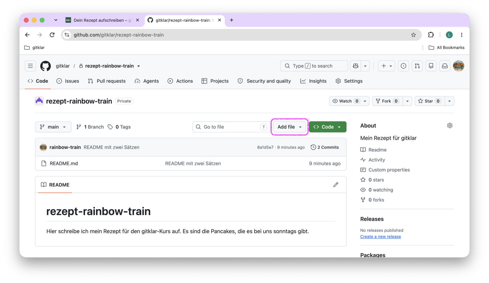
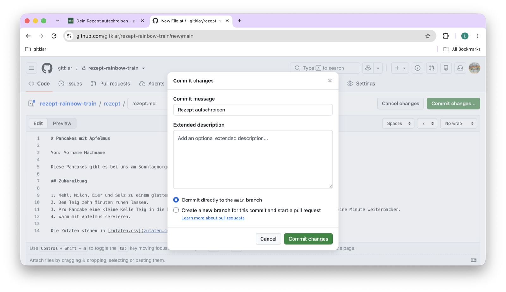
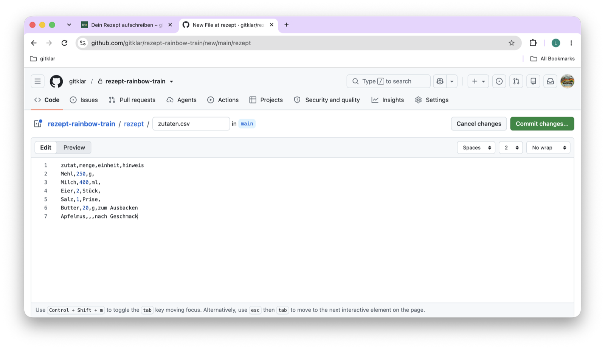
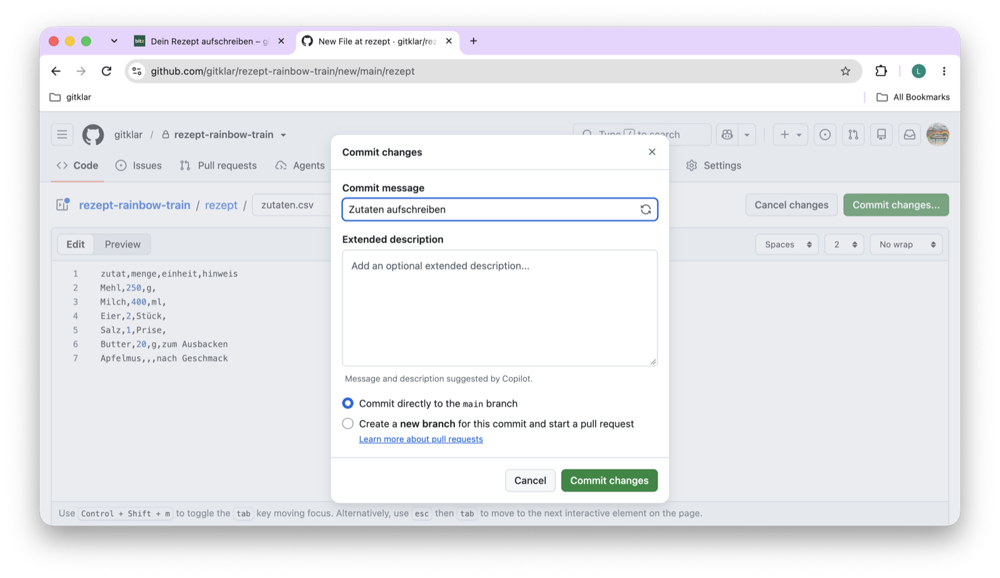
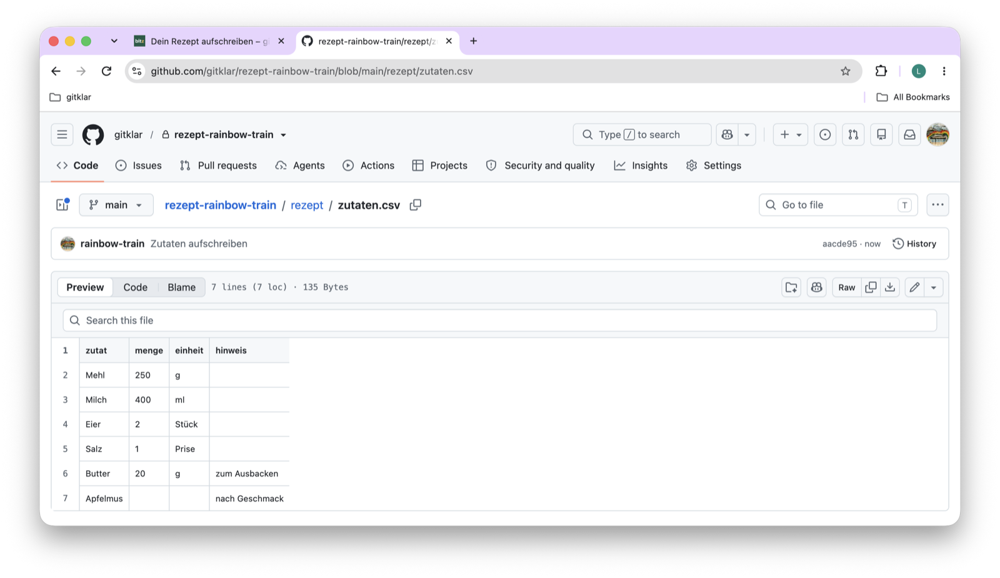

Such dir ein Gericht aus, das du gern kochst und mit der Gruppe teilen magst. Du schreibst es in deinem Repository `rezept-dein-benutzername` auf, im Browser, in einem Ordner `rezept` mit zwei Dateien:

- `rezept.md`: was das Gericht ist und wie man es zubereitet.
- `zutaten.csv`: die Zutaten als Tabelle.

Im Workshop 1 kopierst du diesen Ordner in das gemeinsame gitklar-Kochbuch. Deshalb ist die Form fest: Alle Rezepte im Kochbuch sind gleich aufgebaut.

Die 30 Minuten sind eine Schätzung. Wenn du dich in dein Rezept vertiefst, dauert es länger. Das ist in Ordnung.

## Schritt 1: das Rezept in rezept.md

`rezept.md` ist eine -Datei: reiner Text mit ein paar Zeichen, aus denen GitHub Überschriften und Listen macht. Eine Zeile mit `#` am Anfang wird eine Überschrift, eine Zeile mit `1.` ein Schritt einer nummerierten Liste.

1. Öffne dein Repository `rezept-dein-benutzername` auf github.com: Klicke in der Lesezeichenleiste auf **gitklar**, dann auf **gitklar - GitHub**. Auf der Seite der Organisation klicke oben auf **Repositories** und dann auf **rezept-dein-benutzername**. Oder tippe in die Adresszeile `github.com/gitklar/rezept-dein-benutzername`. Du bist richtig, wenn oben links neben einem Schloss `rezept-dein-benutzername` steht und weiter unten die README mit deinen zwei Sätzen.
2. Klicke über der Dateiliste, rechts neben **Go to file**, auf **Add file**, dann auf **Create new file**.

   {.bild-screenshot fig-alt="github.com: das Repository rezept-rainbow-train, der Knopf Add file über der Dateiliste ist markiert"}

3. Schreib in das Namensfeld oben `rezept/rezept.md`. Sobald du den Schrägstrich tippst, macht GitHub daraus einen Ordner `rezept`, und im Feld bleibt `rezept.md`.
4. Kopiere diese Vorlage mit dem Symbol rechts oben im Kasten, füge sie in das Textfeld ein und ersetze den Text durch dein Rezept:

   ```markdown
   # Pancakes mit Apfelmus

   Diese Pancakes gibt es bei uns am Sonntagmorgen. Das Rezept reicht für vier Personen.

   ## Zubereitung

   1. Mehl, Milch, Eier, Salz und einen Schuss Wasser mit Kohlensäure zu einem glatten Teig verrühren. Die Kohlensäure macht die Pancakes knusprig.
   2. Den Teig zehn Minuten ruhen lassen.
   3. Pro Pancake eine kleine Kelle Teig in die heisse Pfanne geben und backen, bis Blasen aufsteigen. Wenden und eine Minute weiterbacken.
   4. Warm mit Apfelmus servieren.

   Die Zutaten stehen in [zutaten.csv](zutaten.csv).
   ```

   Dein Name muss nicht hinein. Im Kochbuch steht jedes Rezept in einem Ordner mit dem Benutzernamen der Person, die es geschrieben hat.

5. Klicke auf **Preview**. Du siehst Überschrift und Schritte so, wie GitHub sie anzeigen wird.
6. Klicke auf **Commit changes...**. Im Feld **Commit message** steht `Create rezept.md`. Ersetze es durch `Rezept aufschreiben` und klicke auf **Commit changes**.

   {.bild-screenshot fig-alt="github.com: das Fenster Commit changes mit der Nachricht Rezept aufschreiben, dahinter die neue Datei rezept/rezept.md"}

## Schritt 2: die Zutaten in zutaten.csv

### Was eine CSV-Datei ist

Eine -Datei ist eine Tabelle, gespeichert als reiner Text. Du kennst Tabellen aus Excel oder Google Sheets. Eine CSV-Datei speichert dieselbe Tabelle ohne Farben, Formeln und Formatierung. Jede Zeile der Tabelle ist eine Zeile Text, und ein Komma trennt die Spalten. Die Abkürzung steht für «comma-separated values», durch Kommas getrennte Werte.

Diese Tabelle

| zutat | menge | einheit | hinweis |
|---|---|---|---|
| Mehl | 250 | g | |
| Milch | 400 | ml | |
| Eier | 2 | Stück | |
| Salz | 1 | Prise | |
| Wasser mit Kohlensäure | 1 | Schuss | |
| Butter | 20 | g | zum Ausbacken |
| Apfelmus | | | nach Geschmack |

sieht als CSV-Datei so aus:

```default
zutat,menge,einheit,hinweis
Mehl,250,g,
Milch,400,ml,
Eier,2,Stück,
Salz,1,Prise,
Wasser mit Kohlensäure,1,Schuss,
Butter,20,g,zum Ausbacken
Apfelmus,,,nach Geschmack
```

Der Vorteil: Git kann bei reinem Text Zeile für Zeile zeigen, was sich geändert hat. Bei einer Excel-Datei kann es das nicht.

Die erste Zeile nennt die Spalten. Bei gitklar sind es immer diese vier, in dieser Reihenfolge:

| Spalte | Was hineinkommt | Beispiel |
|---|---|---|
| `zutat` | der Name der Zutat | `Mehl` |
| `menge` | eine Zahl, mit Punkt statt Komma | `250`, `0.5` |
| `einheit` | die Einheit, darf leer bleiben | `g`, `ml`, `Stück`, `EL`, `Prise` |
| `hinweis` | alles andere, darf leer bleiben | `zum Ausbacken` |

: {tbl-colwidths="[15,45,40]"}

Für die Datei hast du drei Wege. Wähle den, der dir am liebsten ist.

::: {.panel-tabset}

## Im Browser schreiben

1. Klicke in deinem Repository auf den Ordner `rezept`. Du siehst darin `rezept.md`.
2. Klicke auf **Add file**, dann **Create new file**. Im Namensfeld steht schon `rezept/`. Schreib dahinter `zutaten.csv`.
3. Kopiere das Beispiel oben mit dem Symbol rechts oben im Kasten, füge es in das Textfeld ein und ändere es zu deinem Rezept. Die erste Zeile bleibt genau so.

   {.bild-screenshot fig-alt="github.com: die neue Datei zutaten.csv im Ordner rezept mit den sieben Zeilen der Zutaten"}

4. Klicke auf **Commit changes...**, schreib als Nachricht `Zutaten aufschreiben` und klicke auf **Commit changes**. Schlägt GitHub eine Nachricht vor, ersetze sie.

   {.bild-screenshot fig-alt="github.com: das Fenster Commit changes mit der Nachricht Zutaten aufschreiben"}

5. GitHub zeigt die neue Datei. Hat alles geklappt, siehst du sie als Tabelle mit den vier Spalten. Siehst du nur Text, ist das auch in Ordnung. Lass es so, ich korrigiere es vor dem Workshop.

   {.bild-screenshot fig-alt="github.com: die Datei zutaten.csv als Tabelle mit den Spalten zutat, menge, einheit und hinweis"}

Jede Zeile hat drei Kommas, auch wenn Felder leer bleiben. Beim Apfelmus fehlen Menge und Einheit, darum stehen dort drei Kommas hintereinander. Braucht ein Hinweis selbst ein Komma, setze ihn in Anführungszeichen: `"fein gehackt, ohne Stiele"`.

## Mit einer Tabelle

Du kannst die Tabelle auch in Excel, Google Sheets oder Numbers anlegen und als CSV-Datei speichern.

1. Schreib in die erste Zeile die vier Spaltennamen `zutat`, `menge`, `einheit` und `hinweis`, je einen in eine Zelle, klein geschrieben.
2. Schreib darunter eine Zutat pro Zeile.
3. Speichere die Tabelle als CSV-Datei:
   - **Google Sheets:** Menü **Datei**, **Herunterladen**, **Kommagetrennte Werte (.csv)**.
   - **Excel:** Menü **Datei**, **Speichern unter** oder **Kopie speichern**, als Dateityp **CSV UTF-8 (durch Trennzeichen getrennt)**.
   - **Numbers:** Menü **Ablage**, **Exportieren**, **CSV**.
4. Benenne die Datei in `zutaten.csv` um, klein geschrieben.
5. Klicke in deinem Repository auf den Ordner `rezept`, dann auf **Add file** und **Upload files**.
6. Zieh die Datei in das Feld, oder klicke auf **choose your files** und wähle sie aus.
7. Schreib bei **Commit changes** als Nachricht `Zutaten hochladen` und klicke auf **Commit changes**.
8. Klicke auf `zutaten.csv`. Hat alles geklappt, zeigt GitHub die Datei als Tabelle mit den vier Spalten.

Excel und Numbers trennen die Spalten auf einem deutschen System oft mit Strichpunkten statt mit Kommas. Dann zeigt GitHub die Datei nicht als Tabelle. Das ist in Ordnung. Lade sie trotzdem hoch, ich korrigiere das vor dem Workshop.

## Ohne Tabelle

Hast du keine Lust auf Tabellen, schreib die Zutaten als Liste in `rezept.md`. Die Datei `zutaten.csv` lege ich dann vor dem Workshop für dich an, mit Hilfe einer KI.

1. Öffne `rezept/rezept.md` auf github.com und klicke auf den Stift oben rechts.
2. Schreib über der Zeile `## Zubereitung` einen Abschnitt mit den Zutaten, eine Zutat pro Zeile mit einem Strich am Anfang:

   ```markdown
   ## Zutaten

   - 250 g Mehl
   - 400 ml Milch
   - 2 Eier
   - 1 Prise Salz
   - 1 Schuss Wasser mit Kohlensäure
   - 20 g Butter zum Ausbacken
   - Apfelmus nach Geschmack
   ```

3. Lösch die letzte Zeile, `Die Zutaten stehen in [zutaten.csv](zutaten.csv).`
4. Klicke auf **Commit changes...**, schreib als Nachricht `Zutaten ergänzen` und klicke auf **Commit changes**.

:::

## Geschafft, wenn

Der Ordner `rezept` in deinem Repository `rezept.md` und `zutaten.csv` enthält, oder `rezept.md` mit einem Abschnitt Zutaten, und GitHub `rezept.md` mit Überschrift und nummerierten Schritten anzeigt.

## Was gerade passiert ist

Jedes Speichern war ein . Such die Liste der Commits noch einmal selbst: Klicke oben links auf den Namen deines Repositorys, dann rechts über der Dateiliste auf die Zahl mit **Commits**. Du siehst jetzt vier oder mehr, alle mit deinem Namen. Von einer Datei aus heisst derselbe Weg **History**. Jeder Commit hält genau eine Änderung fest, mit deiner Nachricht dazu. Eine CSV-Datei und eine Markdown-Datei sind beide reiner Text. Deshalb kann Git bei jeder Fassung Zeile für Zeile zeigen, was sich geändert hat.

## Hängt es?

- **GitHub zeigt die CSV nicht als Tabelle.** Zähl die Kommas in jeder Zeile. Es müssen drei sein, ausser in Anführungszeichen. Stehen Strichpunkte statt Kommas in der Datei, lass es so, ich korrigiere es.
- **zutaten.csv liegt nicht im Ordner rezept.** Lade die Datei noch einmal hoch, diesmal aus dem Ordner `rezept` heraus. Die falsche lösch so: Datei anklicken, die drei Punkte rechts oben, **Delete file**, dann **Commit changes**.
- **Der Laptop öffnet CSV-Dateien mit Excel oder Numbers.** Hier im Browser ist das egal. Auf dem Laptop öffnest du `zutaten.csv` später mit einem Texteditor, zum Beispiel Sublime Text. Excel und Numbers können beim Speichern die Kommas durch Strichpunkte ersetzen.
- Alles andere: Kommentar in dein Issue, mit Screenshot.


