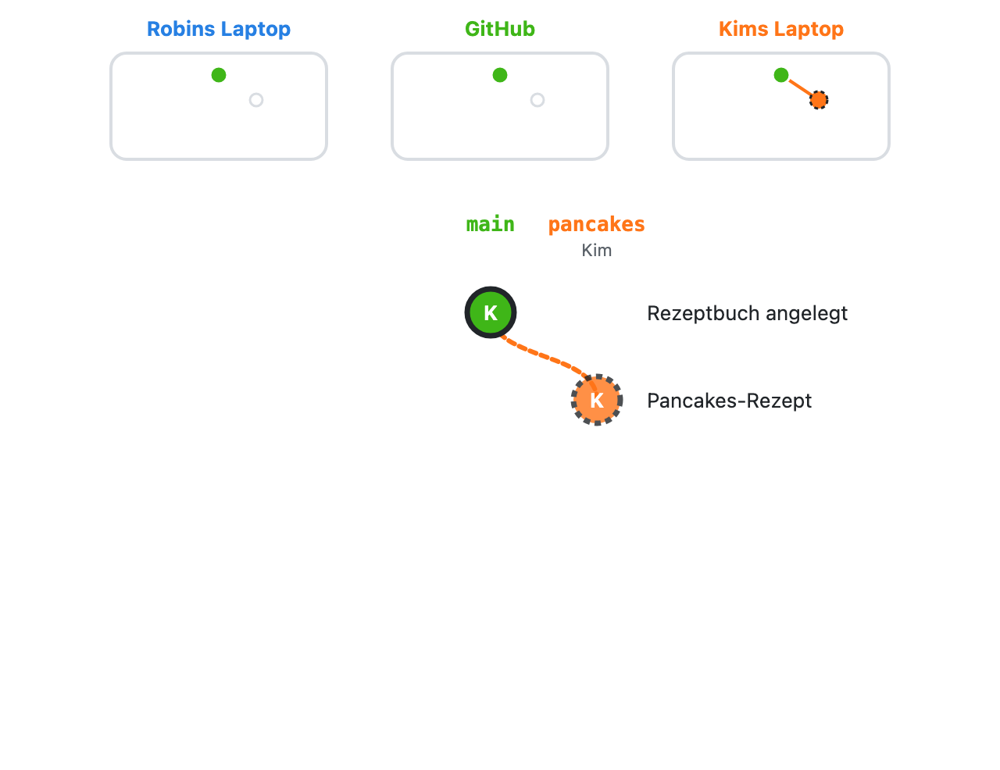
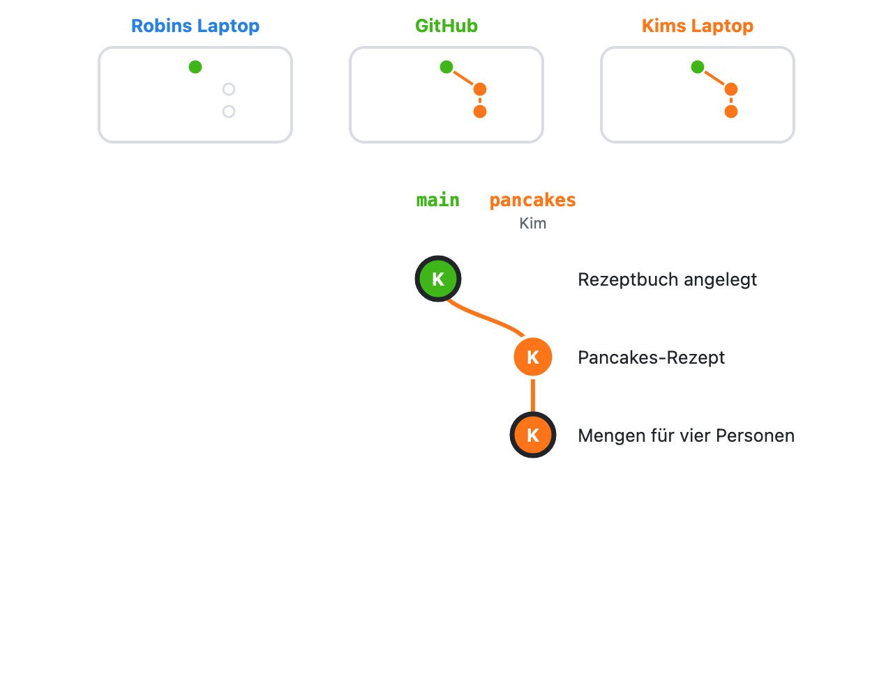
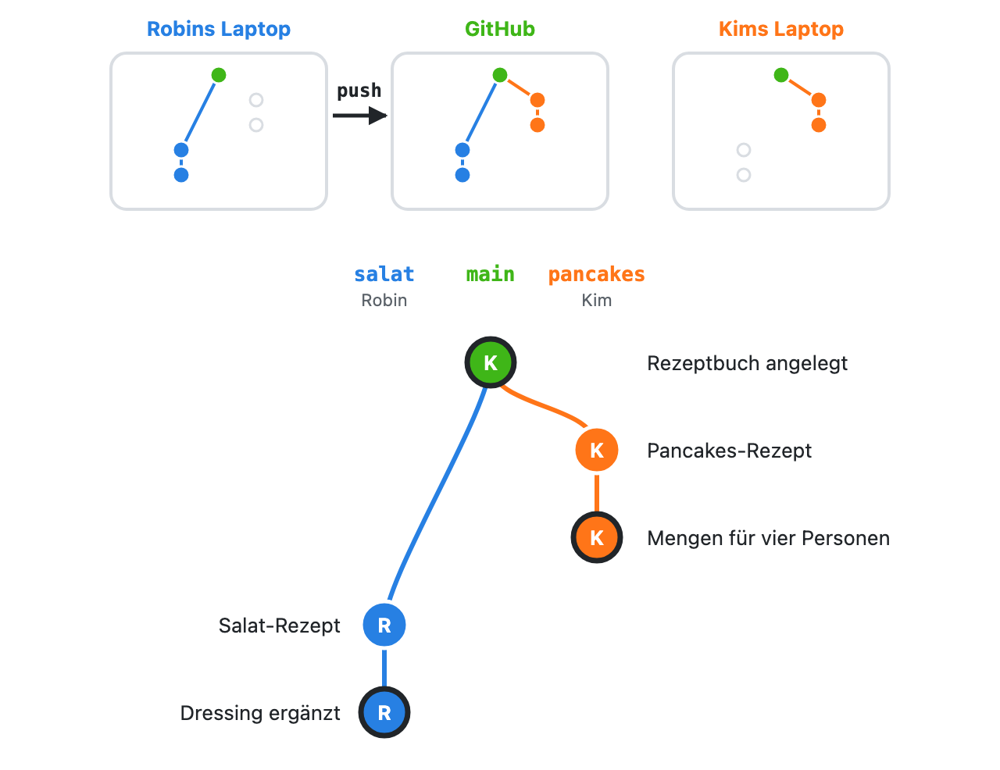
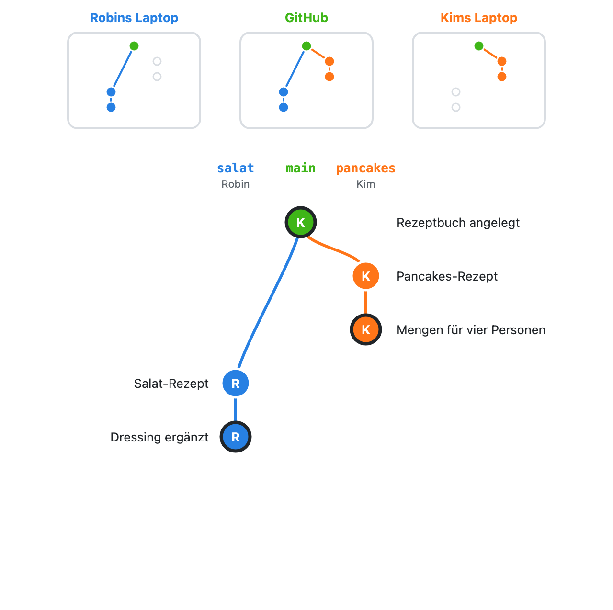
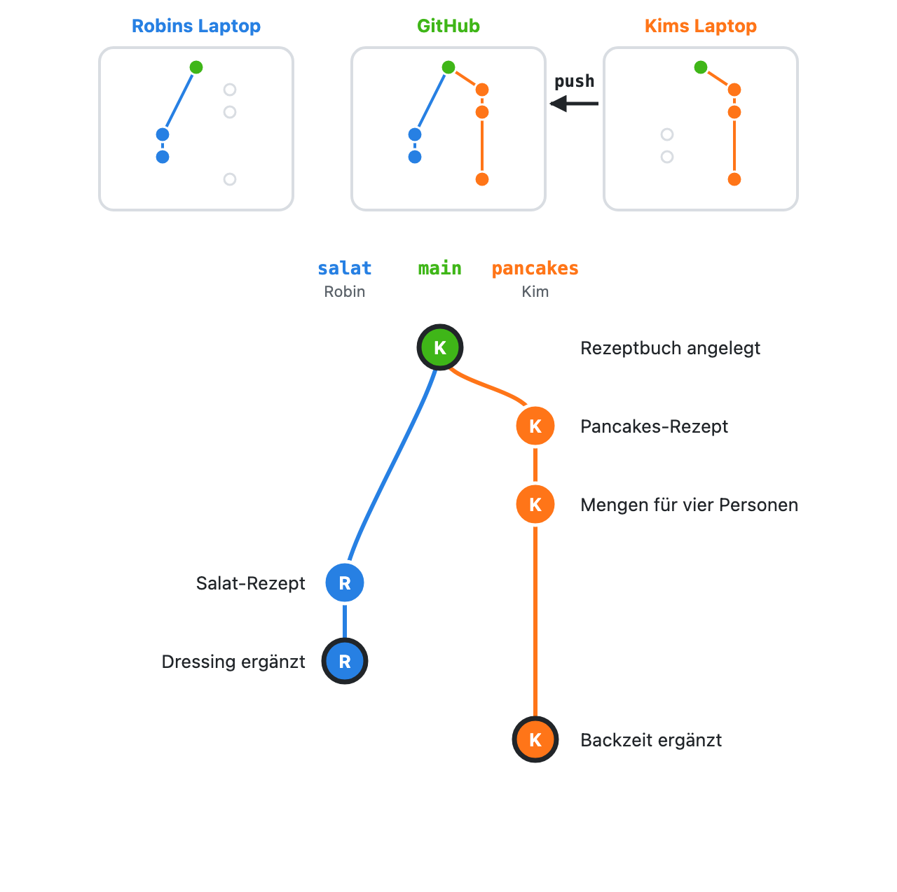
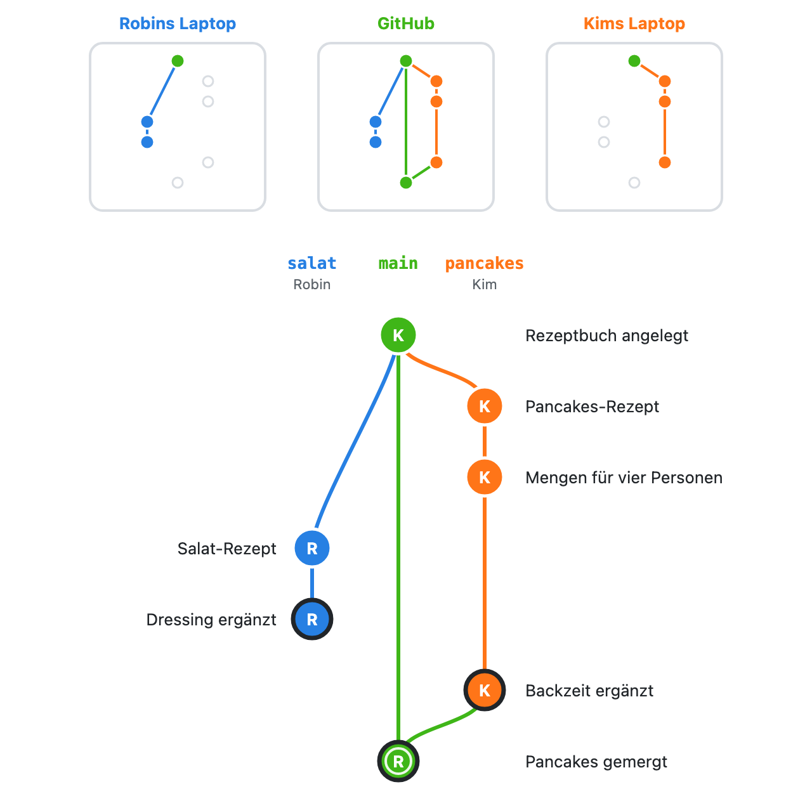

<!--
Folien für Workshop 1 der Gruppe airetreat-01, Dienstag, 17. November 2026,
09:30 bis 11:30 Uhr, Zoom. Aufbau nach dem Deck von gitforsci-ghe
(My turn, Your turn, Our turn). Die Bilder der Geschichte sind Standbilder
aus gitklar/spiel: geschichte.html?g=rezeptbuch&szene=<n>&bild=1,
zugeschnitten pro Block (bilder/block-a, block-b, block-c).
Rendern: quarto render workshop/workshop-1.qmd
-->

# Willkommen {background-color="#1e5a46"}

## Zum Ankommen {.smaller}

::: aufgabe
Schreib in den Chat: **Was möchtest du nach diesem Kurs mit Git oder GitHub tun können?**

Ein Satz reicht.
:::

::: hand
Der Zoom-Passcode steht in der Kalendereinladung «gitklar Kurs». Wir zeichnen auf.
:::

::: {.notes}
09:30, 5 Minuten. Aufnahme starten und sagen. Zwei, drei Ziele aus dem Chat vorlesen.
:::

## Was dieser Kurs ist, und was nicht

::: incremental
-   Heute [ist]{.marke} Git und GitHub für die Zusammenarbeit: Commit, Push, Branch, Pull request.
-   Heute ist [kein]{.marke} KI-Workshop. Was Agenten wie Claude Code im Repository tun, baut genau auf diesen Schritten auf.
-   Hier darf etwas [schiefgehen]{.marke}. Alles, was wir heute tun, lässt sich rückgängig machen.
:::

::: {.notes}
09:35. Die zwei Ankersätze laut sagen: kein KI-Workshop, alles ist rückgängig machbar.
:::

## Wo ihr steht {.smaller}

Aus euren 27 Antworten in der Umfrage:

::: {.zahlen}
::: {.zahl}
[17]{.gross}

haben Git noch nie benutzt
:::

::: {.zahl}
[19]{.gross}

programmieren nicht
:::

::: {.zahl}
[16]{.gross}

arbeiten schon mit Claude Code
:::
:::

Ihr seid also richtig hier. Der Kurs setzt nichts voraus ausser der Vorbereitung.

::: {.notes}
Zahlen aus der Umfrage vom Oktober, 27 Antworten mit Einwilligung. Nur Summen, keine Namen.
:::

## Ablauf heute {.smaller}

| Zeit  | Was                                                        |
|-------|------------------------------------------------------------|
| 09:30 | Ankommen, dein Ziel                                        |
| 09:42 | Was ist ein Commit?                                        |
| 09:50 | Ein Repository, mehrere Orte. Dein Repository in History   |
| 10:00 | Ein Knopf ist ein Befehl                                   |
| 10:05 | Branch und Pull request                                    |
| 10:13 | Pause                                                      |
| 10:20 | Ich zeige es: ein Rezept kommt ins Kochbuch                |
| 10:35 | Ihr seid dran: dein Rezept als Pull request                |
| 11:05 | Review und Merge                                           |
| 11:13 | Wie es weitergeht                                          |

# Der Commit {background-color="#1e5a46"}

## Was ist ein Commit?

Ein Commit ist ein gespeicherter Stand deiner Dateien, mit vier Angaben:

::: incremental
-   **Wer** hat ihn gemacht: ein Name und eine E-Mail-Adresse
-   **Wann**: Datum und Uhrzeit
-   **Was** hat sich geändert: Zeile für Zeile
-   **Warum**: die Nachricht, die du dazu schreibst
:::

::: {.notes}
09:42, 8 Minuten. Danach in ein echtes Repository wechseln und die Spuren zeigen: Liste der Commits, ein Commit mit Diff, Name und Zeit.
OFFEN: Repository von Steffi (ihre Sport-App, öffentlich) nur mit ihrem Ja. Ersatz: github.com/gitklar/website/commits/main.
:::

## Spuren in einem echten Repository

::: hand
Ich zeige es im Browser.
:::

-   die Liste der Commits: wer, wann, mit welcher Nachricht
-   ein einzelner Commit: rot ist weg, grün ist neu
-   dieselbe Datei vor einem Monat

Git vergisst nichts. Das ist der Nutzen, und es ist der Grund, bewusst zu wählen, was in einem Commit steht.

## Ein Repository, mehrere Orte

::: {.r-stack}
{.fragment .fade-in width="78%" fig-alt="Drei Kästen: Robins Laptop und Kims Laptop sind leer und gestrichelt, mit den Worten noch keine Kopie. Im Kasten GitHub liegt ein Commit. Darunter der Commit-Graph mit dem ersten Commit auf main."}

{.fragment .fade-in width="78%" fig-alt="Von GitHub zeigt je ein Pfeil mit dem Wort clone zu Robins Laptop und zu Kims Laptop. Alle drei Kästen enthalten jetzt denselben Commit."}
:::

::: {.notes}
09:50. Block A der Geschichte. Kim legt das Repository auf GitHub an. Kim und Robin klonen: drei Orte, derselbe Stand. Laptops reden nie direkt miteinander, immer über GitHub. Wörter: lokal ist der Laptop, remote ist GitHub.
:::

## Wir zusammen {.smaller}

::: aufgabe
1.  Öffne **GitHub Desktop**.
2.  Wähle oben links dein Repository `rezept-dein-benutzername`.
3.  Klicke auf den Reiter **History**.
:::

Du siehst deine eigenen Commits aus der Vorbereitung: wer, wann, was, warum.

::: hand
Siehst du deine Commits? Schreib «da» in den Chat.
:::

::: {.notes}
Bis 10:00. Wer die Vorbereitung nicht fertig hat, schaut bei mir zu. Kurz auf rainbow-train zeigen: derselbe Blick.
:::

## Ein Knopf ist ein Befehl {.smaller}

GitHub Desktop führt für dich Befehle aus. Im Terminal heissen sie so:

| In GitHub Desktop        | Im Terminal   |
|--------------------------|---------------|
| History                  | `git log`     |
| Changes                  | `git status`  |
| Commit to main           | `git commit`  |
| Push origin              | `git push`    |
| Fetch origin, Pull origin| `git pull`    |

::: hand
Nur bei mir am Bildschirm. Ihr müsst nichts tippen.
:::

::: {.notes}
10:00, 5 Minuten. In GitHub Desktop: Repository, Open in Terminal. git status und git log zeigen. Nicht aus dem Terminal pushen (dort ist larnsce angemeldet).
:::

# Branch und Pull request {background-color="#1e5a46"}

## Ein eigener Branch, dann die Bitte

::: {.r-stack}
{.fragment .fade-in width="62%" fig-alt="Kim hat den Branch pancakes angelegt. Im Graphen steht neben main die Spalte pancakes, noch ohne eigenen Commit."}

{.fragment .fade-in width="62%" fig-alt="Ein erster Commit auf dem Branch pancakes, gestrichelt gezeichnet. Er liegt nur im Kasten Kims Laptop."}

{.fragment .fade-in width="62%" fig-alt="Ein Pfeil mit dem Wort push zeigt von Kims Laptop zu GitHub. Die zwei Commits des Branches sind jetzt durchgezogen und liegen auch auf GitHub."}

{.fragment .fade-in width="62%" fig-alt="Kim hat einen Pull request geöffnet. Der Graph ist unverändert: main steht beim ersten Commit, der Branch pancakes hat zwei Commits."}

{.fragment .fade-in width="62%" fig-alt="Robin hat links einen eigenen Branch salat mit zwei Commits. Auf Robins Laptop fehlen Kims Commits, auf Kims Laptop fehlen Robins Commits. Auf GitHub liegen alle."}
:::

::: {.notes}
10:05, 8 Minuten. Block B. Branch: eine eigene Arbeitslinie, main bleibt unberührt. Gestrichelt: nur auf dem Laptop. Push: durchgezogen, jetzt auch auf GitHub. Pull request: die Bitte, den Branch in main zu übernehmen. Letztes Bild: jede Person hat ihren eigenen Branch, darum heisst eurer rezept-benutzername.
:::

## Pause

Bis 10:20 Uhr.

::: hand
Danach bringe ich ein Rezept ins Kochbuch, und dann ihr.
:::

# Das Kochbuch {background-color="#1e5a46"}

## Von deinem Repository ins Kochbuch {.smaller}

::::: columns
::: {.column width="50%"}
### Vorher

-   Dein Rezept liegt in `rezept-dein-benutzername`
-   Nur du schreibst dort
:::

::: {.column width="50%"}
### Nachher

-   Dein Rezept liegt auf einem Branch in `gitklar/kochbuch`
-   Ein Pull request bittet darum, es aufzunehmen
:::
:::::

Aus dem Kochbuch entsteht ein öffentliches Buch im Internet. Mehr dazu am Schluss.

## Ich zeige es {.smaller}

::: hand
Lehn dich zurück und schau zu. Ich bin jetzt rainbow-train, eine Person aus dem Kurs wie ihr.
:::

1.  Kochbuch klonen
2.  Branch anlegen
3.  Rezeptordner kopieren und umbenennen
4.  Committen
5.  Branch veröffentlichen
6.  Pull request öffnen

::: {.notes}
10:20, 15 Minuten. Laut sagen, bevor sie es selbst erleben:
1. Steht gitklar/kochbuch nicht in der Liste: Reiter URL, gitklar/kochbuch tippen.
2. Vor Clone: Local Path endet auf gitrepos/gh-org-gitklar/kochbuch.
3. _vorlage: der Unterstrich heisst, das ist kein Rezept, sondern die Vorlage. Sie steht zuoberst, und das Buch lässt sie aus.
4. In Changes haben beide Dateien ein Häkchen.
5. Den kopierten Ordner umbenennen. Falscher Name: im Finder umbenennen, committen, pushen. Der Pull request zeigt es von selbst.
6. Auf der Seite des Pull requests nicht auf «Try the Overview page» klicken.
Mit dem Pull request stimmst du zu, dass dein Rezept unter CC BY 4.0 im Kochbuch steht.
:::

## Ihr seid dran {.smaller}

::: aufgabe
1.  **File, Clone Repository**, Reiter **URL**: `gitklar/kochbuch`. Local Path endet auf `gh-org-gitklar/kochbuch`.
2.  **Current Branch, New Branch**: `rezept-dein-benutzername`
3.  Ordner `rezept` aus deinem Repository nach `kochbuch/rezepte` kopieren und in **deinen Benutzernamen** umbenennen
4.  **Changes**: beide Dateien angehakt, Summary schreiben, **Commit to rezept-...**
5.  **Publish branch**
6.  **Create Pull Request**, die drei Zeilen ausfüllen, **Create pull request**
:::

::: hand
Fertig? Schreib «fertig» in den Chat. Hängt es? Schreib die Nummer des Schritts.
:::

::: {.notes}
10:35, 30 Minuten, geschützter Block. Wer nicht vorbereitet ist: zuschauen und später über gitklar.ch/rezept-einreichen.html einreichen. Bei 11:00 ansagen: noch fünf Minuten.
:::

# Review und Merge {background-color="#1e5a46"}

## Eine zweite Person liest mit

::: {.r-stack}
{.fragment .fade-in width="50%" fig-alt="Robin hat Kims Pull request gelesen und um eine Änderung gebeten. Der Graph ist unverändert."}

{.fragment .fade-in width="50%" fig-alt="Kim hat mit einem weiteren Commit auf dem Branch pancakes geantwortet und gepusht. Der Commit liegt auf Kims Laptop und auf GitHub."}

{.fragment .fade-in width="50%" fig-alt="Der Pull request ist gemergt. Auf main liegt ein Merge-Commit, der Kims drei Commits übernimmt. Er liegt nur auf GitHub; auf beiden Laptops ist er ein leerer Kreis."}
:::

::: {.notes}
11:05, 8 Minuten. Block C, dann live: als larnsce im zweiten Browser den Pull request von rainbow-train öffnen, Files changed, ein Kommentar auf eine Zeile. Als rainbow-train mit einem Commit antworten, pushen. Als larnsce mergen. Nur dieser eine Merge heute.
:::

# Wie es weitergeht {background-color="#1e5a46"}

## Bis zum 2. Dezember {.smaller}

::: incremental
-   **Dein Pull request bleibt offen.** Am 2. Dezember liest ihn eine zweite Person aus dem Kurs und mergt ihn.
-   **Noch kein Pull request?** Die Schritte stehen auf [gitklar.ch/rezept-einreichen.html](https://gitklar.ch/rezept-einreichen.html), bitte bis Dienstag, 1. Dezember.
-   **Deine E-Mail-Adresse in den Commits:** Wenn sie nicht öffentlich sein soll, stell es unter [github.com/settings/emails](https://github.com/settings/emails) um. Die Schritte stehen im Issue 30 in `gitklar/vorbereitung`.
-   **Aus den Rezepten wird ein Buch**, öffentlich im Internet. Am 2. Dezember seht ihr, wie ein Merge darin erscheint.
:::

## Workshop 2 {.smaller}

**Mittwoch, 2. Dezember 2026, 09:30 bis 11:30 Uhr**, derselbe Zoom-Link

-   den Pull request einer anderen Person lesen und kommentieren
-   auf einen Kommentar mit einem Commit antworten
-   mergen
-   ein Konflikt, und wie man ihn löst

::: hand
Was hat heute gehakt? Schreib es in den Chat oder in dein Issue.
:::

::: {.notes}
11:13, 10 Minuten. Die Aufzeichnung kommt per E-Mail. Rückmeldungen aus dem Chat sichern.
:::
