<!--
Folien für Workshop 1 der Gruppe airetreat-01, Dienstag, 17. November 2026,
09:30 bis 11:30 Uhr, Zoom. Aufbau nach dem Deck von gitforsci-ghe
(My turn, Your turn, Our turn). Die Bilder der Geschichte sind Standbilder
aus gitklar/spiel: geschichte.html?g=rezeptbuch&szene=<n>&bild=1,
zugeschnitten pro Block (bilder/block-a, block-b, block-c).
Rendern: quarto render workshop/workshop-1.qmd
-->

# Willkommen {background-color="#1e5a46"}

## Zum Ankommen {.smaller}

::: aufgabe
Schreib in den Chat: **Was möchtest du nach diesem Kurs mit Git oder GitHub tun können?**

Ein Satz reicht.
:::

::: hand
Der Zoom-Passcode steht in der Kalendereinladung «gitklar Kurs». Wir zeichnen auf.
:::

::: {.notes}
09:30, 5 Minuten. Aufnahme starten und sagen. Zwei, drei Ziele aus dem Chat vorlesen.
:::

## Ihr habt schon angefangen

::: incremental
-   Repository angelegt, Rezept geschrieben, geklont, committet, gepusht: in 60 bis 90 Minuten.
-   Heute gehen wir dieselben Schritte gemeinsam durch.
-   Für Fragen zwischen den Workshops bekommst du nach dem Workshop ein eigenes Issue. Dafür bin ich da.
:::

::: {.notes}
Die Vorbereitung hat schon gelehrt, was der Workshop zeigen soll. Wer noch nicht durch ist: heute zuschauen, danach nachholen.
:::

## Was dieser Kurs ist, und was nicht

::: incremental
-   Heute [ist]{.marke} Git und GitHub für die Zusammenarbeit: Commit, Push, Branch, Pull request.
-   Heute ist [kein]{.marke} KI-Workshop. Was Agenten wie Claude Code im Repository tun, baut genau auf diesen Schritten auf.
-   Hier darf etwas [schiefgehen]{.marke}. Alles, was wir heute tun, lässt sich rückgängig machen.
-   Wir arbeiten mit [GitHub Desktop]{.marke}. Das Werkzeug ist in einem Kurs auch für mich neu. Sonst arbeite ich mit Entwicklungsumgebungen für Code, und die meisten hier arbeiten nicht mit Code.
:::

::: {.notes}
09:35. Die zwei Ankersätze laut sagen: kein KI-Workshop, alles ist rückgängig machbar.
:::

## Wo ihr steht {.smaller}

Aus euren 27 Antworten in der Umfrage:

::: {.zahlen}
::: {.zahl}
[17]{.gross}

haben Git noch nie benutzt
:::

::: {.zahl}
[19]{.gross}

programmieren nicht
:::

::: {.zahl}
[16]{.gross}

arbeiten schon mit Claude Code
:::
:::

Ihr seid also richtig hier. Der Kurs setzt nichts voraus ausser der Vorbereitung.

::: {.notes}
Zahlen aus der Umfrage vom Oktober, 27 Antworten mit Einwilligung. Nur Summen, keine Namen.
:::

## So arbeiten wir {.smaller}

Drei Arten zu arbeiten. Welche gerade gilt, steht oben auf der Folie.

[Ich bin dran]{.dran .ich} Ich zeige etwas an meinem Bildschirm. Ihr schaut zu und tippt nichts.

[Wir sind dran]{.dran .wir} Wir machen denselben Schritt zur selben Zeit: ich an meinem Bildschirm, ihr an eurem.

[Ihr seid dran]{.dran .ihr} Ihr arbeitet zu zweit an einer Aufgabe. Ich helfe, wo es hängt.

## Ablauf heute {.smaller}

| Zeit  | Was                                                        |
|-------|------------------------------------------------------------|
| 09:30 | Ankommen, dein Ziel                                        |
| 09:42 | Was ist ein Commit?                                        |
| 09:50 | Ein Repository, mehrere Orte. Dein Repository in History   |
| 10:00 | Ein Knopf ist ein Befehl                                   |
| 10:05 | Branch und Pull request                                    |
| 10:13 | Pause                                                      |
| 10:20 | Ich zeige es: ein Rezept kommt ins Kochbuch                |
| 10:35 | Ihr seid dran: dein Rezept als Pull request                |
| 11:05 | Review und Merge                                           |
| 11:13 | Wie es weitergeht                                          |

::: hand
Der Ablauf ist eng getaktet. Stell Fragen im Zoom-Chat. Was heute keinen Platz hat, beantworte ich danach.
:::

# Der Commit {background-color="#1e5a46"}

## Was ist ein Commit?

Ein Commit ist ein gespeicherter Stand deiner Dateien, mit vier Angaben:

::: incremental
-   **Wer** hat ihn gemacht: ein Name und eine E-Mail-Adresse
-   **Wann**: Datum und Uhrzeit
-   **Was** hat sich geändert: Zeile für Zeile
-   **Warum**: die Nachricht, die du dazu schreibst
:::

::: {.notes}
09:42, 8 Minuten. Danach die Spuren in einem echten Repository, auf der nächsten Folie, ohne Browser.
Steffis Repository marathon-strength (öffentlich), mit ihrem Ja vom 16. November. Die Nachrichten erzählen, was sie wann gebaut hat. Zwei davon zeigen, dass Git nichts vergisst: am 1. Oktober beginnt sie den Verlauf neu, am 8. Oktober nimmt sie Name und Pulswerte aus dem Code. Stand der Zahlen: 16. November.
:::

## Spuren in einem echten Repository {.smaller}

[Ich bin dran]{.dran .ich}

Steffis Trainings-App, öffentlich auf GitHub: `skiefa/marathon-strength`

-   **23 Commits** vom 1. bis 27. Oktober, 13 davon an einem einzigen Tag
-   1\. Oktober: «Trainingsbuch (frischer Stand ohne alten Verlauf)»
-   8\. Oktober: «Öffentlichen Code neutralisiert (kein Name, keine Pulswerte)»
-   21\. Oktober: «Heute: neue Tageskarte». 27. Oktober: «Tageskarte entfernt»

Git vergisst nichts. Das ist der Nutzen, und es ist der Grund, bewusst zu wählen, was in einem Commit steht.

## Ein Repository, mehrere Orte

::: {.r-stack}
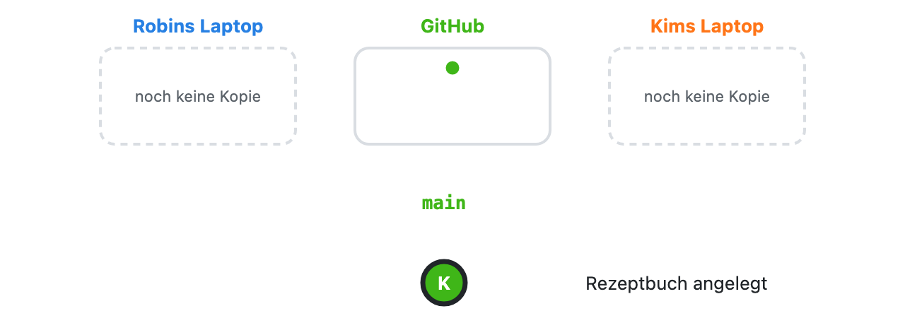{.fragment .fade-in width="78%" fig-alt="Drei Kästen: Robins Laptop und Kims Laptop sind leer und gestrichelt, mit den Worten noch keine Kopie. Im Kasten GitHub liegt ein Commit. Darunter der Commit-Graph mit dem ersten Commit auf main."}

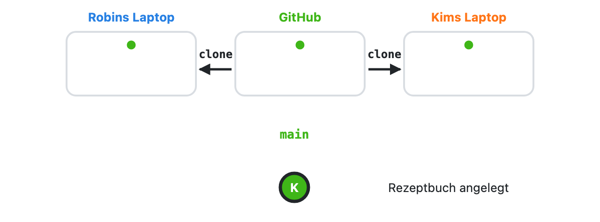{.fragment .fade-in width="78%" fig-alt="Von GitHub zeigt je ein Pfeil mit dem Wort clone zu Robins Laptop und zu Kims Laptop. Alle drei Kästen enthalten jetzt denselben Commit."}
:::

::: {.notes}
09:50. Block A der Geschichte. Kim legt das Repository auf GitHub an. Kim und Robin klonen: drei Orte, derselbe Stand. Laptops reden nie direkt miteinander, immer über GitHub. Wörter: lokal ist der Laptop, remote ist GitHub.
:::

## Deine Commits in GitHub Desktop {.smaller}

[Wir sind dran]{.dran .wir}

::: aufgabe
1.  Öffne **GitHub Desktop**.
2.  Wähle oben links dein Repository `rezept-dein-benutzername`.
3.  Klicke auf den Reiter **History**.
:::

Du siehst deine eigenen Commits aus der Vorbereitung: wer, wann, was, warum.

::: hand
Siehst du deine Commits? Schreib «ich sehe es» in den Chat.
:::

::: {.notes}
Bis 10:00. Wer die Vorbereitung nicht fertig hat, schaut bei mir zu. Kurz auf rainbow-train zeigen: derselbe Blick.
:::

## Deine Commits auf GitHub {.smaller}

[Wir sind dran]{.dran .wir}

::: aufgabe
1.  In GitHub Desktop: Menü **Repository**, **View on GitHub**. Dein Repository öffnet sich im Browser.
2.  Klicke rechts über der Liste der Dateien auf die Uhr mit der Zahl, zum Beispiel **5 Commits**.
:::

Du siehst dieselben Commits wie in GitHub Desktop. Dein Laptop und GitHub haben denselben Stand.

::: hand
Siehst du dieselben Commits? Schreib «ich sehe es» in den Chat.
:::

## Dasselbe im Terminal {.smaller}

[Ich bin dran]{.dran .ich}

<pre class="terminal">$ git status
On branch main
Your branch is up to date with 'origin/main'.

nothing to commit, working tree clean

$ git log --oneline
3220950 Nachhaken zum Apfelmus
aacde95 Zutaten aufschreiben
67ec9bf Rezept aufschreiben
8a1d5e7 README mit zwei Sätzen
76cb14e Initial commit</pre>

Das Terminal zeigt dasselbe Repository wie GitHub Desktop, als Text.

::: {.notes}
Ausgabe aus rezept-rainbow-train. Ein paar Worte: das Terminal ist ein zweiter Weg zu denselben Befehlen, Agenten wie Claude Code arbeiten so.
:::

## Ein Knopf ist ein Befehl {.smaller}

[Ich bin dran]{.dran .ich}

GitHub Desktop führt für dich Befehle aus. Im Terminal heissen sie so:

| In GitHub Desktop        | Im Terminal   |
|--------------------------|---------------|
| History                  | `git log`     |
| Changes                  | `git status`  |
| Commit to main           | `git commit`  |
| Push origin              | `git push`    |
| Fetch origin, Pull origin| `git pull`    |

::: hand
Ihr müsst nichts tippen.
:::

::: {.notes}
10:00, 5 Minuten. In GitHub Desktop: Repository, Open in Terminal. git status und git log zeigen. Nicht aus dem Terminal pushen (dort ist larnsce angemeldet).
:::

# Branch und Pull request {background-color="#1e5a46"}

## Ein eigener Branch, dann die Bitte

::: {.r-stack}
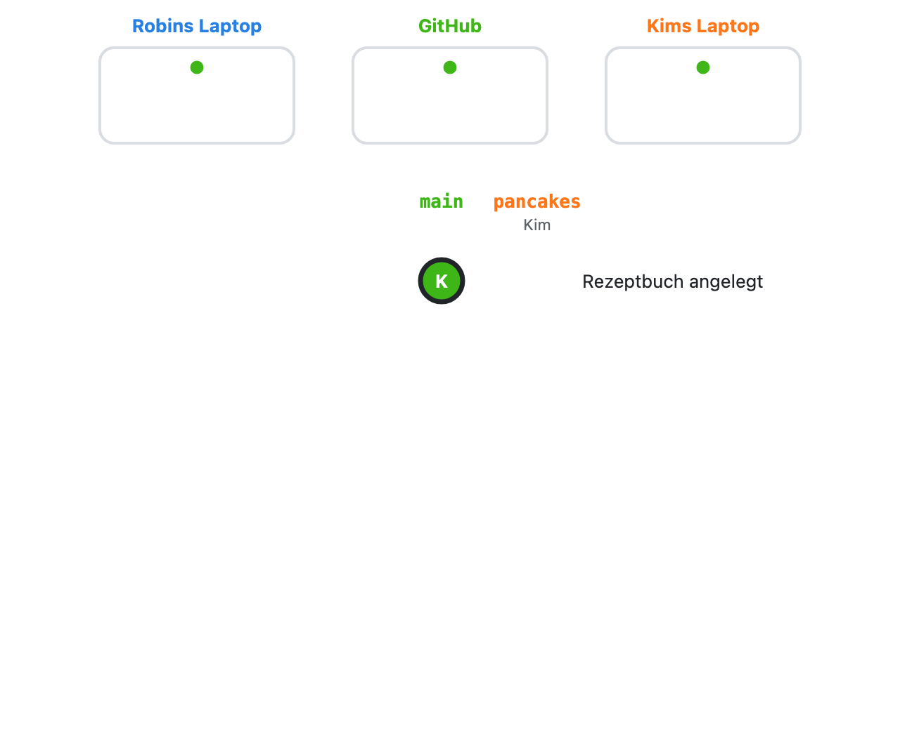{.fragment .fade-in width="62%" fig-alt="Kim hat den Branch pancakes angelegt. Im Graphen steht neben main die Spalte pancakes, noch ohne eigenen Commit."}

{.fragment .fade-in width="62%" fig-alt="Ein erster Commit auf dem Branch pancakes, gestrichelt gezeichnet. Er liegt nur im Kasten Kims Laptop."}

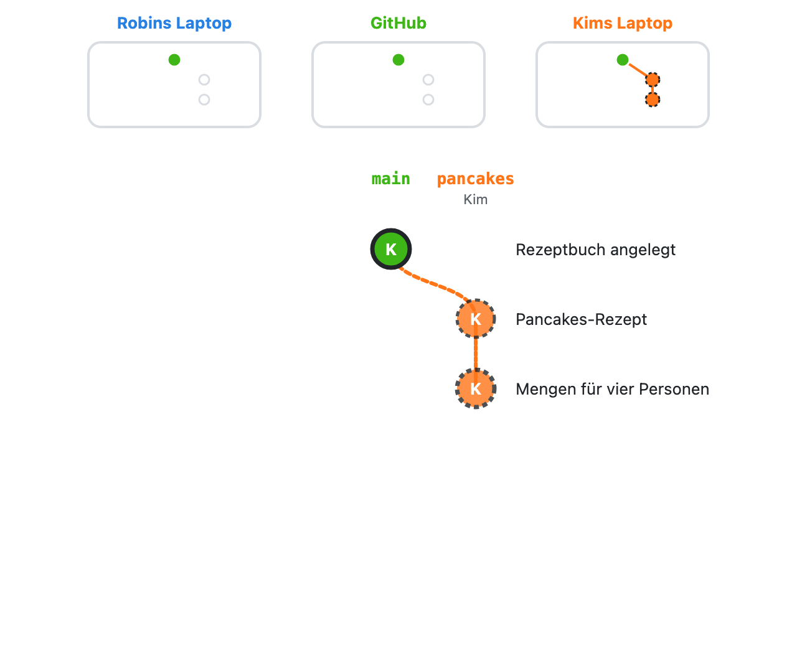{.fragment .fade-in width="62%" fig-alt="Ein zweiter Commit auf dem Branch pancakes, Mengen für vier Personen, ebenfalls gestrichelt und nur auf Kims Laptop."}

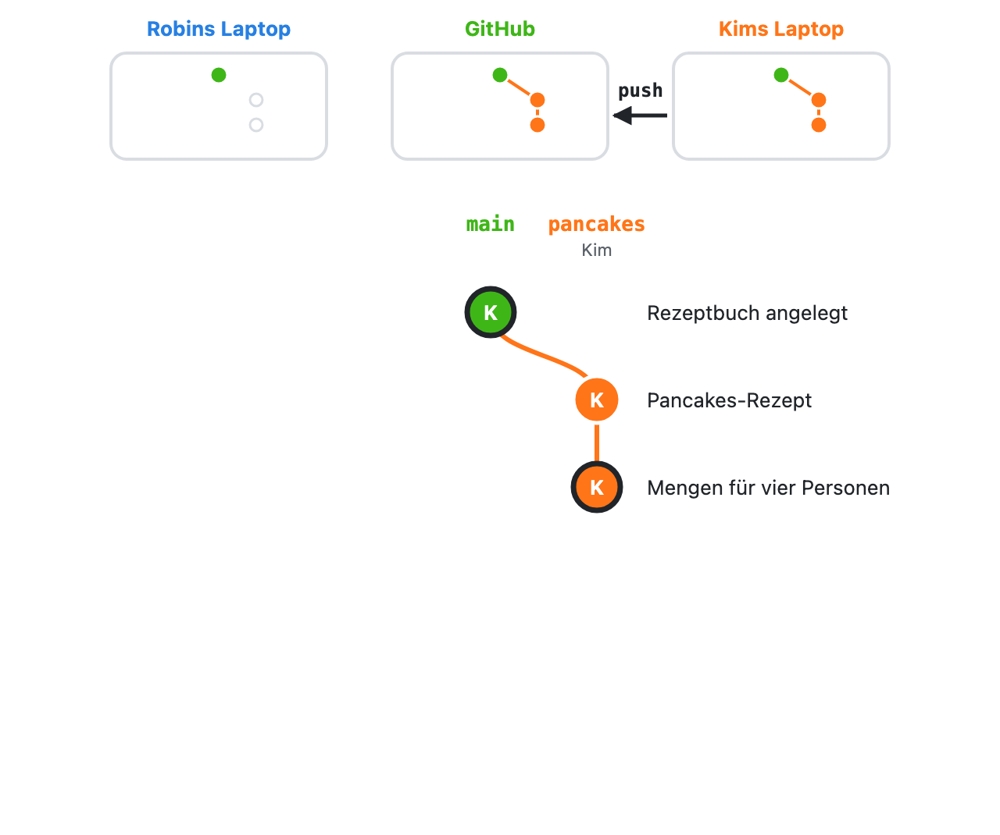{.fragment .fade-in width="62%" fig-alt="Ein Pfeil mit dem Wort push zeigt von Kims Laptop zu GitHub. Die zwei Commits des Branches sind jetzt durchgezogen und liegen auch auf GitHub."}

{.fragment .fade-in width="62%" fig-alt="Kim hat einen Pull request geöffnet. Unter dem neuesten Commit des Branches pancakes steht Pull request: offen. Der Graph ist sonst unverändert."}
:::

::: legende
**K** ist Kim, **R** ist Robin. Gestrichelt: nur auf dem Laptop. Dunkler Rand: der neueste Commit eines Branches.
:::

::: {.notes}
10:05, 8 Minuten für diese und die nächste Folie. Block B. Branch: eine eigene Arbeitslinie, main bleibt unberührt. Ein Commit, noch ein Commit, dann erst der Push: durchgezogen, jetzt auch auf GitHub. Pull request: die Bitte, den Branch in main zu übernehmen. Er steht im Bild unter dem neuesten Commit.
:::

## Robin arbeitet zur selben Zeit

::: {.r-stack}
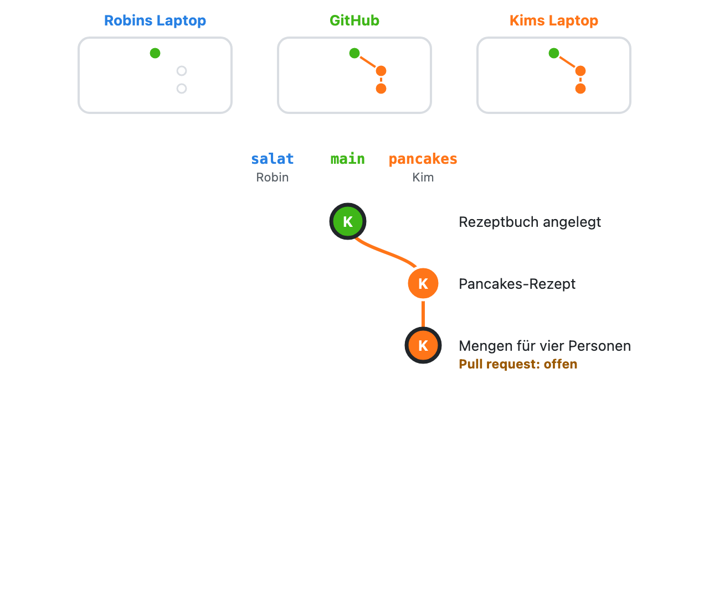{.fragment .fade-in width="62%" fig-alt="Robin hat links den eigenen Branch salat angelegt, noch ohne eigenen Commit."}

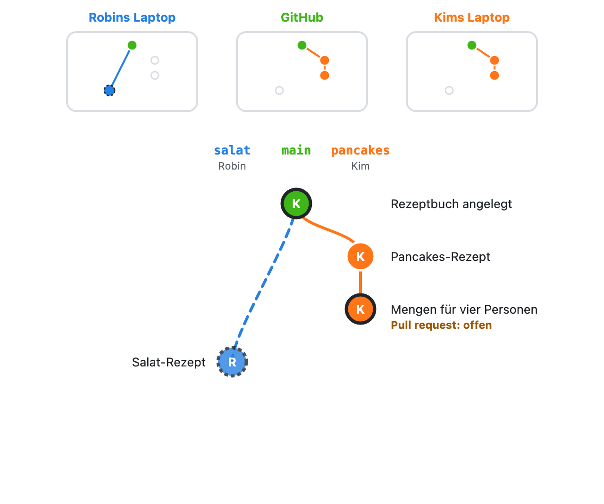{.fragment .fade-in width="62%" fig-alt="Robins erster Commit, Salat-Rezept, gestrichelt und nur auf Robins Laptop."}

{.fragment .fade-in width="62%" fig-alt="Robins zweiter Commit, Dressing ergänzt, ebenfalls nur auf Robins Laptop."}

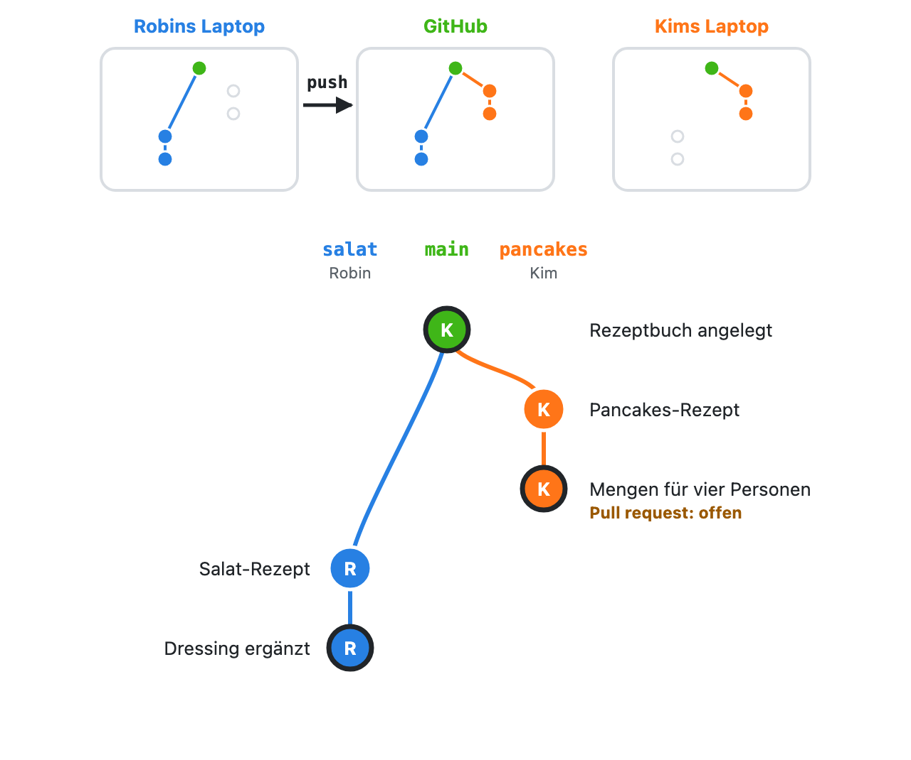{.fragment .fade-in width="62%" fig-alt="Ein Pfeil mit dem Wort push zeigt von Robins Laptop zu GitHub. Robins zwei Commits liegen jetzt auch auf GitHub."}

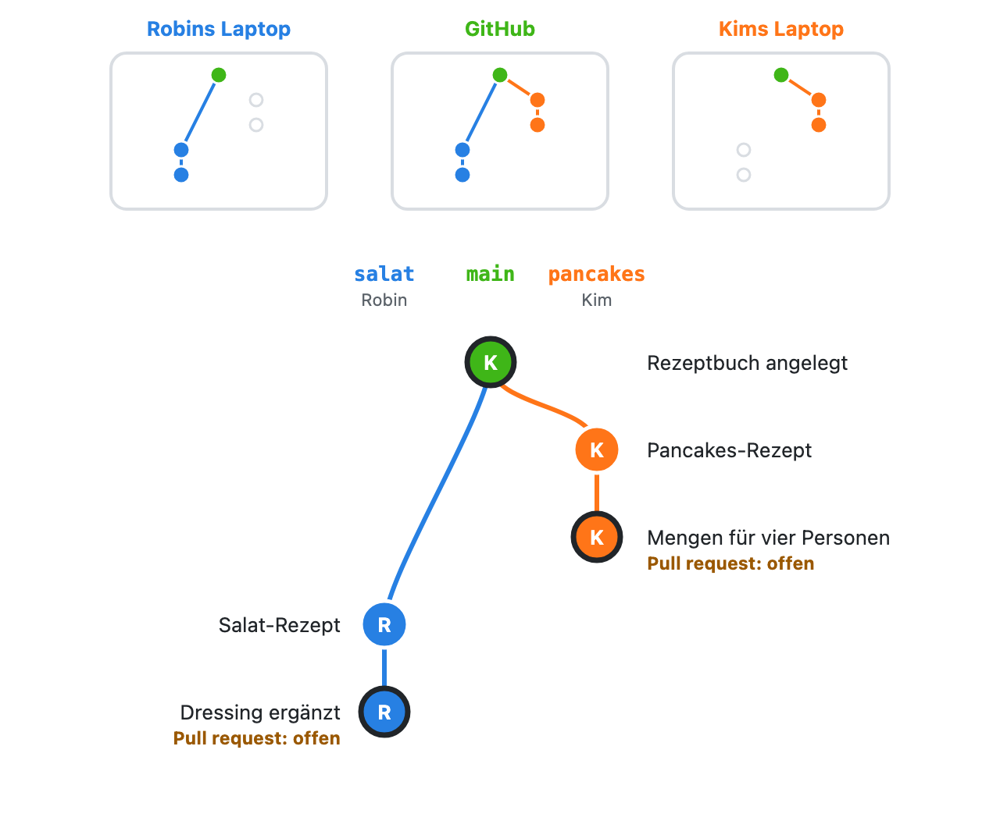{.fragment .fade-in width="62%" fig-alt="Robin hat einen eigenen Pull request geöffnet. Unter den neuesten Commits beider Branches steht Pull request: offen. Auf Robins Laptop fehlen Kims Commits, auf Kims Laptop fehlen Robins Commits. Auf GitHub liegen alle."}
:::

::: {.notes}
Dieselben Schritte bei Robin, einer nach dem anderen: Branch, Commit, Commit, Push, Pull request. Letztes Bild: jede Person hat ihren eigenen Branch, darum heisst eurer rezept-benutzername. Auf GitHub liegt alles, auf jedem Laptop nur das Eigene.
:::

## Pause

Bis 10:20 Uhr.



::: hand
Danach bringe ich ein Rezept ins Kochbuch, und dann ihr.
:::

# Das Kochbuch {background-color="#1e5a46"}

## Von deinem Repository ins Kochbuch {.smaller}

::::: columns
::: {.column width="50%"}
### Vorher

-   Dein Rezept liegt in deinem eigenen Repository `rezept-dein-benutzername`
-   Nur du schreibst dort
:::

::: {.column width="50%"}
### Nachher

-   Dein Rezept liegt zusätzlich im gemeinsamen Repository `kochbuch` auf GitHub (`github.com/gitklar/kochbuch`), dort auf deinem eigenen Branch
-   Ein Pull request bittet darum, es in das Kochbuch aufzunehmen
:::
:::::

Aus dem Repository `kochbuch` entsteht ein öffentliches Buch im Internet. Mehr dazu am Schluss.

## Ein Rezept kommt ins Kochbuch {.smaller}

[Ich bin dran]{.dran .ich}

::: hand
Lehn dich zurück und schau zu. Ich arbeite jetzt mit dem Konto rainbow-train, als Person aus dem Kurs wie ihr.
:::

1.  Das Repository `kochbuch` klonen
2.  Branch anlegen
3.  Rezeptordner kopieren und umbenennen
4.  Committen
5.  Branch veröffentlichen
6.  Pull request öffnen

::: {.notes}
10:20, 15 Minuten. Laut sagen, bevor sie es selbst erleben:
1. Steht gitklar/kochbuch nicht in der Liste: Reiter URL, gitklar/kochbuch tippen.
2. Vor Clone: Local Path endet auf gitrepos/gh-org-gitklar/kochbuch.
3. _vorlage: der Unterstrich heisst, das ist kein Rezept, sondern die Vorlage. Sie steht zuoberst, und das Buch lässt sie aus.
4. In Changes haben beide Dateien ein Häkchen.
5. Den kopierten Ordner umbenennen. Falscher Name: im Finder umbenennen, committen, pushen. Der Pull request zeigt es von selbst.
6. Auf der Seite des Pull requests nicht auf «Try the Overview page» klicken.
Mit dem Pull request stimmst du zu, dass dein Rezept unter CC BY 4.0 im Kochbuch steht.
:::

## Dein Rezept als Pull request {.smaller}

[Ihr seid dran]{.dran .ihr}

::: hand
Öffne zuerst diese Seite, der Link steht im Chat: [gitklar.ch/rezept-einreichen.html](https://gitklar.ch/rezept-einreichen.html). Dort stehen alle Schritte, auch wenn du diese Folie nicht mehr siehst.
:::

::: aufgabe
Ihr arbeitet zu zweit in einem Breakout-Raum, 30 Minuten.

1.  Eine Person teilt den Bildschirm und geht die Schritte 1 bis 6 auf der Seite durch. Die andere liest mit und hilft.
2.  Steht der Pull request, tauscht ihr.
:::

Hängt es? Klicke im Breakout-Raum auf **Ask for Help**, dann komme ich zu euch.



::: {.notes}
10:35, 30 Minuten, geschützter Block. Vor dem Öffnen der Räume: Link zur Seite in den Chat, warten, bis alle sie offen haben. Räume zu zweit, automatisch zugeteilt, Ende nach 30 Minuten mit 60 Sekunden Vorwarnung. Bei 11:00 als Nachricht an alle Räume: noch fünf Minuten. Wer nicht vorbereitet ist: mitlesen und später über die Seite einreichen. Die sechs Schritte: klonen (Reiter URL, gitklar/kochbuch), Branch rezept-benutzername, Ordner kopieren und umbenennen, Commit, Publish branch, Create pull request.
:::

# Review und Merge {background-color="#1e5a46"}

## Eine zweite Person liest mit

[Ich bin dran]{.dran .ich}

::: {.r-stack}
{.fragment .fade-in width="50%" fig-alt="Robin hat Kims Pull request gelesen und einen Kommentar geschrieben. Unter Kims neuestem Commit steht Pull request: Kommentar."}

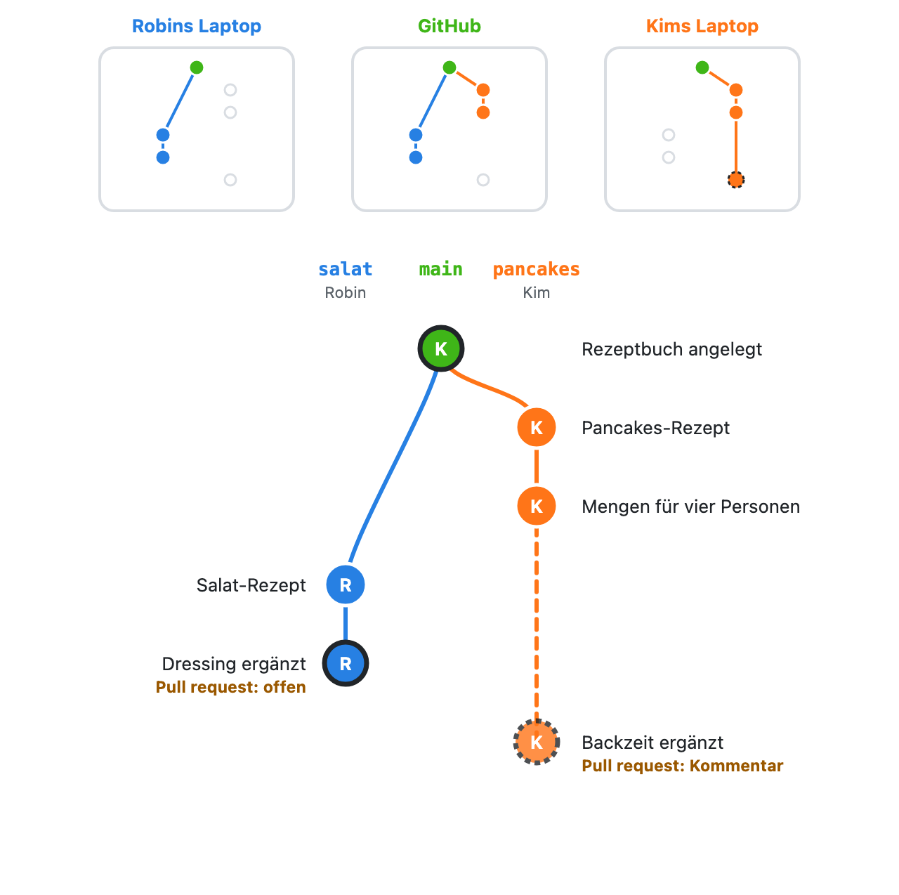{.fragment .fade-in width="50%" fig-alt="Kim hat mit einem weiteren Commit geantwortet, Backzeit ergänzt. Er ist gestrichelt und liegt nur auf Kims Laptop."}

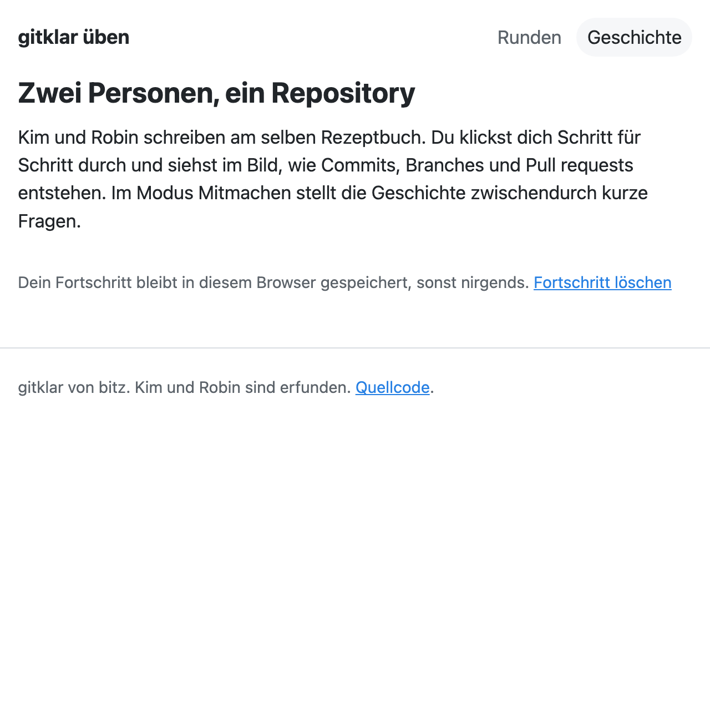{.fragment .fade-in width="50%" fig-alt="Kim hat gepusht. Der Commit Backzeit ergänzt liegt jetzt auch auf GitHub und gehört zum offenen Pull request."}

{.fragment .fade-in width="50%" fig-alt="Der Pull request ist gemergt. Auf main liegt ein Merge-Commit, der Kims drei Commits übernimmt. Unter Kims neuestem Commit steht Pull request: gemergt. Der Merge-Commit liegt nur auf GitHub."}
:::

::: {.notes}
11:05, 8 Minuten. Block C: Kommentar, Commit, Push, Merge, einer nach dem anderen. Der Stand des Pull requests steht unter Kims neuestem Commit. Dann live: als larnsce im zweiten Browser den Pull request von rainbow-train öffnen, Files changed, ein Kommentar auf eine Zeile. Als rainbow-train mit einem Commit antworten, pushen. Als larnsce mergen. Nur dieser eine Merge heute.
:::

# Wie es weitergeht {background-color="#1e5a46"}

## Bis zum 2. Dezember {.smaller}

::: incremental
-   **Dein Pull request bleibt offen.** Am 2. Dezember liest ihn eine zweite Person aus dem Kurs und mergt ihn.
-   **Noch kein Pull request?** Die Schritte stehen auf [gitklar.ch/rezept-einreichen.html](https://gitklar.ch/rezept-einreichen.html), bitte bis Dienstag, 1. Dezember.
-   **Deine E-Mail-Adresse in den Commits:** Wenn sie nicht öffentlich sein soll, stell es unter [github.com/settings/emails](https://github.com/settings/emails) um. Die Schritte stehen im [Issue 30](https://github.com/gitklar/vorbereitung/issues/30) des Repositorys `vorbereitung`.
-   **Aus den Rezepten wird ein Buch**, öffentlich im Internet. Am 2. Dezember seht ihr, wie ein Merge darin erscheint.
:::

## Workshop 2 {.smaller}

**Mittwoch, 2. Dezember 2026, 09:30 bis 11:30 Uhr**, derselbe Zoom-Link

-   den Pull request einer anderen Person lesen und kommentieren
-   auf einen Kommentar mit einem Commit antworten
-   mergen
-   ein Konflikt, und wie man ihn löst

Noch nie mit einem Agenten wie Claude Code gearbeitet? Ein Repository ist ein Ordner, und genau in solchen Ordnern arbeitet ein Agent. Mit den Grundlagen von heute siehst du, was er dort tut.

::: hand
Was hat heute gehakt? Schreib es jetzt in den Chat. Für alles danach bekommst du heute ein neues Issue mit dem Titel «Zwischen den Workshops». GitHub schickt dir dazu eine E-Mail.
:::

::: {.notes}
11:13, 10 Minuten. Die Aufzeichnung kommt per E-Mail. Rückmeldungen aus dem Chat sichern.
:::
