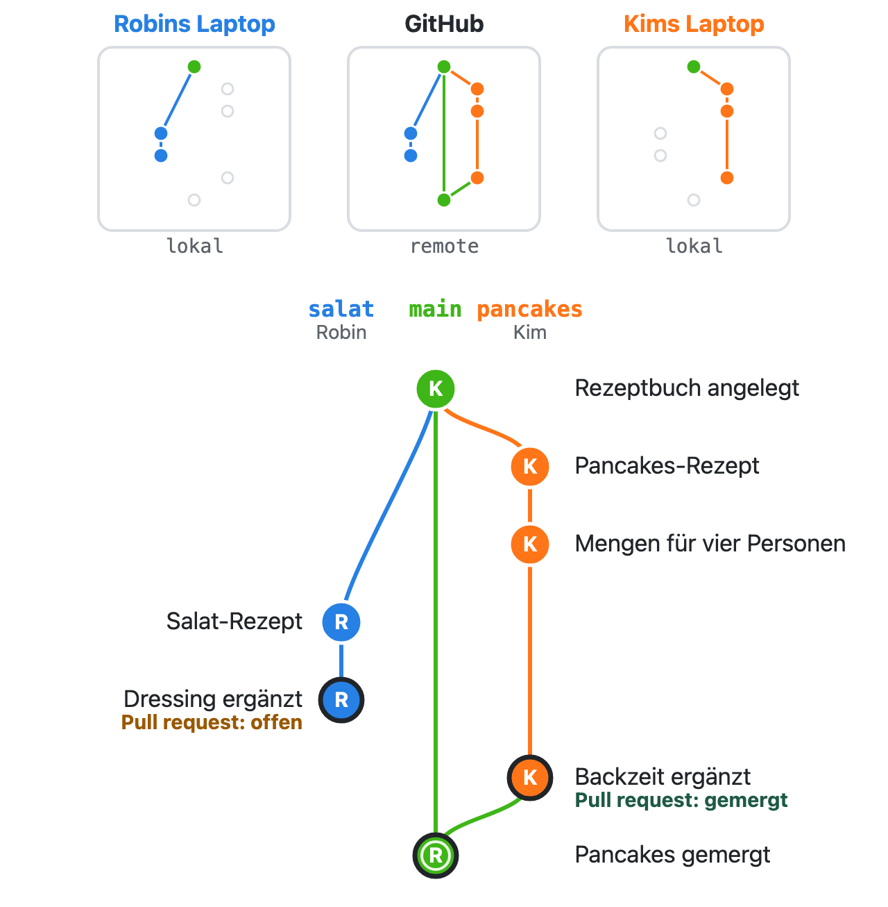
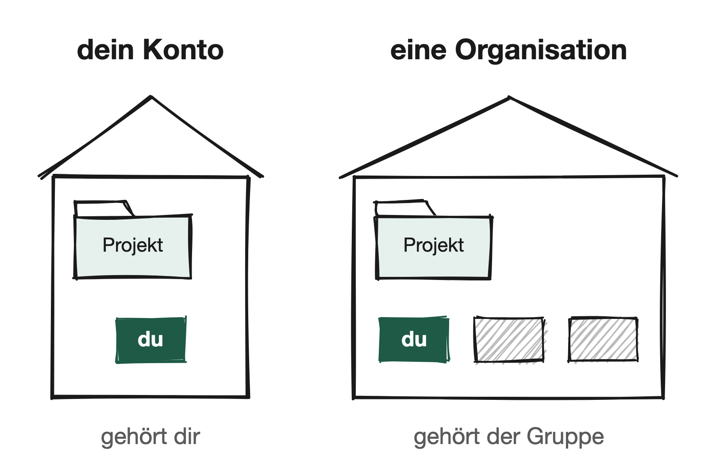
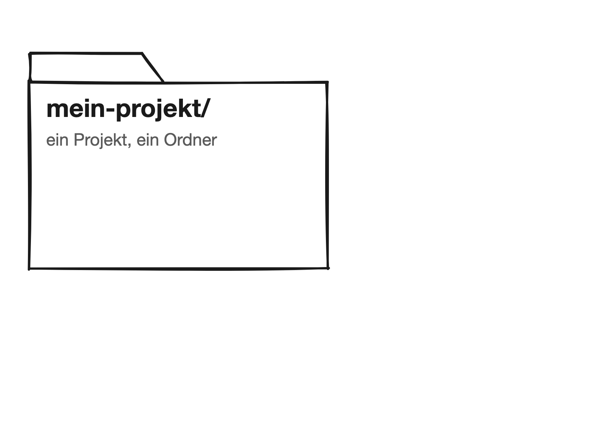
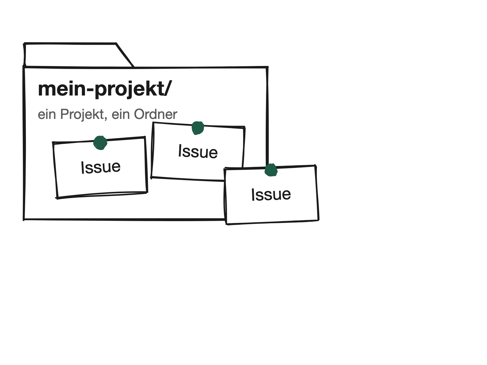
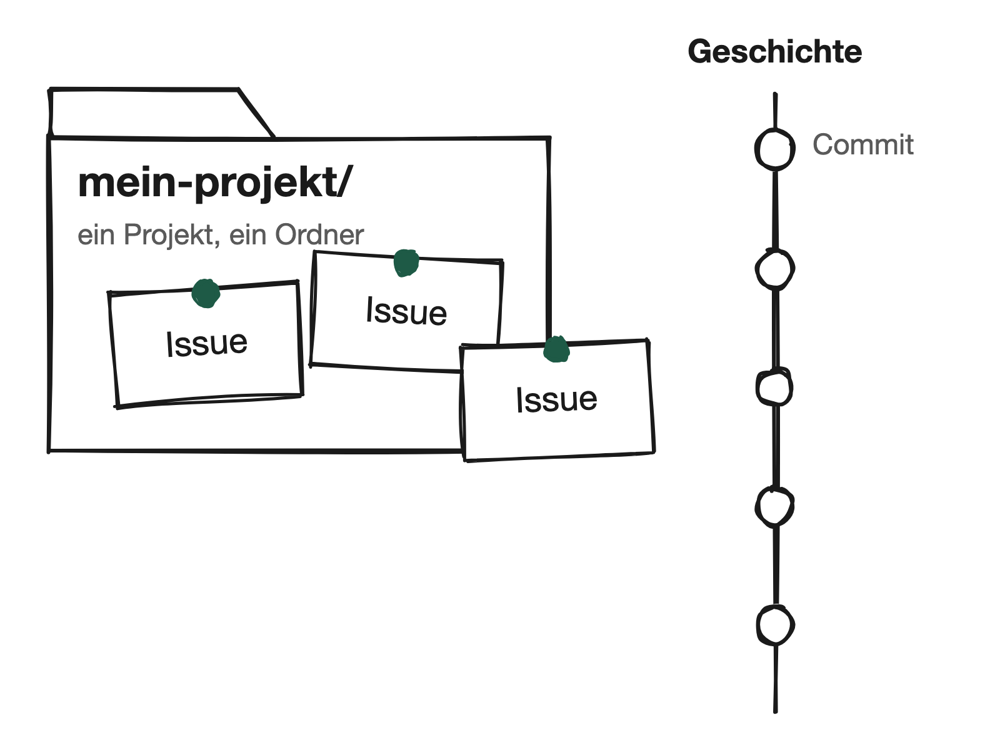
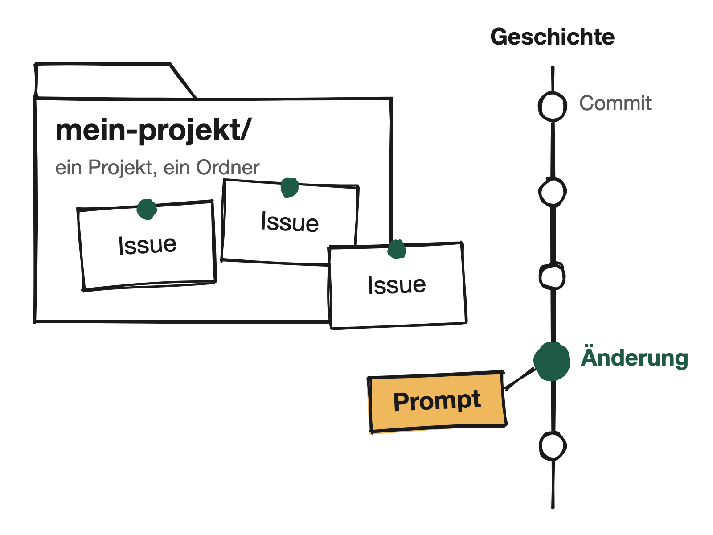

<!--
Folien für Workshop 2 der Gruppe airetreat-01, Mittwoch, 2. Dezember 2026,
09:30 bis 11:30 Uhr, Zoom. Geschrieben am 24. November 2026 aus
workshop-2-outline.md. Aufbau wie Workshop 1 (Ich bin dran, Wir sind dran,
Ihr seid dran, Uhrzeiten in den Notizen).
Stellen, die noch eine Entscheidung oder ein Bild brauchen, tragen das Wort
OFFEN. Suche danach, bevor die Folien gezeigt werden.
Die Zeichnungen entstehen aus bilder/zeichnungen.js.
Rendern: quarto render workshop/workshop-2.qmd
-->

# Willkommen {background-color="#1e5a46"}

## Zum Ankommen {.smaller}

::: aufgabe
Schreib in den Chat: **Was hast du seit dem 17. November mit GitHub gemacht?**

Ein Stichwort reicht. Auch «nichts» ist eine Antwort.
:::



::: hand
Wir zeichnen auf.
:::

::: {.notes}
09:30. Aufnahme starten und sagen. Zwei, drei Antworten aus dem Chat vorlesen.
:::

## Heute {.smaller}

| Zeit  | Was                                             |
|-------|-------------------------------------------------|
| 09:40 | Review zu zweit: lesen, kommentieren, mergen    |
| 10:10 | Ein Konflikt, und wie man ihn löst              |
| 10:15 | Pause                                           |
| 10:25 | Dein eigenes Projekt kommt auf GitHub           |
| 10:50 | Aufgaben und Projekte                           |
| 11:05 | Wie es weitergeht                               |
| 11:15 | Eure Rückmeldung zum Kurs                       |

::: hand
Fragen in den Zoom-Chat. Was heute keinen Platz hat, beantworte ich danach in deinem Issue.
:::

::: {.notes}
Ein Satz zu meiner übrigen Arbeit, Wunsch aus der Umfrage: Ich arbeite an der ETH Zürich als Data Steward und bringe Forschenden bei, ihre Daten zu veröffentlichen. gitklar ist mein Kurs für alle, die nicht programmieren.
:::

## Deine Spuren {.smaller}

Jeder Commit trägt vier Angaben: wer, wann, was, warum.

::: hand
**OFFEN:** Bildschirmfoto eines Commits des Kontos rainbow-train, mit Markierungen für Name, Adresse und Zeit. Datei: `bilder/spuren-commit.png`.
:::

-   **Name und Adresse** stehen in jedem Commit, für alle, die das Repository lesen dürfen.
-   **Das Gespräch** im Pull request bleibt ebenfalls stehen: Kommentare, Antworten, der Merge.

::: {.notes}
Bis 09:40, 3 Minuten für diese Folie. Das Bild zeigen, die drei Markierungen nennen. Ein Satz zur E-Mail-Adresse: Der Hinweis stand in den E-Mails und im Issue 30. Wer damit noch ein Problem hat, schreibt es ins eigene Issue «Zwischen den Workshops».
:::

# Review und Merge {background-color="#1e5a46"}

## Eine zweite Person liest mit

{width="50%" fig-alt="Der Pull request ist gemergt. Auf main liegt ein Merge-Commit, der Kims drei Commits übernimmt. Unter Kims neuestem Commit steht Pull request: gemergt."}

::: legende
Lesen, kommentieren, mit einem Commit antworten, mergen.
:::

::: {.notes}
09:40. Das Bild aus Workshop 1, das letzte der Geschichte von Kim und Robin. Vier Stichworte, mehr nicht: lesen, kommentieren, mit einem Commit antworten, mergen. Eure Pull requests sind seit dem 17. November offen. Heute liest sie eine zweite Person.
:::

## Ein Pull request wird gemergt {.smaller}

[Ich bin dran]{.dran .ich}

::: hand
Lehn dich zurück und schau zu. Ich zeige einen offenen Pull request im Kochbuch.
:::

1.  Den Pull request öffnen, Reiter **Files changed** lesen
2.  Einen Kommentar auf eine Zeile schreiben
3.  Als rainbow-train antworten
4.  **Merge pull request**, **Confirm merge**

::: {.notes}
3 Minuten. OFFEN: welchen offenen Pull request ich zeige und merge. Zuerst sagen, was passiert (die vier Punkte), dann machen. Zwei Browser: larnsce liest und kommentiert, rainbow-train antwortet, larnsce mergt.
:::

## Review zu zweit {.smaller}

[Ihr seid dran]{.dran .ihr}

::: aufgabe
Ihr arbeitet zu zweit in einem Breakout-Raum, 20 Minuten. Jede Person liest den Pull request der anderen.

1.  Öffne den Pull request deiner Partnerin oder deines Partners in `gitklar/kochbuch`.
2.  Rechts unter **Reviewers**: Trag die andere Person ein. So bittet ihr euch gegenseitig um ein Review.
3.  Reiter **Files changed**: Lies das Rezept und such nach den drei Dingen unten.
4.  Schreib mindestens einen Kommentar auf eine Zeile (das Plus am Zeilenanfang).
5.  Antworte auf den Kommentar an deinem Rezept mit einem Commit: in GitHub Desktop ändern, committen, pushen.
6.  **Review changes**, **Approve**, **Submit review**. Dann **Merge pull request**.
:::

**Findet:** für wie viele Personen das Rezept ist, eine Zutat ohne Menge oder Einheit, und einen Schritt, bei dem ihr nachfragen würdet.



::: {.notes}
09:45, 20 Minuten und 2 für den Wechsel. Die Paare entstehen jetzt aus den Anwesenden mit einem offenen Pull request. Wer keinen hat, kommt als zweite Person für das Review zu einem Paar. Für alle, die fehlen, merge ich nach dem Workshop. OFFEN: Die Suchliste ist ein Vorschlag, sie braucht deine Durchsicht. Bei 10:02 als Nachricht an alle Räume: noch drei Minuten. Ihr mergt den Pull request der anderen Person, nicht den eigenen.
:::

## Ein Merge erscheint im Buch {.smaller}

[Ich bin dran]{.dran .ich}

Aus dem Repository `kochbuch` entsteht ein Buch im Internet: **kochbuch.gitklar.ch**

::: hand
**OFFEN:** live zeigen oder Bildschirmfoto. Die Durchsicht des Buchs bis Freitag, 27. November, entscheidet. Datei für den Ersatz: `bilder/kochbuch-buch.png`.
:::

::: {.notes}
10:07, 3 Minuten. Das Buch neu laden: Die Rezepte, die ihr soeben gemergt habt, stehen drin. Ein Merge auf main löst den Bau des Buchs aus.
:::

# Ein Konflikt {background-color="#1e5a46"}

## Ein Konflikt, und wie man ihn löst {.smaller}

[Ich bin dran]{.dran .ich}

Ein Konflikt entsteht, wenn zwei Personen **dieselbe Zeile** geändert haben. Git weiss dann nicht, welche Fassung gilt, und fragt dich.

Was ich gleich mache:

1.  Zwei Pull requests ändern dieselbe Zeile in `inhalt.csv`
2.  Der erste wird gemergt
3.  Beim zweiten meldet GitHub einen Konflikt: **Resolve conflicts**
4.  Ich wähle, was bleibt, und merge

::: hand
Niemand klickt mit. Ein Konflikt ist kein Fehler, er ist eine Frage an dich.
:::

::: {.notes}
10:10, 5 Minuten für diese Folie und die Demo. Erst die vier Punkte vorlesen, dann im Browser machen. Die Zeichen im Editor nennen: Zwischen den Markierungen stehen beide Fassungen, ich lösche, was nicht bleibt, und die Markierungen dazu. TODO: vorher durchspielen.
:::

## Pause

Bis 10:25 Uhr.



::: hand
Danach kommt dein eigenes Projekt auf GitHub. Leg den Ordner bereit.
:::

# Dein eigenes Projekt {background-color="#1e5a46"}

## Dein Konto oder eine Organisation

{width="78%" fig-alt="Zeichnung: Ein Repository liegt entweder im eigenen Konto oder in einer Organisation, in der mehrere Personen arbeiten."}

::: {.notes}
10:25. Du entscheidest, wo dein Projekt liegt. Allein: im eigenen Konto. Mit anderen: in einer eigenen Organisation. In der Organisation gitklar lesen alle aus dem Kurs mit, dort gehört es nicht hin. 3 Minuten für diese und die zwei nächsten Folien.
:::

## Vier Fragen an deinen Ordner {.smaller}

Du hast sie in der Vorbereitung beantwortet. Zur Erinnerung:

::: incremental
1.  **Wo liegt er?** Nicht in iCloud, OneDrive oder Dropbox.
2.  **Wie gross ist die grösste Datei?** Über 50 MB bleibt draussen.
3.  **Gibt es etwas, das niemand sonst sehen darf?** Passwörter, Schlüssel, Daten anderer Personen.
4.  **Gibt es einen versteckten Ordner `.git`?** Er wird nicht mitkopiert.
:::

::: {.notes}
Eine Wiederholung, eine Minute. Die Fragen stehen auf der Seite «Dein eigenes Projekt vorbereiten».
:::

## Welche Dateien zeigt Git? {.smaller}

| Datei                              | Was Git zeigt                          |
|------------------------------------|----------------------------------------|
| Text: `.md`, `.csv`, `.txt`, Code  | jede geänderte Zeile                   |
| Word, Excel, PowerPoint, PDF       | dass sich die Datei geändert hat       |
| Bilder                             | altes und neues Bild nebeneinander     |

Git bewahrt jede Fassung von jeder Datei auf. Zeile für Zeile lesen kannst du die Änderung bei Textdateien.

::: {.notes}
Darum war das Rezept eine Markdown-Datei und eine CSV-Datei. Word-Dateien dürfen ins Repository, der Vergleich zeigt dann nichts Lesbares.
:::

## Was ich gleich mache {.smaller}

[Ich bin dran]{.dran .ich}

::: hand
Lehn dich zurück und schau zu. Zuerst die Liste, dann die Schritte am Bildschirm.
:::

1.  Auf GitHub: neues **privates** Repository, mit README
2.  In GitHub Desktop: klonen
3.  Im Finder: die Dateien in den geklonten Ordner kopieren
4.  In GitHub Desktop: den Reiter **Changes** lesen
5.  Ignorieren, was nicht hineingehört
6.  Commit, Push

::: {.notes}
10:28, 7 Minuten für diese Folie und die Demo. Diese Folie ist der erste Durchgang: eine Minute, die sechs Punkte vorlesen.
:::

## Die Ferienplanung kommt auf GitHub {.smaller}

[Ich bin dran]{.dran .ich}

Mein Ordner `ferienplanung`:

-   zwei Textdateien
-   eine Datei `.DS_Store`
-   eine Datei `passwort.txt`
-   ein versteckter Ordner `.git`

::: aufgabe
Frage an euch: **Was davon gehört nicht auf GitHub?**
:::

::: {.fragment}
`passwort.txt` und `.DS_Store` ignoriere ich im Reiter **Changes** mit einem Rechtsklick. Git schreibt sie in die Datei `.gitignore`. Den Ordner `.git` kopiere ich nicht mit.
:::

::: {.notes}
Der zweite Durchgang, als rainbow-train. Die vier Fragen im Finder stellen. Repository ferienplanung anlegen: Owner ist das eigene Konto, Private, Add README. Klonen nach gitrepos/gh-rainbow-train/. Dateien kopieren, ohne .git. In Changes: Rechtsklick auf passwort.txt und .DS_Store, Ignore File (Add to .gitignore). Die Datei .gitignore erscheint in der Liste. Summary «Projektdateien hinzugefügt», Commit to main, Push origin. Auf GitHub zeigen: passwort.txt ist nicht da.
:::

## Dein Projekt kommt auf GitHub {.smaller}

[Ihr seid dran]{.dran .ihr}

::: hand
Die Schritte stehen auch auf der Seite [gitklar.ch/airetreat-01/eigenes-projekt.html](https://gitklar.ch/airetreat-01/eigenes-projekt.html), der Link steht im Chat.
:::

::: aufgabe
Zu zweit im selben Breakout-Raum wie vorhin, 15 Minuten. Jede Person arbeitet am eigenen Ordner, die andere hilft.

1.  Auf GitHub: **New repository**. Owner ist dein Konto, **Private**, **Add README** an.
2.  In GitHub Desktop: **File**, **Clone Repository**, nach `gitrepos/gh-dein-benutzername/`.
3.  Kopiere deine Dateien in den geklonten Ordner, ohne `.git`.
4.  Lies den Reiter **Changes**. Ignoriere, was nicht hineingehört.
5.  **Commit to main**, **Push origin**.
6.  Öffne das Repository auf GitHub und prüfe, dass dort **Private** steht.
:::

Du möchtest nach dem Kurs Unterstützung? Füge `larnsce` unter **Settings**, **Collaborators** hinzu.



::: {.notes}
10:35, 15 Minuten, bis 10:50. Wer kein Projekt hat, legt den Ordner uebung-projekt mit zwei Textdateien an. Niemand muss den Bildschirm teilen. Die Räume werden nicht aufgezeichnet. Bei 10:47 als Nachricht an alle Räume: noch drei Minuten. Wer nicht fertig wird, macht mit der Seite weiter. Schlusssatz nach der Rückkehr: Ab jetzt ist der geklonte Ordner dein Projekt. Der alte bekommt die Endung «alt».
:::

# Aufgaben und Projekte {background-color="#1e5a46"}

## Ein Projekt, ein Ordner

::: {.r-stack}
{width="70%" fig-alt="Zeichnung: ein Ordner mit dem Namen mein-projekt. Ein Projekt, ein Ordner."}

{.fragment .fade-in width="70%" fig-alt="Zeichnung: An den Ordner sind drei Zettel geheftet, auf jedem steht Issue."}
:::

::: {.notes}
10:50, 3 Minuten. Erstes Bild: Dein Projekt ist ein Ordner, und dieser Ordner ist jetzt ein Repository. Zweites Bild: Aufgaben hängen am Projekt. Auf GitHub heissen sie Issues. Ihr kennt sie aus der Vorbereitung, dort habe ich sie für euch geschrieben. Ab heute schreibt ihr sie für euch selbst.
:::

## Issues, Labels und ein Board {.smaller}

[Ich bin dran]{.dran .ich}

Ich zeige ein Projekt, an dem ich arbeite.

-   **Issues:** eine Aufgabe, eine Frage oder eine Idee, mit einem Gespräch darunter
-   **Labels:** Farben und Wörter, um Issues zu ordnen
-   **Board:** dieselben Issues in Spalten, von «offen» bis «erledigt»

::: {.notes}
10:53, 7 Minuten. OFFEN: welches Projekt ich zeige. Es braucht Issues, Labels und ein Board, die in einer aufgezeichneten Sitzung gezeigt werden dürfen. TODO: vorbereiten.
:::

## Dein erstes Issue {.smaller}

[Ihr seid dran]{.dran .ihr}

::: aufgabe
Jede Person für sich, 5 Minuten.

1.  Öffne dein neues Repository auf GitHub.
2.  Reiter **Issues**, dann **New issue**.
3.  Titel: das Nächste, was du in deinem Projekt tun willst.
4.  **Create**.
:::

::: hand
Geschafft? Schreib den Titel deines Issues in den Chat.
:::



::: {.notes}
11:00, 5 Minuten, alle bleiben im Hauptraum. Zwei, drei Titel aus dem Chat vorlesen.
:::

# Wie es weitergeht {background-color="#1e5a46"}

## Die Geschichte, und ein Prompt an einer Änderung

::: {.r-stack}
{width="70%" fig-alt="Zeichnung: Neben dem Ordner mit den Issues läuft die Geschichte von oben nach unten, eine Linie von Commits."}

{.fragment .fade-in width="70%" fig-alt="Zeichnung: An einem Commit der Geschichte hängt ein Prompt, der Satz, auf den hin ein Agent die Änderung gemacht hat."}
:::

::: {.notes}
11:05, 5 Minuten für diese und die nächste Folie. Erstes Bild: Jeder Commit ist ein Punkt in der Geschichte deines Projekts. Zweites Bild: Arbeitet ein Agent in deinem Ordner, macht er Commits wie du. Am Commit siehst du, was er geändert hat, und kannst es prüfen oder zurücknehmen.
:::

## Was ein Agent in deinem Repository macht {.smaller}

Ein Satz an den Agenten: «Bring diesen Ordner als privates Repository auf GitHub.»

| Dein Knopf von heute                 | Der Befehl des Agenten            |
|--------------------------------------|-----------------------------------|
| Der Ordner wird ein Repository       | `git init`                        |
| Häkchen im Reiter Changes            | `git add`                         |
| Commit to main                       | `git commit`                      |
| New repository, dann Push origin     | `gh repo create --private --push` |

gitklar ist kein KI-Kurs. Es gibt dir Grundlagen für sicheres und nachvollziehbares Arbeiten.

::: hand
**OFFEN:** Link zum Screencast.
:::

::: {.notes}
Der Agent stellt die vier Fragen an den Ordner nicht von selbst. Er committet, was da ist. Darum stellst du sie vorher. TODO: Screencast anschauen und entscheiden, ob der Link hier steht.
:::

## Wie du mit mir weiterarbeiten kannst {.smaller}

-   **Workshops zur Arbeit mit KI-Agenten.** Von der Einrichtung bis zu den Grundlagen, an deinem eigenen Projekt.
-   **Coaching für Einzelne und Teams.** Wie ihr Werkzeuge wie Claude Code und Codex in eurer Arbeit wirksam einsetzt.

Falls du Interesse hast, melde dich bei mir, und wir können ein Angebot ausarbeiten.

::: {.notes}
11:10, 2 Minuten.
:::

## Das Kochbuch wird öffentlich {.smaller}

::: hand
**OFFEN:** das Datum, an dem das Kochbuch öffentlich wird.
:::

-   Öffentlich werden das Repository `kochbuch` und das Buch auf kochbuch.gitklar.ch.
-   Dein eigenes Repository `rezept-dein-benutzername` bleibt privat.
-   In den Commits im Kochbuch stehen dein Name und die Adresse, mit der du committet hast.

::: aufgabe
Du möchtest deinen Ordner oder deine Adresse nicht im Kochbuch haben? Schreib es bis **Mittwoch, 9. Dezember**, in dein Issue «Zwischen den Workshops».
:::

::: {.notes}
11:12, 3 Minuten. Mit dem Pull request habt ihr zugestimmt, dass euer Rezept unter CC BY 4.0 im Kochbuch steht. Wer es sich anders überlegt hat, sagt es bis zum 9. Dezember, ohne Begründung.
:::

# Eure Rückmeldung {background-color="#1e5a46"}

## Think {.smaller}

Zwei Minuten allein. Mach dir Notizen zu vier Bereichen:

| Bereich          | Was lief gut? | Was soll besser werden? |
|------------------|---------------|-------------------------|
| **Vorbereitung** |               |                         |
| **Interaktion**  |               |                         |
| **Präsentation** |               |                         |
| **Inhalt**       |               |                         |

Der ganze Kurs zählt: die Vorbereitung, beide Workshops und die Zeit dazwischen.



::: {.notes}
11:15, 2 Minuten. Niemand spricht.
:::

## Pair {.smaller}

::: aufgabe
Sechs Minuten zu zweit in einem Breakout-Raum.

Erzählt euch, was ihr notiert habt. Was sagt ihr beide? Wo seht ihr es verschieden?
:::



::: {.notes}
11:17, 6 Minuten. Neue Räume zu zweit, automatisch zugeteilt.
:::

## Share {.smaller}

::: aufgabe
Sieben Minuten, jede Person für sich: Füll das Formular aus.
:::

::: hand
**OFFEN:** Link und QR-Code zum Feedback-Formular.
:::



::: {.notes}
11:23, 7 Minuten. Link in den Chat. Das Formular hat die vier Bereiche mit je zwei Feldern, der Benutzername ist freiwillig.
:::

# Danke {background-color="#1e5a46"}

## Danke!

Die Aufzeichnung kommt per E-Mail.

Diese Folien: <https://gitklar.ch/workshop/workshop-2.html>

Kurswebsite: <https://gitklar.ch/airetreat-01/>

Folien erstellt mit revealjs und Quarto: <https://quarto.org/docs/presentations/revealjs/>
